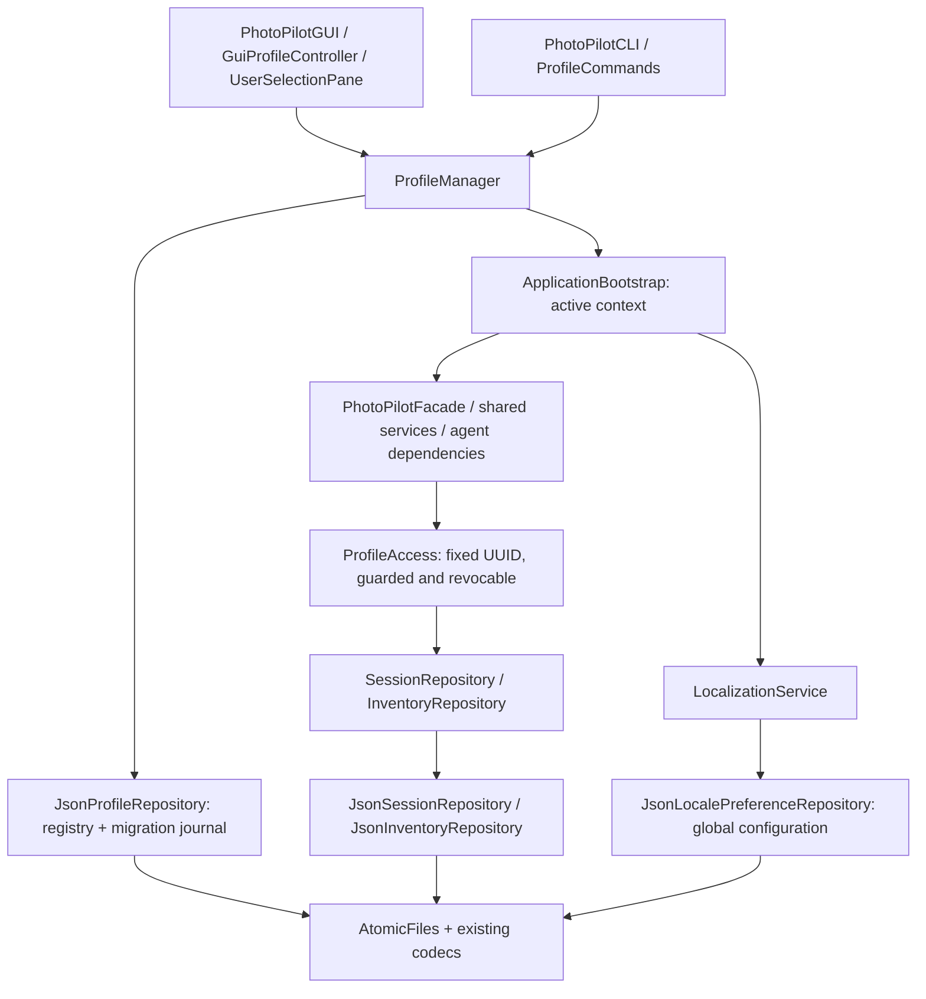

# Local data storage: final integration and operation

Current storage reference, consolidated in Phase 5 on 2026-10-31. This is a focused Stage 2 stabilization pass over Phases 1–4, not completion of Stage 3 testing or of the entire PhotoPilot application. F01 sessions, F05 equipment and F08 calculators remain the implemented business features.

## Architecture and audit findings

| Component | Responsibility and actual integration |
| --- | --- |
| `LocalProfile`, `PhotographySession`, `GearInventory`, equipment and linked models | UUID identity, metadata, validation, immutable historical evidence and transient revisions. Profiles are local workspaces, not authenticated accounts. |
| `StorageConfiguration`, `StorageScope` | Resolve stable/configured paths; one immutable root/UUID address per context. Names never become directory identifiers. |
| `ProfileManager`, `JsonProfileRepository` | Process-local active selection; persisted registry/default; create, list, retrieve, rename and confirmed archive; journaled initialization/migration. |
| `ApplicationBootstrap`, `ProfileAccess` | Construct one context's Facade/services/agent graph; guarded session/inventory ports validate registry membership and paths on each operation and reject use after close. |
| `SessionRepository` / `JsonSessionRepository` | Session aggregate CRUD/search/reference lookup, state/history invariants and per-record optimistic revisions. |
| `InventoryRepository` / `JsonInventoryRepository` | Equipment load/save/transaction, validated types, duplicate IDs and stale-write protection. |
| `SessionJson`, `SessionDomainAdapters`, `EquipmentData`, `StrictJson` | Existing explicit codecs and constructors; strict bounded parsing, type/schema/duplicate-key checks, defensive restoration. No class names from JSON are instantiated. |
| `AtomicFiles`, `ProfilePaths` | Bounded UTF-8 IO, writer locks, forced temporary files and atomic replacement; profile paths reject existing links/reparse points and unsafe trees. |
| `JsonLocalePreferenceRepository`, `LocalizationService` | Application-wide JSON language preferences, first-save legacy properties copy, retry/error presentation. |
| GUI and CLI adapters | Delegate to the same manager/Facade; display Result failures and refresh from the active context. No business JSON IO in presentation or services. |

Traced F01 `SessionPane` / `SessionCommands` -> Facade -> SessionService -> guarded SessionRepository -> JSON, and F05 `InventoryPane` / `InventoryCommands` -> Facade -> InventoryService -> guarded InventoryRepository -> JSON. F05's saved-session reference check uses the same context and reentrant root coordination. F08 is stateless except its GUI inputs/results and optional inventory prefill. Saved calculation evidence belongs to its parent session; standalone calculations are not automatically persisted.

No competing normal business stores or profile-data singleton/cache was found. JsonProfileRepository's ThreadLocal stores only lock ownership, not active identities or records. The old public `FileLocalePreferenceRepository` is retained for explicitly constructed legacy clients/tests; normal bootstrap uses only the JSON implementation. Likewise, explicit unscoped bootstrap/repository construction remains for controlled legacy tooling and tests, not normal GUI/CLI startup. Removing these compatibility entry points would break existing callers. Configuration's legacy-path detection is discovery, not a second writer.

The original 2026-10-31 Phase 5 pass reproduced and corrected two defects:

1. **Reselecting the current profile bypassed storage validation.** A corrupt inventory or missing registered directory could still produce selection success. ProfileManager now uses the existing registry open/validation path, closes the temporary validation access, and retains the current context/views. Failure preserves the damaged bytes and drafts; valid reselection does not rebuild the application. Existing GUI/CLI error paths now receive the failure.
2. **JSON preference saves unnecessarily depended on the legacy writer lock.** After migration, an unrelated old properties writer could block authoritative JSON updates. The repository now reads JSON once under its JSON lock and acquires the legacy lock only when JSON is absent and a first copy is needed. Existing JSON corruption still fails without fallback; legacy bytes and unrelated preference values remain intact.

That original pass changed only those two production files. The 2026-11-01 follow-up below adds focused corrections without changing schemas, dependencies or Stage1 artifacts.

### Static-audit follow-up (2026-11-01)

- CLI argument batches and redirected stdin stop after a failed profile command, before subsequent business mutations can reach the previous profile. Ordinary command-validation behavior and interactive console recovery remain compatible. Invalid `--profile` still aborts before business commands.
- `ProfileManager(environment, UUID)` opens the requested registered profile directly, without first opening the default business stores. CLI parses startup selection before constructing the manager. GUI startup failures offer `ProfileRecoveryDialog`: select an existing identity, retry after failed selection, or cancel. Shared `availableProfiles` reads metadata without opening business stores; selection validates through the same manager/bootstrap. No automatic fallback, repair, registry reset or default-identity change occurs.
- F05 retains its editor, original revision and feedback across navigation/reselection. Its pending operation completes against the captured pane/context even when temporarily hidden; disposal still invalidates callbacks and tracked work still blocks profile switching. Unsaved forms remain visible to the existing switch/close guard.
- Pending default migration rechecks the legacy source even when the recorded snapshot was empty. Legacy data appearing before directory publication causes a visible failure with original bytes and the pending UUID/journal preserved. Ordinary empty-profile creation remains independent of legacy data; completed migration still does not reimport it.

Original design -> explicit startup selection and recovery over the existing manager, retained F05 draft state, profile-command batch stop and default-journal source revalidation -> correct wrong-profile writes, failure isolation, draft loss and interrupted-migration ambiguity -> F01/F05 CLI/GUI and profile infrastructure; Facade/Repository/State boundaries remain unchanged.



The Phase 5 corrections preserve the Phase 4 class relationships; this consolidated diagram supplements its detailed GUI lifecycle diagram. Facade, Strategy, Adapter, Command and State remain in place.

## Locations, formats and identity

Default locations are independent of launch directory:

```text
${user.home}/.photopilot/
  preferences.json
  settings.properties                 optional retained legacy settings
  data/
    profiles.json                     registry and pending initialization journal
    profiles.lock                     cross-process coordination
    profiles/<uuid>/
      inventory.json                  created lazily on first successful save
      sessions/sessions.json          created lazily on first successful save
    profile-staging/<uuid>/           temporary journaled initialization, when needed
    inventory.json                    optional retained legacy original
    sessions/sessions.json            optional retained legacy original
```

Set actual environment variables `PHOTOPILOT_DATA_DIR` and `PHOTOPILOT_CONFIG_DIR` to override the business root and global settings directory independently. Absolute paths are recommended; relative overrides resolve against the process working directory. Blank overrides fail. `.env.example` is documentation, not an automatic environment loader. Names are Unicode display labels (1–80 characters, no controls); duplicates are allowed and UUIDs disambiguate them.

All current formats remain schema version 1:

| File | Envelope and ownership |
| --- | --- |
| `profiles.json` | `schemaVersion`, `defaultProfileId`, `profiles` entries (`profile` UUID/name/createdAt/updatedAt plus `archived`), `pending` journal or null. The journal holds the pending profile and expected legacy-file hashes. |
| `inventory.json` | `schemaVersion`, `items`; five equipment types, UUIDs, quantities, specifications and provenance. Owned by its path's profile. |
| `sessions/sessions.json` | `schemaVersion`, `sessions`; metadata, state and linked requirements/plans/loadouts/reviews/statistics/ideas saved with the parent aggregate. Owned by its path's profile. |
| `preferences.json` | `schemaVersion`, string-valued `values`, including `language`; global application configuration, not copied between profiles. |

Stable UUIDs survive rename, restart and migration. Inventory revisions compare stored bytes; session revisions compare canonical aggregate content. ProfileAccess additionally stamps transient revisions with the profile UUID. Revisions do not change the on-disk schema. Existing linked records can be restored without LLM calls; their producer workflows remain scaffolded.

## Selection, UI refresh and concurrency

GUI startup initializes the persisted default behind a splash, then requires selection in the workspace chooser before Home. Normal CLI startup opens the persisted default UUID. Explicit CLI `--profile UUID` / `--profile=UUID` opens that identity directly, even if the default business store is damaged; invalid selection aborts before business commands. GUI startup failure offers selection of an existing profile or cancellation. GUI selection and CLI `profile select` affect that process only and never change the persisted default. Commands execute synchronously and report failures with process exit code 2; argument batches and redirected stdin stop after a failed profile command. Interactive console users may correct the failure while retaining the original context. Metadata listing/current identity does not itself certify business-file health; entering/reselecting a profile validates its stores. CLI without an explicit startup UUID still requires a healthy default.

In the GUI, use the avatar menu: **User Settings** creates, renames or deletes a profile in place, and **Switch Workspace** enters another. The header reflects backend identity. Identifiers stay hidden in the GUI; the CLI lists them. Delete requires a cancellable confirmation naming the target. In the CLI, use `profile list`, `profile create "Name"`, `profile current`, `profile select UUID`, `profile rename UUID "New Name"`, and `profile delete UUID --confirm`; `profile help` lists syntax. Use a complete command per stdin line or properly quoted argument. See [current user workspace and avatar implementation](user-workspace.md) and [historical GUI/CLI integration](phase4-profile-ui.md).

The optional avatar is `<root>/profiles/<uuid>/avatar.png`: bounded PNG/JPEG import with preview, normalization to 256 × 256 PNG, atomic replacement under the registry lock, restart persistence and default-initial fallback. Rename preserves the UUID/path; archive retains this file along with business data. No registry schema change or external source path is needed. See [avatar safety and limits](user-workspace.md#avatar-storage-and-failure-behavior).

Switching blocks while the GUI's tracked queue or completion delivery is pending. Unsaved session/equipment/calculator inputs require explicit discard, or cancellation followed by an existing Save operation. A different successful selection constructs new service/agent dependencies, revokes old access and rebuilds views/listeners, clearing old tables, forms, calculation results and prefill state. Failed selection retains the old context and drafts. Valid same-profile selection validates without disposing views. All later operations still recheck membership/path safety.

Use **Refresh list** or reopen management after external profile changes; use the existing session/inventory refresh controls after external record edits. There is no filesystem watcher or shared Java memory between processes. Managed business operations and registry changes coordinate through the root lock; repositories also hold their writer locks across read/modify/replace. Busy operations return retryable failures. Stale record edits fail rather than silently overwriting another process. An external archive revokes the peer's next guarded operation. These are practical local-writer safeguards, not distributed transactions or adversarial access control.

## Migration and failure policy

On first initialization of a root, known legacy inventory/session files are validated and snapshotted under their existing locks. A persisted UUID/hash journal precedes staging, verified atomic directory publication and registry completion. Original files stay unchanged. Restart resumes the same pending identity; a changed source, conflicting destination or incomplete/invalid snapshot stops without overwriting either copy. Ready profiles do not re-import later legacy changes. Unknown legacy session-store contents fail conservatively.

An older working-directory `data` location is only detected and reported when a new default root is selected; it is not silently merged. To use it, close older writers, preserve a backup and explicitly select that root with `PHOTOPILOT_DATA_DIR`. Preferences read legacy properties only while JSON is absent; explicit save copies values under both relevant locks and retains the original. Once JSON exists it is authoritative, with no fallback on corruption and no further dependency on the legacy lock.

| Condition | Behavior |
| --- | --- |
| Fresh root / absent business JSON | Initialize the stable registry/profile safely; business collections start empty and files are created on save. |
| Empty, malformed, invalid UTF-8, unsupported schema/type/fields, duplicate keys or oversized JSON | Return an error; do not overwrite, reset, silently fall back or report save success. |
| Unknown/archived UUID, missing registered directory, existing linked/reparse path | Reject access/selection; preserve registry and remaining data. Missing registry with existing profile directories does not invent replacement identities. |
| Failed writes, permissions, lock contention, unsupported atomic replacement | Report failure; no non-atomic overwrite fallback. Original document survives pre-replacement failure. |
| Interrupted temporary write/migration | Ignore uncommitted business temp files; recover known pending profile initialization only after validation. Do not promote arbitrary temp files. |
| Delete profile | Confirmed registry archive; active/default profiles protected. Files remain, disk space is not reclaimed, and no restore command exists. |

Documents have byte limits (registry 1 MiB, inventory 10 MiB, sessions 20 MiB, preferences 64 KiB) and bounded JSON nesting. Atomic replacement is per file; there is no general transaction across independent business files. Missing business JSON cannot distinguish a never-saved collection from an externally deleted file; retain backups and restore unexpected loss instead of saving a replacement empty collection. Link validation is not a guarantee against malicious time-of-check/time-of-use filesystem races, and forced writes do not establish physical-power-loss recovery on every filesystem.

## Backup, recovery and repository hygiene

Close all GUI/CLI writers before copying. Back up the **entire business root**, including `profiles.json`, all UUID directories, any pending journal/staging and retained legacy originals; back up the separate configuration directory too. Keep private backups outside the source repository. Restoring just one file or combining roots can mismatch identities/revisions: restore a coherent backup to a separate empty location, point the application to it, verify profiles/records, and retain the original damaged copy until recovery is confirmed. Never delete the registry to force initialization, hand-edit a pending journal or erase lock files while applications are running. There is no automated backup/restore feature or archive-restore command.

Reviewed ignore rules cover expected runtime roots, Stage2 profile directories/registry/settings/temp files, caches, logs, local launchers and secrets. Controlled fixtures and `.env.example` remain tracked. All verification uses temporary directories or ignored `target/`; no real profiles, photography records or credentials are needed. Custom runtime/backup locations should remain outside the repository.

## Basic verification and Stage 3 boundary

Latest shell integration (2026-11-01): **172/172**, JAR and GUI_SMOKE_OK; actual chooser/Home/avatar controls and bilingual renders verified. The startup flow now uses Home. See [current verification and limits](user-workspace.md#verification-and-limits). The storage audit evidence below describes the preceding snapshot.

Follow-up verification, 2026-11-01: **32/32** focused checks passed, followed by **169/169** full Stage2 tests, zero failures/errors/skips, JAR packaging and **GUI_SMOKE_OK**. Four methods were added to existing test classes; the existing gear-draft check now navigates away/back and reselects F05 before cancellation/discard. Child CLI JVMs verify redirected-input stop and healthy explicit startup with corrupt default data. Real JavaFX recovery controls verify failed selection, retry, cancellation and byte preservation; the recovery-dialog render was inspected. All 131 main/29 test sources compiled during final verification; not Maven clean. Stage1 has no diff; the separate Python structural audit was not rerun in this follow-up.

Initial compilation hit sandbox JavaFX-cache access errors; local JDK21 execution resolved them. The first full run exposed an overly broad batch-error stop and a missing explicit English resource entry; both were corrected before final success. No existing test was weakened. No Stage3 suite, stress campaign or real user data was added.

```powershell
# Local JDK21; smoke DATA/CONFIG overrides use a fresh ignored target/ directory.
./mvnw.cmd -B -o '-Dtest=ProfileCliTest,ProfileGuiTest,ProfileRecoveryTest,InventoryGuiTest' test
./mvnw.cmd -B -o test package javafx:run '-Djavafx.args=--smoke-test'
```

The remainder of this section records the historical 2026-10-31 Phase 5 verification:

Fresh Phase 5 baseline: **163/163** existing tests passed. The two defect checks failed before repair (false successful reselection; legacy-lock Busy error after JSON migration). After repair, **31/31** focused existing integration checks passed. Final full suite: **165/165**, zero failures/errors/skips; JAR packaging and **GUI_SMOKE_OK**. No existing checks were removed or weakened.

```powershell
# From Stage2 with JDK 21; smoke DATA/CONFIG overrides point into ignored target/.
./mvnw.cmd -B -o test '-Dtest=ProfileManagerTest,JsonPreferencesTest,ProfileCliTest,ProfileGuiTest'
./mvnw.cmd -B -o test package javafx:run '-Djavafx.args=--smoke-test'
python tools/verify_sources.py
```

| Requested basic workflow | Evidence reused/rerun in this phase |
| --- | --- |
| A: restart persistence | Actual CLI child JVM/session restart checks and profile-manager reconstruction; stable record/default UUIDs. |
| B: profile isolation | A/B service and real GUI workflows, old-context revocation and unchanged foreign records. |
| C: profile management | Existing real JavaFX controls plus CLI dispatcher/process create/select/rename/confirmation/archive checks. |
| D: GUI/CLI consistency | GUI saves profile/gear/session, separate CLI JVM reads and edits, GUI refresh observes it. |
| E: storage failure | Existing corrupt/read-only/lock/atomic-failure checks plus current-profile corrupt/missing-directory regression; originals retained. |
| F: legacy data | Existing controlled exact-byte migration/repeated initialization and interrupted-journal checks; original records and UUIDs preserved. |

All 130 main/29 test source files were recompiled during the repair; no Maven clean claim. A separate short packaged-JAR smoke check also passed: two profiles, cross-directory CLI restarts, isolated records, rename identity/data retention, archive confirmation/retained bytes and corrupt-store exit 2 without reset. Source audit confirms 87 UML types, 267 fields, 184 operations, 83 recorded relationships and 20 unchanged original-source hashes. This is structural compatibility evidence, not completion of scaffolded features. Real JavaFX execution was available on Windows; no new visual redesign or manual comprehensive acceptance session is claimed.

The storage subsystem is ready for future feature work and Stage 3 validation. Comprehensive JUnit boundary matrices/KUMA behavior, prolonged multi-process stress, repeated-switch leak measurements, crash/power-loss/backup drills, very large stores, multi-DPI/accessibility and other operating systems remain Stage 3 or later validation work; they were not implemented as a new Phase 5 test project. Live AI and the other eight business workflows remain outside this storage pass. Future asynchronous AI must retain a captured immutable context and participate in the switch/queue policy; no untracked result may be saved using whichever profile happens to be current later.
