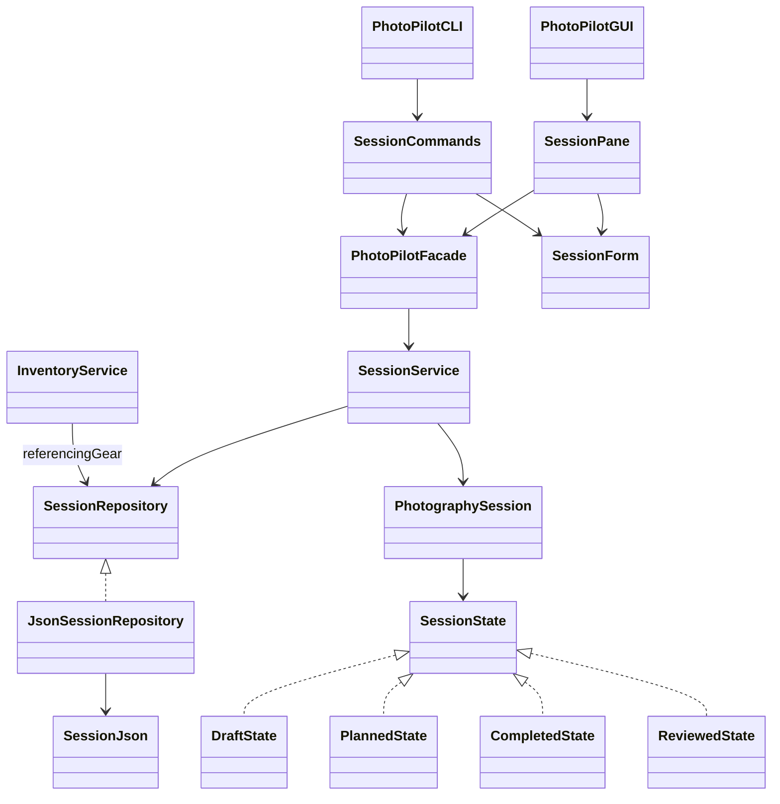

# F01 session management

Verified on Windows / JDK 21, 2026-10-31 (America/Toronto). F01/UC01/SD01 is implemented through the existing JavaFX workspace and CLI. Both call `PhotoPilotFacade.sessions()` and `SessionService`; no AI request is involved.

## Scope and use

Stage1PPP.pdf section 2, UC01, section 4.5 and SD01 require title, date, optional location/notes/goals, unique identity, timestamps, searchable persistence, restored linked records and guarded lifecycle. Category, mandatory coordinates, time-of-day, cancellation and a separate direct equipment picker are not in this F01 design and were not added. Notes hold free-form goals. Existing F07/F10 plan loadouts own gear selections; F01 restores their snapshots without inventing an alternative inventory.

GUI: open **Sessions & History**, choose **Create session**, enter title/date and optional location/goals, then **Save session**. Select a history row and use **Open / Edit** to restore/edit it. Search covers title, notes, place, UUID, ISO date and state identifier; optional exact date/state filters combine with the query. Blank history shows an empty state. Delete requires confirmation. Navigation and language switching retain drafts; replacing an editor or closing the window requires discard confirmation. Failed saves and stale edits retain the form. Reopen explicitly to resolve a conflict; there is no automatic merge.

CLI examples (inside the CLI; replace `<id>` with the generated UUID):

```text
session create title="Evening portrait" date=2026-11-01 location="Park" notes="Soft light"
session list query=portrait status=DRAFT date=2026-11-01
session open <id>
session edit <id> notes="Bring a reflector" location="River park"
session restore <id>
session transition <id> event=SHOOT_COMPLETED
session delete <id> --confirm
```

`F01` aliases `session list`. `session help` documents commands; `view`, `open` and `restore` read the same record. Quoted values and UTF-8 user text are preserved. Empty `location=`/`notes=` clears optional values. Unknown/repeated options, noncanonical UUIDs and invalid ISO dates return errors. A command does not retain an editable in-memory session between invocations; each edit opens the current record and uses its revision.

## Lifecycle and boundaries

| Current state | Event | Requirement | Result |
| --- | --- | --- | --- |
| Draft | PLAN_APPROVED | Aggregate contains an approved, non-provisional plan from the F10 boundary | Planned |
| Planned | SHOOT_COMPLETED | Explicit user request | Completed |
| Completed | REVIEW_SAVED | Aggregate contains a saved review from the F11 boundary | Reviewed |
| Any | Other event or skipped/backward transition | Rejected | Stored record unchanged |

Draft/Planned permit plan editing; Completed/Reviewed prohibit replacing stored plans. Metadata can still be corrected. A direct repository save also checks state adjacency and protects historical plans; the UI is not the only guard. `PhotographySession.apply` returns a changed copy, preserving its caller on failed persistence.

**F10 plan generation/approval and F11 review production remain unavailable.** A newly created Draft cannot be promoted merely by choosing an event. F01 reports the missing approved plan/review. Acceptance tests use explicitly constructed linked fixtures to test valid later transitions, not fabricated application history. These tests do not establish functioning F10/F11 workflows or their future deterministic validators.

## Persistence and data integrity

- Shared location: `PHOTOPILOT_DATA_DIR/sessions/sessions.json`, default `data/sessions/sessions.json` relative to the process working directory. Launch GUI and CLI from the same directory or set the same data root. Bootstrap/read-only empty-history access creates no business files.
- UTF-8 JSON root: `{schemaVersion: 1, sessions: [...]}`. Each session retains existing fields `id`, `title`, `date`, `location`, `notes`, `createdAt`, `updatedAt`, `state`, `requirements`, `plans`, `reviews`, `profile`, `statistics`, `savedIdeas`. Optional records use null; collections use arrays/maps. Dates/times/durations use ISO strings; state uses the four allowlisted identifiers above. Linked objects use their existing typed fields. Legitimate F08 infinite values use JSON strings `Infinity`/`-Infinity`.
- `GeoLocation.coordinatesPresent` distinguishes manual descriptions from coordinates; absent coordinates never mean a real location at 0,0. Existing coordinate constructor, device-origin flag and recorded consent remain supported. The GUI requests no device location. Location editing that changes a description replaces it with a manual location; leaving it unchanged preserves any coordinates/consent already present.
- Every mutation loads fresh data under an OS lock (`sessions.lock`), validates, writes a same-directory temporary file, flushes its channel and atomically replaces the store. No non-atomic fallback. Readers observe the old or new complete file. Temporary files are removed after ordinary success/failure; a crash can leave an ignored `sessions-*.tmp` file. This is not a power-loss backup system.
- SHA-256 revision tokens cover each stored session's content and are not serialized into the domain document. Saving/deleting compares the token with current content. Unrelated session changes do not invalidate another record. Insert and update are separate: duplicate insert and missing update fail instead of overwriting/upserting.
- Strict JSON token parsing is reused from the inventory repository. Duplicate keys/IDs, unsupported schemas/fields/states, missing fields, malformed dates/UTF-8, excessive depth and files over 20 MiB fail visibly without resetting the store. Canonical typed round trips prevent silent field loss. Unknown legacy files in the sessions directory fail safely. A corrupt aggregate blocks all session writes and gear-reference checks; no partial salvage or automatic migration is claimed. Preserve the original file and restore a known-good backup manually.
- The codec preserves all existing linked record structures, but does not implement the still-scaffolded F03/F06/F07/F10/F11 business validators. Their future services must validate and explicitly approve records before attaching them. Existing attach/append workflow methods remain unavailable until those features implement their contracts.
- `referencingGear` scans actual plan/loadout snapshots. F05 warns on affected session IDs before removal, requires acceptance, and retains copied historical gear after removal. Restored snapshot getters expose immutable collections. Missing live gear does not invalidate historical snapshots. No gear selection, inventory mutation, formula duplication or calculator change is introduced by F01.

## Participants and changed files

Paths below are relative to Stage2 unless prefixed otherwise.

| Files | Important behavior |
| --- | --- |
| `model/PhotographySession.java` | Metadata getters, validate, edit, apply and repository revision copies; existing linked-record fields retained |
| `service/SessionService.java` | create overloads, save/open/search, update/delete, transition with expected revision |
| `repository/SessionRepository.java`, `JsonSessionRepository.java`, new `SessionJson.java` | Separate insert/update, confirmed-service delete, strict aggregate codec, atomic writes, conflict checks, restored links, real gear-reference scan |
| `repository/JsonInventoryRepository.java` | Existing strict parser made package-visible for reuse; inventory behavior unchanged |
| New `application/SessionForm.java` | Shared GUI/CLI date, UUID and metadata parsing |
| Four concrete states plus `state/SessionState.java`, `SessionEvent.java` | Existing State pattern implemented; contract comments corrected |
| `model/GeoLocation.java`, `GearSnapshot.java`, `Loadout.java`; `command/ShootPlan.java` | Manual description/validation; immutable restored snapshot collections; minimal read-only history accessors |
| `agent/HistoryRetriever.java` | `retrieve` delegates to persisted search; `contextFor` and agent execution remain scaffolded |
| New `ui/gui/SessionPane.java`; `FeaturePane.java`, `PhotoPilotWorkspace.java`, `PhotoPilotGUI.java` | Connected editor/history/lifecycle controls, retained drafts, close guard, async work, showSession route, accurate smoke/status wiring |
| New `ui/cli/SessionCommands.java`; `PhotoPilotCLI.java`; `config/FeatureCatalog.java` | Session command family/help/F01 alias and real availability |
| Shared `photopilot.css`, three `messages*.properties` | Same theme, multiline input extension and matching bilingual resource keys |
| New `session/SessionFixtures.java`, `SessionTest.java`, `SessionCliTest.java`, `ui/gui/SessionGuiTest.java` under test sources | Domain/storage/CLI/real GUI acceptance; temporary data only |
| Existing `BootstrapTest`, `LocalizedCliTest`, `FeaturePresentationTest` | Assertions updated to distinguish real F01 from remaining scaffolds |
| README files, feature mapping, root project memory/status and this document | Usage, current status, design changes and actual evidence |

Java file entries refer to `src/main/java/com/photopilot/` unless marked test sources (`src/test/java/com/photopilot/`). No dependencies were added. Stage1 originals and AGENTS.md are unchanged.

## Design change record and implementation diagrams

| Original design | Implemented change | Reason | Impact |
| --- | --- | --- | --- |
| create(title,date), no optional-field mutation route | Create overload and revision-aware metadata update via SessionService/SessionForm | Fulfil UC01 optional location/goals without duplicating business rules | F01/UC01/SD01; Facade signatures retained |
| GeoLocation always carries primitive coordinates | Explicit coordinatesPresent and manual description factory | Optional manual location must not fabricate coordinates or require device permission | F01 value/storage extension; F09 provider remains unavailable |
| Provisional JSON port, save only | Versioned aggregate, separate insert/update/delete, revision tokens and atomic locking | Actual persistence, duplicate/missing/stale protection and explicit deletion | F01 repository implementations; F05 reference gate becomes operational |
| State declarations and event descriptions | Existing concrete State implementations with evidence guards and save-time checks | Enforce original lifecycle without arbitrary status editing | F01 direct; preserves F10/F11 producer responsibility |
| Linked records private/unreadable | Minimal read-only getters and typed aggregate codec | Reopen linked history and scan stored gear IDs | F01/F05 history; no F07 matching or F08 formula change |
| Generic feature placeholder | SessionPane and SessionCommands in existing shell | Actual shared-service workflows, localization and draft safety | Existing Facade and FxLocalizer Observer reused; no Factory or new framework |



```mermaid
sequenceDiagram
    actor User
    participant UI as GUI / CLI
    participant S as Facade.sessions / SessionService
    participant M as PhotographySession / SessionState
    participant R as JsonSessionRepository
    User->>UI: Edit opened details or request lifecycle event
    UI->>S: update(expected, details) / transition(expected, event)
    S->>M: Validate metadata / apply(event)
    M-->>S: Changed copy or failure
    S->>R: save(copy with original revision)
    R->>R: Lock, reload, compare revision and state, validate
    R->>R: Flush temp file and atomic replace
    R-->>S: Saved record + new revision, or error
    S-->>UI: Result
    UI-->>User: Confirm saved; on failure preserve entered draft
```

## Executed verification

Baseline: `./mvnw.cmd -B -o test` passed **71/71** before edits. Final command from Stage2 with local JDK 21:

```powershell
./mvnw.cmd -B -o test package javafx:run '-Djavafx.args=--smoke-test'
```

Result: **95 tests, zero failures/errors/skips**, JAR built, `GUI_SMOKE_OK`. The run recompiled all 115 main and 19 test source files; it was not a Maven `clean` build. The 24 added tests cover identity, metadata, filtering, duplicate/missing IDs, stale updates/deletes, corrupt/oversized/invalid-UTF8 stores, atomic-write failure, locks, event prerequisites/adjacency, direct-save bypass prevention, immutable historic plans/snapshots, linked-record round trips including calculator infinity, and actual F05 reference warnings/removal.

GUI acceptance drives real JavaFX controls for create/edit/save, errors, filters, guarded lifecycle, discard/delete cancellation/confirmation, navigation/language draft retention, conflict retention, and a new Stage/bootstrap restoring saved data. Independent CLI JVM processes create, reopen and edit UTF-8 records in isolated temporary directories. Existing F05, F08, localization and bootstrap tests pass. Screenshots generated from the running JavaFX scene at wide and minimum window sizes were visually inspected (`target/f01-history-wide.png`, `target/f01-editor-narrow-zh.png`; ignored artifacts).

The structural/source audit passes all 87 baseline types / 267 fields / 184 operations and 20 original source hashes. Its historical blanket footer about unimplemented behavior is not current F01 status. Intermediate failures were a sandbox JAR-access issue, two test-fixture compilation mistakes, and numerical EXIF map-key decoding; these were corrected before the passing final run. Existing-cache compilation required sandbox escalation; no dependency changes or downloads were needed.

Limits: Windows only; no macOS/Linux/display-scale or screen-reader certification, live AI/provider verification, power-loss simulation, or submission video. F10/F11 production of the records required for later lifecycle events remains future work. The 20 MiB aggregate and fail-closed corruption policy are explicit local-storage limits. This task is one meaningful implementation commit, not evidence that all weekly course commit quotas are met.
