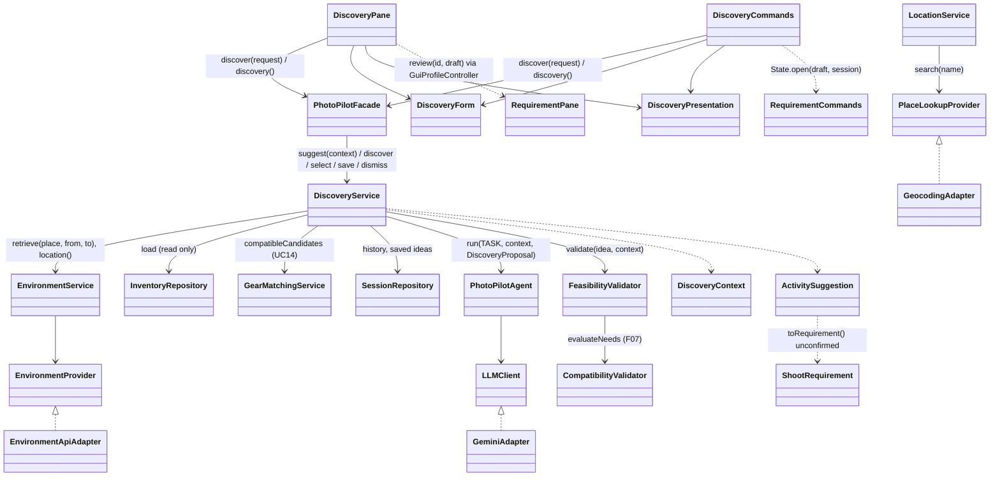

# F02 AI photography inspiration and activity recommendation

F02 / UC02 / SD01. Question answered: *I want to take photographs but don't know what to shoot — what realistic activities fit my circumstances?* Status: **implemented and verified** through GUI and CLI with offline provider and Gemini fakes, plus two live CLI runs against the real providers and Gemini (2026-11-03); see [Verification](#verification-2026-11-03-windows--jdk-21). F02 never confirms F03 requirements and never runs F10.

## Workflow (UC02 / SD01)

1. The user opens **General > Discover Inspiration** ("Find Something to Shoot") or runs `discover` / `F02`. No session is needed.
2. The page opens on step 1 of the guided flow (Location & Time); the read-only F05 inventory is on step 2 (Photography Preferences). Opening it reads local files only. It sends no provider, device or Gemini request.
3. The user reviews or enters the inputs:
   - place: a name, region or area; optionally coordinates (typed, found by name, or from the device after consent)
   - date and on-site period, as local times, plus an optional longest activity
   - maximum straight-line travel distance
   - optional interests, subjects to avoid, portability and other constraints
   - whether saved sessions may be used as a hint
4. `PhotoPilotFacade.discover(request)` calls `DiscoveryService.prepare(request)`, which builds a validated `DiscoveryContext`:
   - F09 `EnvironmentService.retrieve` (Open-Meteo plus sunrise-sunset.org), only when coordinates exist
   - time zone: provider-verified, else from the place lookup, else this computer's zone (labelled)
   - F05 `InventoryRepository.load`, with F07 `GearMatchingService.compatibleCandidates` (UC14-verified owned loadouts; no ranking or AI)
   - optional F01 history (at most 5 sessions with confirmed subjects or saved ideas)
5. `DiscoveryService.discover(context)` runs `PhotoPilotAgent.run(TASK, context, DiscoveryProposal.class)` → `LanguageAwareLLMClient` → `GeminiAdapter` (`responseJsonSchema`). Gemini returns structured candidates.
6. `convert` checks each untrusted candidate structurally and rejects malformed ones with reasons. For a suggested destination it looks up the name (`LocationService.search`, at most 6 per request) and computes straight-line distances to the matches.
7. `FeasibilityValidator.validate(idea, context)` decides FEASIBLE / UNVERIFIED / INFEASIBLE from deterministic checks. The ideas are then ranked deterministically.
8. The user can:
   - **Continue in Requirements** — `select` returns an unconfirmed F03 draft
   - **Save idea** — `save` appends the idea to an editable session atomically
   - **Dismiss** — `dismiss` removes the idea from the current results only
   - adjust the inputs and ask again



Patterns: **Facade** (`discover`, `suggest`, `discovery()`), **Adapter** (existing `GeminiAdapter`, `EnvironmentApiAdapter`, `GeocodingAdapter`). No new pattern was introduced. GUI and CLI share `DiscoveryForm` and `DiscoveryPresentation`. Business rules live only in `DiscoveryService`, `FeasibilityValidator` and the domain classes.

## DiscoveryContext and ActivitySuggestion

- `DiscoveryRequest` (new record) holds the reviewed inputs. `validate()` reports every problem at once:
  - a place is required; coordinates are optional but must come in pairs
  - the period is 15 min to 24 h
  - the longest activity, if given, is 15 min or more and no longer than the period
  - distance is 0–1000 km
  - at most 12 interests and 12 avoided subjects, each up to 100 characters; notes up to 500 characters
  - past dates and dates more than 365 days ahead are rejected by `prepare`
- `DiscoveryContext` keeps the Stage 1 constructor. A full constructor adds:
  - `avoid`, `portability`, `notes` and `maxActivity`
  - `ZoneSource` (PROVIDER / LOOKUP / COMPUTER)
  - inventory readability and UC14-verified loadouts
  - light-phase estimates, stale fields and preparation notices
  - `validate()` implements the Stage 1 input gates
- `ActivitySuggestion` persisted fields (F01 `savedIdeas`, v1 additive): `id`, `subject`, `genre`, `setting`, `place` (a label, never coordinates), `atUserLocation`, `start`, `estimatedDuration`, `estimatedTravelKm` (straight-line, only for one unambiguous gazetteer match), `light`, `gear` (owned item names and AI gear notes), `rationale`, `limitations`, `status` and `suggestedAt`.
- Transient fields (never saved): AI label, `outdoor`, `needsClearSky`, `dependsOnEvent`, capability `gearNeeds`, `TravelEvidence`, per-criterion `Check`s, application notes and ranking reasons. The Stage 1 six-argument constructor remains and creates an UNVERIFIED idea.
- `toRequirement()` returns an **unconfirmed** `ShootRequirement`. It carries over:
  - subject, setting as goal, date/time and duration
  - light as the time window
  - the place as a label without coordinates, flagged for review
  - clarification questions for an unverified place or unverified checks
  - an originalText that records the idea and its status when suggested

  Camera count, lens changes, weight and gear constraints stay unspecified.

## Gemini generation (`DiscoveryService.TASK`, `DiscoveryProposal.SCHEMA`)

- Evidence sent to Gemini:
  - place label, approximate flag, time zone and whether it is verified
  - availability start and end with offset, marked as a fixed user constraint
  - longest activity, straight-line distance limit, interests, avoid list, portability and notes
  - inventory as labels `G1..Gn` with type, name, quantity, weight and recorded specifications — no item ids
  - the number of verified loadouts and the supported capability names and units
  - provider sun events, light-phase estimates and forecast hours inside the period, with units, unavailable/stale groups, source and retrieval time
  - history: confirmed subjects, saved idea subjects, date and state — no titles, notes or locations

  Coordinates, session ids and the API key are never sent.
- Rules (summary):
  - propose 3–6 distinct activities and nothing that is to be avoided
  - stay inside the availability and the longest-activity limit, writing local ISO times with offset
  - use `atLocation` or a searchable `destination` with region
  - never state distances, travel times, hours, prices or access, and never invent events (set `dependsOnEvent` instead)
  - refer to owned gear only by label, and express hard needs only as supported capabilities (`focalLength` maximum = reach)
  - use only the environmental evidence
  - give a rationale and limitations, and rank by ids
- Conversion rejects, with reasons:
  - unreadable candidates; bad, repeated or more than 6 ids
  - missing or overlong text; unknown place type; a destination without a name
  - an unparseable time or a time with a wrong offset (`FeasibilityValidator.parseProposed`)
  - a duration under 10 min or over 24 h; an unknown light category
  - an invalid or unsupported capability need (`CapabilityNeed.problems`)
  - an unknown gear label; an idea that repeats an earlier subject and place

  AI statements are removed (and counted) when they are over 400 characters or quote distances, travel times, or measurements absent from the provider data (`FeasibilityValidator.unverifiedFigures`; focal lengths in mm are exempt). The model cannot save, confirm or change anything.

## Deterministic feasibility (`FeasibilityValidator.validate`)

The overall status is the worst check. FEASIBLE requires positive evidence for every applicable criterion.

| Criterion | FEASIBLE | UNVERIFIED | INFEASIBLE |
| --- | --- | --- | --- |
| time | start..end inside the availability, ≤ longest activity, start not past; travel time noted as excluded | no start | outside availability, too long, already started |
| travel | at the user's place; every gazetteer match within the limit (straight-line, labelled) | no user coordinates, no or failed lookup, lookup limit, matches on both sides of the limit | travel needed but limit 0 km; nearest match beyond the limit (a route can only be longer) |
| equipment | no hard need and ≥ 1 verified owned loadout; or some loadout meets every need (F07 `evaluateNeeds`) | inventory unreadable or empty; no verified loadout; a need depends on an unrecorded spec | every verified loadout leaves a need unmet |
| environment | not light/weather dependent; or light matches provider sun data (F09 light rules) and fresh forecast hours cover the activity | no coordinates/provider data, stale data, no forecast for the date, light unverifiable, cloud cover missing for a clear-sky idea | light conflicts with sun data; clear sky needed but cloud ≥ 80% throughout |
| avoid | no avoided subject in subject/genre/setting/place | — | contains an avoided subject |
| event | (only when `dependsOnEvent`) | schedule unverifiable | — |

Forecast warnings use the F09 thresholds: thunder, precipitation ≥ 70%, gusts ≥ 50 km/h, visibility < 1000 m. They are listed, and they lower the ranking without deciding feasibility. Every AI-suggested destination carries the note that its existence, opening and access are not verified.

## Ranking, filtering and no-result handling

The order is deterministic, with no invented scores:

1. status: feasible, then unverified, then not suitable
2. the number of stated interests matched
3. fewer forecast warnings
4. Gemini's priority, used only if its ranking refers to known, distinct candidate ids; otherwise it is ignored with a notice
5. proposal order

Each idea lists its ranking reasons. Distinctness comes from the prompt and from duplicate subject/place rejection; F02 does not force variety.

Infeasible ideas appear only in a separate "Not suitable" group. They cannot be continued or saved. Unverified ideas are shown with their open points and can be continued or saved.

When nothing is feasible, `limitingFactors` lists, per criterion, how many ideas it blocked, plus deterministic adjustment hints:

- extend the period
- raise the distance limit
- record gear
- add coordinates
- change the date
- review the avoid list

Constraints are never relaxed silently. Gemini's own `missingContext` / `adjustments` / `summary` are shown separately as labelled advice.

## Select, save and dismiss

- `select(sessionId, idea)`:
  - the session must be Draft or Planned
  - the idea must be the exact object issued in the current results (identity check), or be saved in that same session — then the stored copy is used, never the caller's
  - an idea saved in another session fails with `discover.error.otherSession`; unknown ideas fail with `discover.error.unknownIdea`; infeasible ideas are refused
  - returns an unconfirmed draft and never writes. Only `PlanningService.confirm` (F03) saves a confirmed requirement; a session's existing requirement is replaced only by that explicit confirmation
- `save(sessionId | expectedSession, idea)`:
  - same identity and status rules
  - `PhotographySession.attachIdea` returns a Result copy: Draft/Planned only, an idea saved at most once (`alreadySaved`), at most 50 per session
  - non-feasible findings are stored as English limitations, like other saved records
  - one atomic `SessionRepository.save` with the revision check; success is reported only after the write; requirements, plans and selections are untouched
- `dismiss(id)` / Stage 1 `dismiss(idea)` removes an idea from the current in-memory results only; an unknown id fails or throws. There is no permanent exclusion list. Saved ideas are listed with `saved(sessionId)` and can be continued in F03.
- GUI target: the chosen editable session, or (checkbox, default when none exist) a new Draft session named after the idea. CLI: `<session-id>` or `new`. Since 2026-11-04 the new-session route is `selectInNewSession` / `saveInNewSession`: every check runs before anything is written, and saving inserts the session and the idea in one atomic write, so a refused idea or a failed write never leaves an empty session (`DiscoveryHandoffTest`).

## F02 → F03 handoff

- **GUI:** `DiscoveryPane` → `GuiProfileController.reviewIdea` → `PhotoPilotWorkspace.selectRequirements()` → `RequirementPane.review(id, draft)`. The new method opens the draft in the existing review form for that session without parsing or saving. It is refused while another draft is open.
- **CLI:** `discover select <n> <session>|new` puts the draft into the shared `RequirementCommands.State` via the new `open(draft, session)`. It is refused while a draft is open. It then prints `requirement draft`; the user continues with `requirement set` / `clarify` / `confirm` / `cancel`.

F03 performs its own validation, clarification and confirmation. F10 is not run.

## Environment, location and privacy

- F09 data is reused unchanged: Open-Meteo forecast (16-day horizon; forecast, not observation), sunrise-sunset.org, Open-Meteo geocoding, the F09 type-specific freshness (forecast 3 h, sun 30 d) and the in-memory evidence cache. Missing or stale groups are named in the context card and never treated as favourable. Beyond the horizon only sun data exists.
- Location:
  - a name alone works and contacts nothing
  - a looked-up place is approximate and adds its zone hint
  - the device location is requested only from **Use device location** (GUI consent dialog) or `discover device consent`; a denial is respected for the application session
  - desktop Java has no device provider, so the answer is "unsupported" and manual entry continues
  - coordinates go only to the weather, sun and lookup providers and are never saved — saved ideas keep labels only

## GUI and CLI

- **GUI:** General > Discover Inspiration, a three-stage guided page since 2026-11-24 (see
  [Guided Discovery GUI](#guided-discovery-gui-three-stages) below):
  - **Discover Photography Ideas** runs as a background operation with the inputs disabled; **Reset inputs**
  - target-session card and a **Saved ideas** tab
  - grouped idea cards with **Continue in Requirements** / **Save idea** / **Dismiss**, AI notes, rejected candidates
  - inputs are kept on every failure; unsaved inputs count as dirty for user switching and closing
  - Home has no F02 card since 2026-11-08 ([Home dashboard](home-dashboard.md))
  - the **Continue in Requirements** hand-off makes its session the window's current session ([session workflow](session-workflow.md))
- **CLI:**

```text
discover gear
discover place Toronto
discover run place=1 date=2026-11-06 from=13:00 until=17:00 distance=40 interests="landscape; aviation; architecture; documentary" avoid=portraits
discover show 1
discover dismiss 3
discover save 1 new
discover saved <session-id>
discover select 2 <session-id>
requirement draft
requirement confirm
discover again distance=10 history=no
```

Other options: `latitude=.. longitude=..`, `device` (after `discover device consent`), `duration=<min>`, `portability=..`, `notes=..`. Numbers stay stable after a dismissal.

- **CLI Guided Discovery wizard (since 2026-11-24, interactive terminals only):** `discover wizard` (alias `discover guided`, optional `width=<columns>`) asks for the same inputs in the GUI's three steps, *Location & Time*, *Photography Preferences* and *Discover & Review*: one prompt at a time on the first pass, then a review menu per step. It supplements the commands above; their arguments, output and exit codes are unchanged (`discover help` and `F02` gained one line naming the wizard, `help` one summary line).
  - Prompts: label with (required)/(optional), an example, the current value in brackets. Enter keeps it, `-` clears an optional value, `"text"` is taken literally. Words: `back`, `next`, `reset` (asks first), `exit` (inputs kept for the next `discover wizard`), `help`; Chinese 上一步/返回, 下一步, 重置, 退出, 帮助. End of input leaves the wizard.
  - Validation is `DiscoveryForm.parse` grouped by `DiscoveryGuide`: an input's problems (including window, range and list rules) are shown right after it and it is asked again; Next and Discover never advance with problems. Date checks that need the place's time zone (past date, more than 365 days ahead, period already over) are made by `DiscoveryService` at Discover, before any Gemini request, and shown by input; **E** asks that input again.
  - Step 2: numbered categories (several at once) plus verbatim custom interests, avoid/portability/restrictions, a one-line equipment summary (records vs units) with the grouped list on request, and the history preference with its disclosure.
  - Results: the conditions of the shown results (with a note when later edits differ), counts, PhotoPilot notes (including `[!]` lines for forecast fields the providers did not supply, `DiscoveryPresentation.gaps`) and limiting factors; per idea a status mark and word (`[OK]`, `[??]`, `[NO]`), a *Suggested by AI (Gemini)* block (facts, setting, reasons, AI limitations; a not-suitable idea shows its setting and reasons only in the details) and a *Checked by PhotoPilot* block (counts, computed straight-line distance, each check with every finding of a check that did not pass and, marked `[!]`, the cautions of a passing one: forecast warnings, straight-line only, travel time not included; then PhotoPilot's notes). Numbered actions use the same services as the commands: details, continue in Shooting Requirements (unconfirmed F03 draft), save (editable or new draft session), dismiss, saved ideas (no AI request; a saved idea can be continued), edit conditions, discover again. The results are the commands' results (`discover show/list/save/select/dismiss/again` use the same numbers); results replaced by a later `discover run`/`again` are never shown again.
  - Terminal: wraps to `COLUMNS` (40–200, default 80) or `width=<n>` (Windows consoles do not export `COLUMNS`); East Asian characters count two columns. Colour is decoration only (`PHOTOPILOT_COLOR=always|never|auto`, `NO_COLOR`, `TERM=dumb`). With auto, colour is on in a console unless `NO_COLOR` is set or `TERM=dumb`; on Windows only in terminals that announce ANSI (`WT_SESSION`, `TERM`, `ConEmuANSI=ON`). Every state also has an ASCII mark and words.
  - Scripts are never prompted: the wizard reads input only in the stdin command loop of an interactive console (on JDK 22+ also `Console.isTerminal()`). The CLI uses the same console check for `env menu` prompts and for stopping redirected input after a failed profile command. On JDK 21, the supported runtime, the check is unchanged (`System.console() != null`). On JDK 22+ it makes those two follow their documented behaviour for redirected input. Otherwise `discover wizard` says how to start it (PhotoPilot without command arguments in a terminal, then `discover wizard`), prints the equivalent commands (command templates wrap only at spaces) and returns 0.
  - Wrapping never splits a command token such as `width=<列数>`, `<回答>` or `字段=值`, in any language.

## Guided Discovery GUI (three stages)

Presentation only (2026-11-24): the request, the checks, the services and the persistence are unchanged. Classes:
`DiscoveryPane` (stages, navigation, request), `DiscoveryStepper`, `DiscoveryIdeaCard`, `DiscoveryGearSummary`,
`DiscoveryFooter` (stage footer that wraps instead of clipping); shared with the CLI wizard: `DiscoveryGuide`,
`DiscoveryInterests`, `DiscoveryPresentation.view/conditions/gear*`, `DiscoveryForm`.

| Stage | Contents |
|---|---|
| 1 Location & Time | place name with **Find location** and **Use device location**, resolution status, privacy sentence; date picker, 24-hour times with a live window note; maximum straight-line distance (large value, 0-200 km slider, exact field up to 1000 km); collapsed Advanced (latitude/longitude, longest activity) |
| 2 Photography Preferences | nine interest chips plus free-text interests (`DiscoveryInterests.compose`), avoid / portability / other restrictions, read-only equipment tiles (units and records) with a closed **View equipment** list, history check box, AI notice |
| 3 Discover & Review | **Recommendations** (changed-conditions banner, request summary, loading / failed / cancelled / empty states, counts, About these results, target session, idea cards) and **Saved ideas** |

Rules:

- Leaving a stage forwards runs `DiscoveryForm.parse` and keeps `DiscoveryGuide.problems` for that stage; problems are
  shown next to their inputs (Advanced opens for coordinates and duration) and focus moves to the first one; a list
  problem is shown at the list to correct, interests or avoid (`DiscoveryGuide.listInputs`). Going back never validates.
  The stepper marks a stage, and the line after it, done once it has been validated. Step 2 stays available once reached; step 3 needs a request, or opens Saved ideas without validation.
- Every navigation keeps every value; only Reset clears them. Focus moves into the stage that opens.
- The large distance shows a value only when the form and the request accept it (`DiscoveryGuide.distance`); the window
  note is hidden when a time does not parse or the start equals the end (`DiscoveryGuide.window`); a window shorter
  than the request's minimum keeps its note beside the error (the CLI hides it while the period has a problem).
- Input problems that only the service finds (past date, window already over) stay next to the unchanged input until it
  is edited.
- A request runs once at a time; Reset abandons a running one (its late answer is ignored, and a new request waits until
  it has ended, with a visible "finishing" status); a cancelled or failed request has its own state with **Try again**,
  **Edit conditions** and the operation's next step (describe the shoot in Shooting Requirements, with its Open button).
- Operation messages show on the stages they belong to; a failure message has a warning shape and a danger rim. The
  success message of results whose conditions have since changed is replaced by the banner above the summary.
- Idea cards: key facts marked as Gemini's proposal, **Checked by PhotoPilot** beside **Suggested by AI (Gemini)**. Every
  finding of a check that did not pass, and the cautions of a passing one (forecast warnings, straight-line only, travel
  time not included: `DiscoveryPresentation.caution`), are always visible under their check; only the remaining evidence
  of passing checks, the setting and the ranking reasons are under **Details**. PhotoPilot's own notes about Gemini's
  statements sit with the checks. The card's accessible text is the CLI's `DiscoveryPresentation.idea` text.
- *About these results* always shows the result notices and the evidence gaps (`DiscoveryPresentation.gaps`: forecast
  fields the providers did not supply, named by their labels; a daily statistic without a label keeps its provider
  name). Notices about missing, unreadable, assumed, approximate or outdated evidence (`DiscoveryPresentation.warning`)
  have the warning shape in the GUI and `[!]` in the CLI. The rest of the context is under **Context used**
  (`DiscoveryPresentation.guidedContext`: the legacy context lines, with the inventory counted in records and gaps
  labelled; the legacy `discover` output keeps `context`). Expanded sections stay
  expanded when the results are redrawn (save, tab switch, return to the page).
- The request summary shows preset interests by their category labels (`DiscoveryPresentation.interests`); the request
  itself carries the fixed English terms the ranking matches. A preset term typed into *Other interests* is the same
  request term, so the summary shows it as the category too, while step 2 keeps the typed text as written.
- The date popup's month and weekday names follow the app language (the JVM format locale is switched only while the
  popup is open and restored when it closes).
- Tests: `DiscoveryGuiTest` (the original end-to-end flow; card text is checked through the accessible text and through
  the visible facts and check rows) and `GuidedDiscoveryGuiTest` (validation, focus, navigation,
  preservation, lookup, distance and window rules, equipment, history, loading and duplicates, cancel, failure and
  retry, saved ideas, saving, stale and abandoned responses, both languages, common sizes, the real 880 x 600 window at
  Font Size 125% with Bold Text, dark mode, the date popup); `DiscoveryPresentationViewTest` for the shared helpers.

## Design changes (Original design → Implemented change → Reason → Impact)

1. `DiscoveryService(agent, environment, validator, sessions)` → overload adding `InventoryRepository` and `GearMatchingService` (and `Clock`), used by bootstrap → equipment feasibility needs the confirmed F05 inventory and F07's UC14 loadout generation instead of a second gear matcher → no new repository. The Stage 1 constructor remains; without an inventory, equipment is UNVERIFIED.
2. Facade had `suggest(context)` only (select/save/dismiss had no route) → added `discover(request)` and the `discovery()` accessor proposed in the Stage 1 explanation; `suggest(context)` kept and returns the usable ideas → closes the documented gap → GUI and CLI share one route.
3. `ActivitySuggestion` six fields → additive v1 fields (`id`, `genre`, `place`, `atUserLocation`, `start`, `light`, `gear`, `status`, `suggestedAt`), with `SessionJson.withIdeaAdditions` filling exactly those when absent. Legacy ideas get a content- and position-derived stable id and the status UNVERIFIED → identity is needed for select/save/dismiss and the saved status must not overstate feasibility → old session files load unchanged and are not rewritten on load.
4. `PhotographySession.savedIdeas` had no writer → `attachIdea` returns a Result copy, like `attachRequirement` → same immutability and stale-revision protection.
5. `FeasibilityValidator.validate` → implemented; also adds `straightLineKm` and `unverifiedFigures` → deterministic travel/figure checks reuse the F09 light rules and `unsupportedMeasurements`.
6. New `DiscoveryRequest`, `DiscoveryResult`, `DiscoveryProposal`, `DiscoveryForm`, `DiscoveryPresentation`, `DiscoveryPane`, `DiscoveryCommands` → reviewed inputs, a result with rejected and limiting information, the structured-output DTO, and shared GUI/CLI text, following the F09 pattern.
7. F03 entry points `RequirementPane.review(id, draft)` and `RequirementCommands.State.open/hasDraft` → the smallest handoff that keeps F03's own review and confirmation.
8. Maximum travel distance is defined as **straight-line** distance → no routing provider exists, and the labelled straight-line value is the only verifiable distance → road distance and travel time are always reported as unknown.

The structural UML audit was not rerun (no Python here); it may flag the additive `ActivitySuggestion`/`DiscoveryContext` members and the new classes.

## Demonstration script (Stage 2)

Use isolated storage, never a real user's data:

1. Launch the GUI or CLI with `PHOTOPILOT_DATA_DIR` set to a scratch folder.
2. Add a few gear items in Gear Inventory, or use `gear add ...`.

For the live part, set `GEMINI_TIMEOUT_SECONDS=120`.

1. **Feature identification.** Sidebar *General > Discover Inspiration* (Home's former Inspiration card was removed on 2026-11-08, see [Home dashboard](home-dashboard.md)); the page opens with its own header (*PHOTO DISCOVERY*, "What will you photograph today?"). CLI: `status`, `F02`.
2. **Open Find Something to Shoot.** The page opens on step 1 (*Location & Time*); nothing is contacted.
3. **Review inputs.** Step 1: enter *Toronto*, choose **Find location**, pick *Toronto, Ontario, Canada*, then a date within the next week, 13:00–17:00 and distance 40; **Next**. Step 2 (*Photography Preferences*): select the *Landscape*, *Aviation* and *Architecture* chips, type *documentary* as another interest and *portraits* under avoid; note the read-only equipment summary (open **View equipment**) and the saved-plans check box.
4. **Trigger AI suggestions** with **Discover Photography Ideas** (inputs and the button disabled while Gemini runs; one indeterminate indicator, no percentage).
5. **Verified context and limitations.** Step 3 shows the conditions the results were made with (**Edit conditions** goes back without losing anything) and *About these results* (counts, notices, evidence gaps); open **Context used** for provider-verified time zone, availability, forecast/sun sources and retrieval time, gear and history counts.
6. **Feasibility validation.** Walk through one feasible card (*Checked by PhotoPilot*: one row per check, forecast warnings and "travel time not included" visible under their row, straight-line distance label; *Suggested by AI (Gemini)* separate; the rest under **Details**), one unverified card (missing evidence named), and the *Not suitable* group (no Continue/Save buttons; reason per criterion).
7. **Dismiss** one idea; **Save idea** another (new draft session created); show it under *Saved ideas*.
8. **Continue in Requirements** — the F03 page opens an unconfirmed draft (place flagged for review, questions listed). Show that nothing is confirmed until **Confirm and save** there.
9. **Error handling.**
   - Enter distance `far` (all problems listed, inputs kept).
   - Use **Use device location** (unsupported → manual entry).
   - Clear the coordinates and ask again: ideas away from the place become unverified, and the coordinates hint appears.
   - Optionally disconnect the network or remove the key: no ideas, nothing invented, inputs kept; the failed state offers **Try again**, **Edit conditions** and the next step to describe the shoot in Shooting Requirements.
10. **CLI parity.** Run the CLI block above (same cards and wording), including `discover select` → `requirement confirm`. In an interactive terminal, `discover wizard` shows the same inputs and results step by step (try `far` as the distance, `13:00`–`13:00` as the period, `back`, `exit` and `discover wizard` again).

## Known limitations and unresolved dependencies

- **No routing provider:** road distance and travel time are never estimated. Straight-line distances come from gazetteer points, which may not be the intended spot; an ambiguous name stays unverified.
- **AI places:** existence, opening hours, access, prices and events are never verified (no venue or event provider exists), so destinations are always labelled unverified and flagged in F03.
- **Gazetteer coverage:** the Open-Meteo gazetteer mainly covers populated places. Parks or landmarks are often not found, so those ideas remain UNVERIFIED for travel.
- **Equipment checks:** only F06/F07-supported capabilities can be checked. Free-text gear advice is shown as AI text, not verified.
- **Forecasts:** weather beyond 16 days is unavailable, and forecasts are not observations. Weather warnings affect ranking only.
- **Process-local results:** results and dismissals live in memory in one process (GUI and CLI processes do not share them). Saved ideas persist in F01.
- **Live quality:** answer quality and latency depend on Gemini. The adapter timeout defaults to 30 s.
- **F06 dependency:** F02 uses F07's deterministic need comparison and does not derive capability profiles itself (F06 AI analysis is a separate step for a planned shoot).
- **Not run:** the UML structural audit and other OS/DPI checks were not run.
- **Chinese wording of ideas:** the Guided Discovery texts call an idea 灵感, and 建议 is kept only for "AI 建议（Gemini）". Texts shared with the legacy `discover` commands and with `DiscoveryPresentation` (for example 可行的建议, the card status details, notices, limits, the saved-list text and service errors) still say 建议, because changing them would change existing CLI output; the GUI's success status uses the measure word 个 instead of the legacy 条.
- **CLI wizard:** the width comes from `COLUMNS` or `width=<n>`, never from the live window size. Inside the wizard the F03 hand-off draft is wrapped to the width (command tokens kept whole); standalone `discover select` and `requirement draft` print it unwrapped, as before. On a list problem the wizard asks both lists again (the GUI marks only the offending list). At the minimum width of 40 columns, a line that holds a session id longer than the line splits the id (the next lines repeat it whole). Legacy Chinese consoles may draw `·`, `–` and `×` two columns wide, so a line can run one or two columns over there. Date checks that depend on the place's time zone appear only at Discover (no Gemini request is made).

## Verification (2026-11-03, Windows / JDK 21)

- Baseline before F02: 292 run, 0 failures, 1 skipped.
- Final: `./mvnw.cmd -B -o test package javafx:run '-Djavafx.args=--smoke-test'` → **306 run, 305 passed, 0 failures/errors, 1 skipped** (opt-in `LiveGeminiPlanSmokeTest`), JAR packaged, `GUI_SMOKE_OK` (all 11 features, F02 status feedback). Incremental build, not a clean rebuild.
- New offline tests (loopback Gemini and provider fakes, isolated fixture gear, temp storage):
  - `F02WorkflowTest` (7): Toronto acceptance without a session; select → unconfirmed draft → F03 confirm; save/duplicate/infeasible/forged/restart/other-session/dismiss; Windows read-only persistence failure; Gemini 503/non-JSON/schema-invalid; invalid candidates and ranking; nothing feasible; name-only/empty inventory/no history; weather or both providers down; permissions; history opt-in; invalid inputs; legacy saved ideas.
  - `DiscoveryFeasibilityTest` (5): every criterion on hand-built evidence; figure filter; handoff and historical sessions.
  - `DiscoveryCliTest` (1): full CLI workflow; CLI output equals the shared presentation; select → `requirement confirm`; outage; Chinese.
  - `DiscoveryGuiTest` (1): real JavaFX controls; no request on opening; background Task; GUI text equals the CLI text; dismiss; save to a new session; handoff into the real `RequirementPane`; outage keeps inputs; EN wide and ZH 880×600 snapshots, inspected.
- Updated: `BootstrapTest` and `FeaturePresentationTest` (F02 now IMPLEMENTED).
- **Live** (CLI, scratch data dir, `GEMINI_TIMEOUT_SECONDS=120`, key from ignored `.env`, never printed), with real Open-Meteo forecast/geocoding, sunrise-sunset.org and Gemini:
  - Run 1 returned 2 feasible ideas. It exposed a rejected candidate (bounds sent for `autofocus`), raw `G#` labels in text and an unformatted timestamp. All three were fixed and covered by tests.
  - Run 2 returned 3 feasible ideas (Toronto Islands, 10.3 km straight-line) and 1 unverified idea ("Pearson Airport Viewpoint" not in the gazetteer). Save to a new session, select into another, then `requirement confirm` worked. A name-only request made every idea unverified, with the coordinates hint.
- Not run: the structural UML audit (no Python), a live GUI run, a device-location provider (none on desktop), and other OS/DPI checks.

## Verification (2026-11-24, Guided Discovery GUI and CLI wizard, Windows / JDK 21)

- Offline, fresh isolated copy of the final working tree (no `.env`, `LLM_API_KEY`/`GEMINI_API_KEY` unset, `PHOTOPILOT_LIVE_GEMINI=0`, loopback Gemini and provider fakes):
  - `mvnw.cmd -B -o clean verify` → **1007 run, 0 failures, 0 errors, 6 skipped** (opt-in live tests), JAR built, no CSS lookup warnings. The previous full run on 2026-11-24 (before this work) was 950/0/0/6.
  - `mvnw.cmd -B -o package -DskipTests javafx:run -Djavafx.args=--smoke-test` → `GUI_SMOKE_OK` (splash, user selection, Home, all 11 features, minimum-size layout).
  - F02 classes in that run: `GuidedDiscoveryGuiTest` 22, `DiscoveryGuiTest` 1, `DiscoveryPresentationViewTest` 9, `DiscoveryWizardCliTest` 26, `DiscoveryCliTest` 1, `F02WorkflowTest` 7, `DiscoveryHandoffTest` 4, `DiscoveryFeasibilityTest` 5, `LocationFeasibilityTest` 16, `TranslationResourcesTest` 3, `CliHelpTest` 5.
- Independent review of the integrated work with adversarial verification: 18 of 23 findings confirmed and fixed in a GUI and a CLI lane. An independent verifier checked each lane by reverting its fixes (every new test failed on the reverted code at its own assertion), and the verifiers' remaining points were fixed in a follow-up round. The main fixes: forecast warnings and travel limits of a passing check stay visible (GUI warning rows, CLI `[!]`); the failed state keeps the Shooting Requirements next step; evidence gaps are always shown; preset interests appear by their labels; command tokens are never split by wrapping.
- Legacy CLI compatibility: the same scripted `discover` commands (help, F02, gear, place, run, list, show, save, select, dismiss, again, saved, invalid input, a Gemini 503, English and Chinese, 126 command blocks) give byte-identical output and exit codes in the baseline and in the CLI lane's final build (session ids and retrieval times normalized); only the intended wizard help lines differ. The integrated build differs from that build only in GUI files and GUI-only `discover.guided.*` keys.
- `GuidedDiscoveryGuiTest` (22) runs the real `DiscoveryPane` in a real window: stage validation and focus, stepper states, value preservation, lookup and Advanced coordinates, distance and window rules, list problems at the list, equipment summary from the real inventory, history disclosure, loading and duplicate requests, cancel, failure and retry, saved ideas, saving, stale results, abandoned and late responses, both languages at 1280×720, 1366×768, 1920×1080, 2560×1440 and the 880×600 minimum window (also at Font Size 125 % with Bold Text), dark mode, the date popup, and passing-check warnings and gaps visible. It writes the `target/f02-guided-*.png` screenshots.
- `DiscoveryWizardCliTest` (26): the three steps end to end with the commands sharing its results; validation by input (distance, empty place, one coordinate, impossible, equal and too-short times, a longest activity beyond the window, a past date reported once with no Gemini request); back/next/reset/exit/help in English and Chinese, resume, a declined reset, a profile switch, results replaced by a later `discover run`, starting from the last request; AI block before PhotoPilot's checks and notes; zero ideas; dismissal summary; Gemini 503 then retry; saved ideas without a request and their F03 hand-off; Chinese labels and the ideographic space; 40/50/60/80 columns with no wider line; `width=`; optional colour; scripts, batch arguments and a piped real process never prompted; `F02` = `discover help`; passing-check cautions and provider gaps as `[!]` lines; interests kept with Enter reach the request unchanged; typed coordinates replace a lookup match even when a navigation word ends the prompt; the wrapped hand-off draft; command tokens never split at any width from 40 to 80; the scripted guidance. Transcripts (English at 80/50/40 columns, Chinese at 80) are written when `PHOTOPILOT_TRANSCRIPTS` is set.
- Not run: a real interactive console (colour and JDK 22+ console detection are covered only by unit decisions), live Gemini and live providers, a hands-on pointer session, macOS/Linux.
