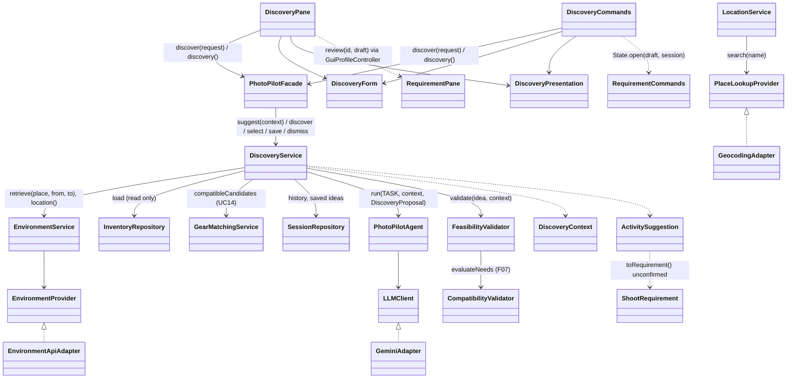

# F02 AI photography inspiration and activity recommendation

F02 / UC02 / SD01. Question answered: *I want to take photographs but don't know what to shoot — what realistic activities fit my circumstances?* Status: **implemented and verified** through GUI and CLI with offline provider and Gemini fakes, plus two live CLI runs against the real providers and Gemini (2026-11-03); see [Verification](#verification-2026-11-03-windows--jdk-21). F02 never confirms F03 requirements and never runs F10.

## Workflow (UC02 / SD01)

1. The user opens **Workspace > Inspiration** ("Find Something to Shoot") or runs `discover` / `F02`. No session is needed.
2. The page shows the input form and the read-only F05 inventory. Opening it reads local files only. It sends no provider, device or Gemini request.
3. The user reviews or enters the inputs:
   - place: a name, region or area; optionally coordinates (typed, found by name, or from the device after consent)
   - date and on-site period, as local times, plus an optional longest activity
   - maximum straight-line travel distance
   - optional interests, subjects to avoid, portability and other constraints
   - whether saved sessions may be used as a hint
4. `PhotoPilotFacade.discover(request)` calls `DiscoveryService.prepare(request)`, which builds a validated `DiscoveryContext`:
   - F09 `EnvironmentService.retrieve` (Open-Meteo plus sunrise-sunset.org), only when coordinates exist
   - time zone: provider-verified, else from the place lookup, else this computer's zone (labelled)
   - F05 `InventoryRepository.load`, with F07 `GearMatchingService.compatibleCandidates` (UC14-verified owned loadouts; no ranking or AI)
   - optional F01 history (at most 5 sessions with confirmed subjects or saved ideas)
5. `DiscoveryService.discover(context)` runs `PhotoPilotAgent.run(TASK, context, DiscoveryProposal.class)` → `LanguageAwareLLMClient` → `GeminiAdapter` (`responseJsonSchema`). Gemini returns structured candidates.
6. `convert` checks each untrusted candidate structurally and rejects malformed ones with reasons. For a suggested destination it looks up the name (`LocationService.search`, at most 6 per request) and computes straight-line distances to the matches.
7. `FeasibilityValidator.validate(idea, context)` decides FEASIBLE / UNVERIFIED / INFEASIBLE from deterministic checks. The ideas are then ranked deterministically.
8. The user can:
   - **Continue in Requirements** — `select` returns an unconfirmed F03 draft
   - **Save idea** — `save` appends the idea to an editable session atomically
   - **Dismiss** — `dismiss` removes the idea from the current results only
   - adjust the inputs and ask again



Patterns: **Facade** (`discover`, `suggest`, `discovery()`), **Adapter** (existing `GeminiAdapter`, `EnvironmentApiAdapter`, `GeocodingAdapter`). No new pattern was introduced. GUI and CLI share `DiscoveryForm` and `DiscoveryPresentation`. Business rules live only in `DiscoveryService`, `FeasibilityValidator` and the domain classes.

## DiscoveryContext and ActivitySuggestion

- `DiscoveryRequest` (new record) holds the reviewed inputs. `validate()` reports every problem at once:
  - a place is required; coordinates are optional but must come in pairs
  - the period is 15 min to 24 h
  - the longest activity, if given, is 15 min or more and no longer than the period
  - distance is 0–1000 km
  - at most 12 interests and 12 avoided subjects, each up to 100 characters; notes up to 500 characters
  - past dates and dates more than 365 days ahead are rejected by `prepare`
- `DiscoveryContext` keeps the Stage 1 constructor. A full constructor adds:
  - `avoid`, `portability`, `notes` and `maxActivity`
  - `ZoneSource` (PROVIDER / LOOKUP / COMPUTER)
  - inventory readability and UC14-verified loadouts
  - light-phase estimates, stale fields and preparation notices
  - `validate()` implements the Stage 1 input gates
- `ActivitySuggestion` persisted fields (F01 `savedIdeas`, v1 additive): `id`, `subject`, `genre`, `setting`, `place` (a label, never coordinates), `atUserLocation`, `start`, `estimatedDuration`, `estimatedTravelKm` (straight-line, only for one unambiguous gazetteer match), `light`, `gear` (owned item names and AI gear notes), `rationale`, `limitations`, `status` and `suggestedAt`.
- Transient fields (never saved): AI label, `outdoor`, `needsClearSky`, `dependsOnEvent`, capability `gearNeeds`, `TravelEvidence`, per-criterion `Check`s, application notes and ranking reasons. The Stage 1 six-argument constructor remains and creates an UNVERIFIED idea.
- `toRequirement()` returns an **unconfirmed** `ShootRequirement`. It carries over:
  - subject, setting as goal, date/time and duration
  - light as the time window
  - the place as a label without coordinates, flagged for review
  - clarification questions for an unverified place or unverified checks
  - an originalText that records the idea and its status when suggested

  Camera count, lens changes, weight and gear constraints stay unspecified.

## Gemini generation (`DiscoveryService.TASK`, `DiscoveryProposal.SCHEMA`)

- Evidence sent to Gemini:
  - place label, approximate flag, time zone and whether it is verified
  - availability start and end with offset, marked as a fixed user constraint
  - longest activity, straight-line distance limit, interests, avoid list, portability and notes
  - inventory as labels `G1..Gn` with type, name, quantity, weight and recorded specifications — no item ids
  - the number of verified loadouts and the supported capability names and units
  - provider sun events, light-phase estimates and forecast hours inside the period, with units, unavailable/stale groups, source and retrieval time
  - history: confirmed subjects, saved idea subjects, date and state — no titles, notes or locations

  Coordinates, session ids and the API key are never sent.
- Rules (summary):
  - propose 3–6 distinct activities and nothing that is to be avoided
  - stay inside the availability and the longest-activity limit, writing local ISO times with offset
  - use `atLocation` or a searchable `destination` with region
  - never state distances, travel times, hours, prices or access, and never invent events (set `dependsOnEvent` instead)
  - refer to owned gear only by label, and express hard needs only as supported capabilities (`focalLength` maximum = reach)
  - use only the environmental evidence
  - give a rationale and limitations, and rank by ids
- Conversion rejects, with reasons:
  - unreadable candidates; bad, repeated or more than 6 ids
  - missing or overlong text; unknown place type; a destination without a name
  - an unparseable time or a time with a wrong offset (`FeasibilityValidator.parseProposed`)
  - a duration under 10 min or over 24 h; an unknown light category
  - an invalid or unsupported capability need (`CapabilityNeed.problems`)
  - an unknown gear label; an idea that repeats an earlier subject and place

  AI statements are removed (and counted) when they are over 400 characters or quote distances, travel times, or measurements absent from the provider data (`FeasibilityValidator.unverifiedFigures`; focal lengths in mm are exempt). The model cannot save, confirm or change anything.

## Deterministic feasibility (`FeasibilityValidator.validate`)

The overall status is the worst check. FEASIBLE requires positive evidence for every applicable criterion.

| Criterion | FEASIBLE | UNVERIFIED | INFEASIBLE |
| --- | --- | --- | --- |
| time | start..end inside the availability, ≤ longest activity, start not past; travel time noted as excluded | no start | outside availability, too long, already started |
| travel | at the user's place; every gazetteer match within the limit (straight-line, labelled) | no user coordinates, no or failed lookup, lookup limit, matches on both sides of the limit | travel needed but limit 0 km; nearest match beyond the limit (a route can only be longer) |
| equipment | no hard need and ≥ 1 verified owned loadout; or some loadout meets every need (F07 `evaluateNeeds`) | inventory unreadable or empty; no verified loadout; a need depends on an unrecorded spec | every verified loadout leaves a need unmet |
| environment | not light/weather dependent; or light matches provider sun data (F09 light rules) and fresh forecast hours cover the activity | no coordinates/provider data, stale data, no forecast for the date, light unverifiable, cloud cover missing for a clear-sky idea | light conflicts with sun data; clear sky needed but cloud ≥ 80% throughout |
| avoid | no avoided subject in subject/genre/setting/place | — | contains an avoided subject |
| event | (only when `dependsOnEvent`) | schedule unverifiable | — |

Forecast warnings use the F09 thresholds: thunder, precipitation ≥ 70%, gusts ≥ 50 km/h, visibility < 1000 m. They are listed, and they lower the ranking without deciding feasibility. Every AI-suggested destination carries the note that its existence, opening and access are not verified.

## Ranking, filtering and no-result handling

The order is deterministic, with no invented scores:

1. status: feasible, then unverified, then not suitable
2. the number of stated interests matched
3. fewer forecast warnings
4. Gemini's priority, used only if its ranking refers to known, distinct candidate ids; otherwise it is ignored with a notice
5. proposal order

Each idea lists its ranking reasons. Distinctness comes from the prompt and from duplicate subject/place rejection; F02 does not force variety.

Infeasible ideas appear only in a separate "Not suitable" group. They cannot be continued or saved. Unverified ideas are shown with their open points and can be continued or saved.

When nothing is feasible, `limitingFactors` lists, per criterion, how many ideas it blocked, plus deterministic adjustment hints:

- extend the period
- raise the distance limit
- record gear
- add coordinates
- change the date
- review the avoid list

Constraints are never relaxed silently. Gemini's own `missingContext` / `adjustments` / `summary` are shown separately as labelled advice.

## Select, save and dismiss

- `select(sessionId, idea)`:
  - the session must be Draft or Planned
  - the idea must be the exact object issued in the current results (identity check), or be saved in that same session — then the stored copy is used, never the caller's
  - an idea saved in another session fails with `discover.error.otherSession`; unknown ideas fail with `discover.error.unknownIdea`; infeasible ideas are refused
  - returns an unconfirmed draft and never writes. Only `PlanningService.confirm` (F03) saves a confirmed requirement; a session's existing requirement is replaced only by that explicit confirmation
- `save(sessionId | expectedSession, idea)`:
  - same identity and status rules
  - `PhotographySession.attachIdea` returns a Result copy: Draft/Planned only, an idea saved at most once (`alreadySaved`), at most 50 per session
  - non-feasible findings are stored as English limitations, like other saved records
  - one atomic `SessionRepository.save` with the revision check; success is reported only after the write; requirements, plans and selections are untouched
- `dismiss(id)` / Stage 1 `dismiss(idea)` removes an idea from the current in-memory results only; an unknown id fails or throws. There is no permanent exclusion list. Saved ideas are listed with `saved(sessionId)` and can be continued in F03.
- GUI target: the chosen editable session, or (checkbox, default when none exist) a new Draft session created through F01 `SessionService.create`, named after the idea. CLI: `<session-id>` or `new`.

## F02 → F03 handoff

- **GUI:** `DiscoveryPane` → `GuiProfileController.reviewIdea` → `PhotoPilotWorkspace.selectRequirements()` → `RequirementPane.review(id, draft)`. The new method opens the draft in the existing review form for that session without parsing or saving. It is refused while another draft is open.
- **CLI:** `discover select <n> <session>|new` puts the draft into the shared `RequirementCommands.State` via the new `open(draft, session)`. It is refused while a draft is open. It then prints `requirement draft`; the user continues with `requirement set` / `clarify` / `confirm` / `cancel`.

F03 performs its own validation, clarification and confirmation. F10 is not run.

## Environment, location and privacy

- F09 data is reused unchanged: Open-Meteo forecast (16-day horizon; forecast, not observation), sunrise-sunset.org, Open-Meteo geocoding, the F09 type-specific freshness (forecast 3 h, sun 30 d) and the in-memory evidence cache. Missing or stale groups are named in the context card and never treated as favourable. Beyond the horizon only sun data exists.
- Location:
  - a name alone works and contacts nothing
  - a looked-up place is approximate and adds its zone hint
  - the device location is requested only from **Use device location** (GUI consent dialog) or `discover device consent`; a denial is respected for the application session
  - desktop Java has no device provider, so the answer is "unsupported" and manual entry continues
  - coordinates go only to the weather, sun and lookup providers and are never saved — saved ideas keep labels only

## GUI and CLI

- **GUI:** Workspace > Inspiration. The page reuses the `EnvironmentPane` controls and conventions:
  - inputs card with **Find place coordinates** / **Use device location**; read-only gear card with refresh
  - **Find ideas** runs as a background Task with the inputs disabled; **Reset inputs**
  - target-session card with saved ideas
  - result cards: context used, results, limiting factors, then grouped idea cards with **Continue in Requirements** / **Save idea** / **Dismiss**, AI notes, rejected candidates
  - inputs are kept on every failure; unsaved inputs count as dirty for user switching and closing
  - only existing CSS classes are used; Home's existing F02 card now opens the page (description text updated)
- **CLI:**

```text
discover gear
discover place Toronto
discover run place=1 date=2026-11-06 from=13:00 until=17:00 distance=40 interests="landscape; aviation; architecture; documentary" avoid=portraits
discover show 1
discover dismiss 3
discover save 1 new
discover saved <session-id>
discover select 2 <session-id>
requirement draft
requirement confirm
discover again distance=10 history=no
```

Other options: `latitude=.. longitude=..`, `device` (after `discover device consent`), `duration=<min>`, `portability=..`, `notes=..`. Numbers stay stable after a dismissal.

## Design changes (Original design → Implemented change → Reason → Impact)

1. `DiscoveryService(agent, environment, validator, sessions)` → overload adding `InventoryRepository` and `GearMatchingService` (and `Clock`), used by bootstrap → equipment feasibility needs the confirmed F05 inventory and F07's UC14 loadout generation instead of a second gear matcher → no new repository. The Stage 1 constructor remains; without an inventory, equipment is UNVERIFIED.
2. Facade had `suggest(context)` only (select/save/dismiss had no route) → added `discover(request)` and the `discovery()` accessor proposed in the Stage 1 explanation; `suggest(context)` kept and returns the usable ideas → closes the documented gap → GUI and CLI share one route.
3. `ActivitySuggestion` six fields → additive v1 fields (`id`, `genre`, `place`, `atUserLocation`, `start`, `light`, `gear`, `status`, `suggestedAt`), with `SessionJson.withIdeaAdditions` filling exactly those when absent. Legacy ideas get a content- and position-derived stable id and the status UNVERIFIED → identity is needed for select/save/dismiss and the saved status must not overstate feasibility → old session files load unchanged and are not rewritten on load.
4. `PhotographySession.savedIdeas` had no writer → `attachIdea` returns a Result copy, like `attachRequirement` → same immutability and stale-revision protection.
5. `FeasibilityValidator.validate` → implemented; also adds `straightLineKm` and `unverifiedFigures` → deterministic travel/figure checks reuse the F09 light rules and `unsupportedMeasurements`.
6. New `DiscoveryRequest`, `DiscoveryResult`, `DiscoveryProposal`, `DiscoveryForm`, `DiscoveryPresentation`, `DiscoveryPane`, `DiscoveryCommands` → reviewed inputs, a result with rejected and limiting information, the structured-output DTO, and shared GUI/CLI text, following the F09 pattern.
7. F03 entry points `RequirementPane.review(id, draft)` and `RequirementCommands.State.open/hasDraft` → the smallest handoff that keeps F03's own review and confirmation.
8. Maximum travel distance is defined as **straight-line** distance → no routing provider exists, and the labelled straight-line value is the only verifiable distance → road distance and travel time are always reported as unknown.

The structural UML audit was not rerun (no Python here); it may flag the additive `ActivitySuggestion`/`DiscoveryContext` members and the new classes.

## Demonstration script (Stage 2)

Use isolated storage, never a real user's data:

1. Launch the GUI or CLI with `PHOTOPILOT_DATA_DIR` set to a scratch folder.
2. Add a few gear items in Gear Inventory, or use `gear add ...`.

For the live part, set `GEMINI_TIMEOUT_SECONDS=120`.

1. **Feature identification.** Home → **Inspiration** card / sidebar *Workspace > Inspiration*; **Check status** shows the F02 description. CLI: `status`, `F02`.
2. **Open Find Something to Shoot.** Note that the page shows inputs and your gear only; nothing is contacted.
3. **Review inputs.** Enter *Toronto*, choose **Find place coordinates**, pick *Toronto, Ontario, Canada*, then enter:
   - a date within the next week
   - 13:00–17:00
   - distance 40
   - interests: landscape; aviation; architecture; documentary
   - avoid: portraits
4. **Trigger AI suggestions** with **Find ideas** (button disabled while Gemini runs).
5. **Verified context and limitations.** Context card: provider-verified time zone, availability, forecast/sun sources and retrieval time, gear and history counts.
6. **Feasibility validation.** Walk through one feasible card (each check with evidence, straight-line distance label, "travel time not included", AI rationale labelled), one unverified card (missing evidence named), and the *Not suitable* group (no Continue/Save buttons; reason per criterion).
7. **Dismiss** one idea; **Save idea** another (new draft session created); show it under *Saved ideas*.
8. **Continue in Requirements** — the F03 page opens an unconfirmed draft (place flagged for review, questions listed). Show that nothing is confirmed until **Confirm and save** there.
9. **Error handling.**
   - Enter distance `far` (all problems listed, inputs kept).
   - Use **Use device location** (unsupported → manual entry).
   - Clear the coordinates and ask again: ideas away from the place become unverified, and the coordinates hint appears.
   - Optionally disconnect the network or remove the key: no ideas, nothing invented, inputs kept.
10. **CLI parity.** Run the CLI block above (same cards and wording), including `discover select` → `requirement confirm`.

## Known limitations and unresolved dependencies

- **No routing provider:** road distance and travel time are never estimated. Straight-line distances come from gazetteer points, which may not be the intended spot; an ambiguous name stays unverified.
- **AI places:** existence, opening hours, access, prices and events are never verified (no venue or event provider exists), so destinations are always labelled unverified and flagged in F03.
- **Gazetteer coverage:** the Open-Meteo gazetteer mainly covers populated places. Parks or landmarks are often not found, so those ideas remain UNVERIFIED for travel.
- **Equipment checks:** only F06/F07-supported capabilities can be checked. Free-text gear advice is shown as AI text, not verified.
- **Forecasts:** weather beyond 16 days is unavailable, and forecasts are not observations. Weather warnings affect ranking only.
- **Process-local results:** results and dismissals live in memory in one process (GUI and CLI processes do not share them). Saved ideas persist in F01.
- **Live quality:** answer quality and latency depend on Gemini. The adapter timeout defaults to 30 s.
- **F06 dependency:** F06 AI capability analysis is still unfinished. F02 relies on F07's deterministic need comparison and does not derive profiles.
- **Not run:** the UML structural audit and other OS/DPI checks were not run.

## Verification (2026-11-03, Windows / JDK 21)

- Baseline before F02: 292 run, 0 failures, 1 skipped.
- Final: `./mvnw.cmd -B -o test package javafx:run '-Djavafx.args=--smoke-test'` → **306 run, 305 passed, 0 failures/errors, 1 skipped** (opt-in `LiveGeminiPlanSmokeTest`), JAR packaged, `GUI_SMOKE_OK` (all 11 features, F02 status feedback). Incremental build, not a clean rebuild.
- New offline tests (loopback Gemini and provider fakes, isolated fixture gear, temp storage):
  - `F02WorkflowTest` (7): Toronto acceptance without a session; select → unconfirmed draft → F03 confirm; save/duplicate/infeasible/forged/restart/other-session/dismiss; Windows read-only persistence failure; Gemini 503/non-JSON/schema-invalid; invalid candidates and ranking; nothing feasible; name-only/empty inventory/no history; weather or both providers down; permissions; history opt-in; invalid inputs; legacy saved ideas.
  - `DiscoveryFeasibilityTest` (5): every criterion on hand-built evidence; figure filter; handoff and historical sessions.
  - `DiscoveryCliTest` (1): full CLI workflow; CLI output equals the shared presentation; select → `requirement confirm`; outage; Chinese.
  - `DiscoveryGuiTest` (1): real JavaFX controls; no request on opening; background Task; GUI text equals the CLI text; dismiss; save to a new session; handoff into the real `RequirementPane`; outage keeps inputs; EN wide and ZH 880×600 snapshots, inspected.
- Updated: `BootstrapTest` and `FeaturePresentationTest` (F02 now IMPLEMENTED).
- **Live** (CLI, scratch data dir, `GEMINI_TIMEOUT_SECONDS=120`, key from ignored `.env`, never printed), with real Open-Meteo forecast/geocoding, sunrise-sunset.org and Gemini:
  - Run 1 returned 2 feasible ideas. It exposed a rejected candidate (bounds sent for `autofocus`), raw `G#` labels in text and an unformatted timestamp. All three were fixed and covered by tests.
  - Run 2 returned 3 feasible ideas (Toronto Islands, 10.3 km straight-line) and 1 unverified idea ("Pearson Airport Viewpoint" not in the gazetteer). Save to a new session, select into another, then `requirement confirm` worked. A name-only request made every idea unverified, with the coordinates hint.
- Not run: the structural UML audit (no Python), a live GUI run, a device-location provider (none on desktop), and other OS/DPI checks.
