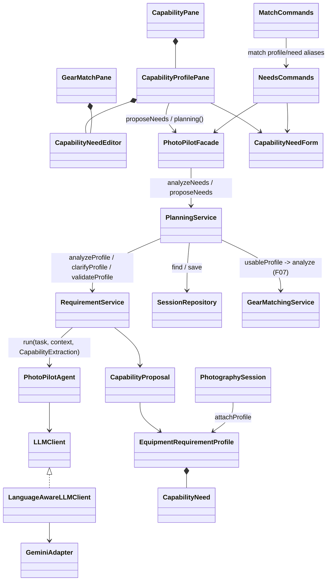
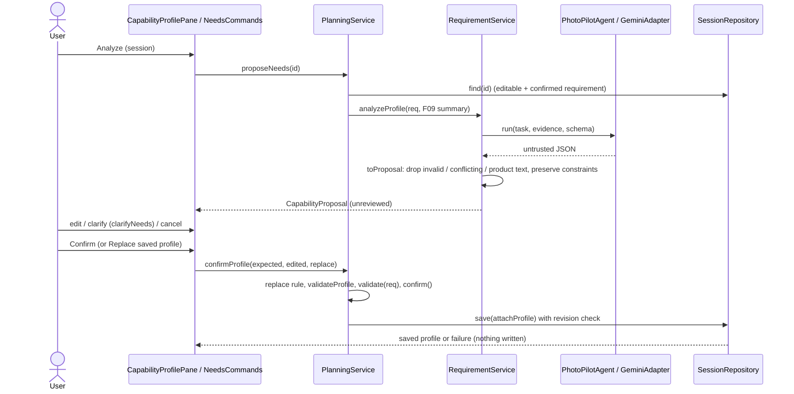
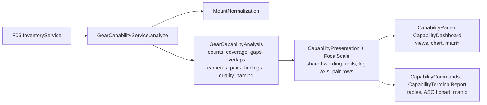

# F06 AI photography equipment capability requirement analysis

F06 / UC06 / SD02 answers: *what equipment capabilities does this photography session require?* It derives capability needs (never products) from a session's confirmed F03 requirement with Gemini, validates them deterministically, lets the user review/edit/clarify them, requires explicit confirmation, saves the confirmed `EquipmentRequirementProfile` to the session, and hands it to F07. The F06 page is **Gear Requirements** (sidebar Active session, step 02). It also keeps the separately requested deterministic **inventory capability report** (bottom of this document), which the sidebar entry **Equipment management > Gear Capability Report** shows on its own ([session workflow](session-workflow.md)).

Status (2026-11-03): **implemented and verified** with offline Gemini fakes through GUI and CLI. Live Gemini verification: see [verification](#verification-2026-11-03-windows--jdk-21).

## What was incomplete before this change

| Problem | Root cause |
| --- | --- |
| `PlanningService.analyzeNeeds`, `PhotoPilotFacade.analyzeNeeds` and `RequirementService.deriveProfile` returned `error.notImplemented` | UC06 had been reserved; only a manual path was added for F07 |
| No Gemini prompt, response schema or conversion for capability needs | Never designed beyond the Stage 1 signature |
| F06 page only showed the inventory report; the only profile editor lived inside F07 (GUI and CLI), labelled "not AI-generated; F06 not available" | Minimal F07 dependency path, duplicated editor code in `GearMatchPane` / `MatchCommands` |
| A saved profile was silently overwritten by any later confirmation | `confirmProfile` had no replacement rule |
| F07 used any reviewed profile, even after F03 was re-confirmed with contradicting values | Consistency was checked only at confirmation time |
| No cross-need contradiction rules (lens count vs bodies, lens-change restriction) | Validation only covered camera count and weight |
| No provenance or trade-off explanation stored with the profile | Profile model held only needs + reviewed flag |
| Catalog/status, `verifyNavigation` smoke check and docs reported F06 as in progress | Consequence of the above |

## Workflow

1. **Open session** (GUI session selector, which follows the window's current session / `needs show <id>`): editable (Draft/Planned) sessions only; the confirmed F03 requirement and any saved profile are shown. A saved profile that no longer matches the current requirement is flagged "Not usable for matching".
2. **Analyze** (`Facade.proposeNeeds` → `PlanningService.proposeNeeds`; Stage 1 `analyzeNeeds(id)` returns just the draft). Requires a confirmed requirement (`needs.error.requirement`, nothing sent otherwise).
3. **Evidence sent to Gemini** (`RequirementService.analyzeProfile`): confirmed requirement fields (original request, subject, goals, date, time window, duration, camera count, lens-change flag, weight limit, portability, gear constraints, priorities, fixed constraints), `supportedCapabilities` (name, unit, accepted bounds, limit) and — only if an F09 assessment was made for the session in this run — accepted shooting windows, light phases and fresh weather values. No place label, coordinates, session/inventory identifiers or owned gear. `responseJsonSchema` = `CapabilityExtraction.SCHEMA` (capability enum = the 12 deterministically checkable capabilities).
4. **Deterministic conversion** (`RequirementService.toProposal`): unsupported or malformed needs, missing priority/mandatory, invalid bounds/values (`CapabilityNeed.problems`) are dropped with their reasons; a capability proposed twice with different values is dropped as contradictory (never guessed); rationale/trade-off/question text naming a brand or product line is removed (`CapabilityExtraction.namesProduct`, token-exact). Confirmed constraints then override the proposal: camera count → `cameraCount` min = max = n; weight limit → `totalWeight` max ≤ limit (mandatory); lens changes avoided + n bodies → `lensCount` max = n. Every change is listed as an adjustment. If no AI need survives, the result is a failure (`needs.ai.noUsable`), never an empty "successful" analysis.
5. **Review** (GUI review card / CLI draft): source line (proposed by Gemini vs entered manually), needs with priority (1 = most important … 10) and mandatory/preferred, trade-offs, needs F07 cannot check, adjustments, unspecified sizing inputs (duration, camera count, lens changes), Gemini's questions and live validation against the confirmed requirement.
6. **Edit / clarify**: the shared `CapabilityNeedEditor` (GUI) / `needs set|remove` (CLI) parse through `CapabilityNeedForm`; `needs clarify` / **Send answers to Gemini** resubmit the current edited draft plus answers (`PlanningService.clarifyNeeds`); constraints are re-applied afterwards. Failures keep the open draft unchanged.
7. **Confirm** (`PlanningService.confirmProfile(expected, edited, replace)`): editable session, confirmed requirement, explicit replacement of an existing confirmed profile (`needs.error.replaceRequired` otherwise), structural rules (`RequirementService.validateProfile`), consistency (`EquipmentRequirementProfile.validate(req)`), `confirm()`, `PhotographySession.attachProfile`, atomic `SessionRepository.save` with the revision check. Success is reported only after the save.
8. **Retrieve after restart**: `PlanningService.profile(id)` (reviewed only); GUI/CLI show it with provenance and trade-offs.
9. **F07**: `matchGear` and `selectLoadout` use `PlanningService.usableProfile(session)`: reviewed **and** still consistent with the current confirmed requirement; otherwise `needs.error.stale` plus the specific findings.
10. **Session progress**: milestone 02 is completed while the saved profile passes `usableProfile`; when a changed requirement no longer fits it, the milestone shows *Needs review*. Without a confirmed requirement it is blocked ([session workflow](session-workflow.md#milestone-completion-criteria)).

Cancel discards the draft and writes nothing. Manual entry (`Enter capability needs` / `needs manual <id>`) never calls Gemini and is labelled "entered manually".

## Validation rules (domain, deterministic)

- `CapabilityNeed`: supported capability, fixed unit, only accepted bounds, at least one bound where bounds apply, 0 < value ≤ limit, whole numbers for counts, priority 1–10, note ≤ 500.
- `EquipmentRequirementProfile.problems()`: 1–20 needs, no duplicate capability, `lensCount` max ≥ `cameraCount` min (`needs.error.lensesForBodies`), known origin, ≤ 8 trade-offs of ≤ 400 chars.
- `validate(req)`: confirmed requirement; camera bounds contain the confirmed count; weight max ≤ confirmed limit; lens changes avoided ⇒ `lensCount` min ≤ bodies (`needs.error.lensChangeConflict`).
- Priority meaning is shared with F07: 1 = most important; F07 weights unmet needs by `MAX_PRIORITY + 1 - priority`; `mandatory` = hard constraint (F07 `mandatoryUnmet`, F10 `plan.violation.need`).

## Architecture and files

| Source | Change |
| --- | --- |
| `model/EquipmentRequirementProfile.java` | `origin` (MANUAL / AI_ASSISTED), `tradeOffs`, cross-need and lens-change rules, `withNeeds`, provenance kept by `confirm/asDraft` |
| `service/CapabilityExtraction.java` (new) | Gemini DTO + schema, draft evidence, product-name check |
| `service/CapabilityProposal.java` (new) | Review package: draft, questions, unsupported needs, adjustments, missing fields, environment flag |
| `service/RequirementService.java` | `deriveProfile`, `analyzeProfile`, `clarifyProfile`, `toProposal`, constraint preservation, `capabilityGaps` |
| `service/PlanningService.java` | `analyzeNeeds`, `proposeNeeds`, `clarifyNeeds`, `manualNeeds`, F09 summary, `confirmProfile(..., replace)`, `usableProfile` used by F07 match/select |
| `application/PhotoPilotFacade.java` | `proposeNeeds` beside Stage 1 `analyzeNeeds` |
| `application/CapabilityNeedForm.java` | provenance-preserving `put/remove`, shared `profile/review/questions` formatting |
| `repository/SessionDomainAdapters.java`, `SessionJson.java` | read new fields; earlier v1 profiles load as MANUAL with no trade-offs (no rewrite) |
| `ui/gui/CapabilityProfilePane.java` (new), `CapabilityNeedEditor.java` (new), `CapabilityPane.java`, `GearMatchPane.java`, `GuiProfileController.java`, `PhotoPilotWorkspace.java` | F06 workflow on the F06 page; one shared editor; dirty tracking; navigation smoke check |
| `ui/cli/NeedsCommands.java` (new), `MatchCommands.java`, `PhotoPilotCLI.java` | `needs` commands; `match profile/need` aliases share the same state and save path; `F06` shows both parts |
| `config/FeatureCatalog.java`, `resources/i18n/messages*.properties` | F06 implemented; 50 new and 9 revised keys in English and Simplified Chinese |

**Patterns:** Facade (shared GUI/CLI entry), Adapter (`GeminiAdapter` / `LanguageAwareLLMClient` behind `LLMClient`), Repository (atomic session save with revision check), and the existing domain validation gates. `CapabilityNeedEditor` is a reused composite view. No new pattern machinery was introduced.

## Stage 1 deviations (for the Stage 2 report)

- `analyzeNeeds(id)` and `deriveProfile(req)` keep their Stage 1 signatures; GUI/CLI use `proposeNeeds` / `analyzeProfile`, which return the same draft plus review context (questions, adjustments, unsupported needs). `clarifyNeeds` and `manualNeeds` are additional operations for UC06's review and Gemini-unavailable alternative flows.
- `confirmProfile` gained an explicit `replace` flag (two-argument form never replaces); `attachProfile` returns a `Result` copy (as already recorded for F07).
- `EquipmentRequirementProfile` gained `origin` and `tradeOffs` (optional v1 additions, migrated on read). Capabilities are restricted to the 12 kinds F07 can check deterministically; other relevant needs are shown as "not checked automatically" and not saved.
- F09 evidence is the process-local assessment (F09 is not persisted). *(2026-11-23: an assessment added to the session is recorded as a minimal `EnvironmentCheck` for session progress only; F06 still uses the in-process assessment.)*
- F07 now refuses profiles that contradict the current requirement (`usableProfile`).

## Inventory capability report (separate extension)

Read-only, deterministic, inventory-based; it never changes the shoot capability profile, sessions, selections, milestones or plans and makes no AI or network request. Shown below the UC06 workflow on Gear Requirements and on its own by **Equipment management > Gear Capability Report** (`CapabilityPane.reportOnly`).

### Dashboard redesign (2026-11-23)

Before: five long plain-text sections (one `Label` each) in the 1180 px reading column; the analytical summary came last; every camera field and every camera–lens pair was printed in full; `E` and `Sony E` counted as different mounts; prime-only gaps and incomplete records had to be found by reading.

| Layer | Source | Responsibility |
| --- | --- | --- |
| Model | `model/GearCapabilityAnalysis.java`, `model/MountSystem.java` (new) | Structured result: record vs unit counts, continuous / isolated components, `gapsBetween`, `LensCapability` and `CameraCapability` (crop factor, sensor format band, mount-matched physical and equivalent coverage), `CameraLensPair` with `MountComparison` (`Relation` → `PairStatus`), `Finding`s, per-item `ItemQuality` issues, `MountNaming`. `mountStatus()` keeps the earlier three-value status. |
| Service | `service/GearCapabilityService.java`, `service/MountNormalization.java` (new) | The only analysis: one inventory read, findings, data quality (MISSING / INVALID / INCONSISTENT / OPTIONAL), equivalents via `PhotoFormulas.cropFactor`/`fullFrameEquivalentFocal`. |
| Shared presentation | `application/CapabilityPresentation.java`, `application/FocalScale.java` (new) | Localized findings, units (33 MP, 10 fps, f/4.5–6.3, 35.9 × 23.9 mm, equivalents to 0.1 mm), Yes/No/Unknown, `pairDetails` rows, assumptions, the complete technical text; the logarithmic axis and its ticks. |
| GUI | `ui/gui/CapabilityPane.java`, `CapabilityDashboard.java`, `CapabilityGearViews.java`, `CapabilityMatrixView.java`, `FocalCoverageChart.java`, `CardGrid.java` (new except the pane) | Header (refresh, copy, last analysis / stale), six page-level views built on first use, empty / loading / stale / failure states. |
| CLI | `ui/cli/CapabilityCommands.java`, `CapabilityTerminalReport.java`, `TextTable.java` (new except the commands) | Same analysis in terminal form. |

**GUI views** (tabs belong to the page; no new sidebar entries): **Overview** — six metric cards (units with record counts, focal span, widest aperture, gaps), key findings with level marks, combined coverage strip, mount status counts. **Camera Bodies** — selectable cards (resolution and burst prominent; unknown values in muted text), sortable comparison table (numbers sort numerically, unknown last), full recorded details. **Lenses** — interactive interval chart (zoom bars, prime diamonds, combined row with dashed gaps and overlap band, log-scale grid), Physical / 35 mm equivalent switch with camera choice, type / aperture / camera filters (camera filter dims lenses whose mount is not established, never hides them), sortable table with short / long focal columns, lens details, aperture comparison bars (stops above f/16). **Compatibility** — lens × camera matrix of selectable cells (symbol + words + colour), camera / lens-mount / status / name filters, detail panel of the selected cell only (the shared `pairDetails` rows). **Data Quality** — items needing attention grouped by item with category chips and **Edit equipment details** (opens Gear Inventory's own editor via `InventoryPane.edit`; an open unsaved edit is never replaced), mount-naming card, optional-only items and the completeness definition in closed disclosures. **Technical Details** — assumptions and the complete plain-text report with identifiers, Copy report. The report page alone lifts `FeaturePane`'s reading width (1180 → 1760 px); other pages are unchanged.

**Colours** are local looked-up colours of `.capability-dashboard` derived with `ladder(-pp-text, …)`, so the same rules give dark tones in Light mode and light tones in Dark mode: green = mount labels established (mount only), amber = not established / unknown, red = different known mount systems, grey = outside the status filter. Every status also has a symbol and words.

**Mount normalization** (report only; F07 `CompatibilityValidator` keeps exact labels, verified by `MountNormalizationTest`): placeholders are UNKNOWN; equal text after case/space normalization is SAME_LABEL; differences only in hyphens or a trailing "mount" are EQUIVALENT_LABELS; labels that both establish a `MountSystem` (owner-qualified "Sony E", self-describing "Micro Four Thirds", or a bare designation on equipment of the owning brand) are EQUIVALENT_LABELS or DIFFERENT_SYSTEMS; a known system against its bare designation without context (Tamron lens "E" vs "Sony E") is POSSIBLE_ALIAS (not established); everything else DIFFERENT_LABELS. EF-S / RF-S / Sony A are deliberately absent. Stored labels are never rewritten; the Data Quality view flags inconsistent naming because Gear Selection compares labels exactly.

**CLI** (`capability` subcommands; earlier names kept): no option or `summary` → summary table, `[INFO]`/`[WARN]` findings, section commands; `overview` (all equipment tables), `cameras`, `lenses` (+ aperture analysis), `coverage [camera #]` (ASCII chart on the shared `FocalScale`, interval lists, conditional equivalents on that body), `aperture`, `compatibility` = `matrix [camera #]` (C1…Cn columns, column blocks for narrow terminals), `pair <lens #> <camera #>` (the GUI detail rows), `quality` (with `gear edit <id> field=...` review commands), `all` = `technical` (complete report with identifiers), `help`. `F06` prints the needs help and the summary. Plain ASCII marks, widths from `COLUMNS` (default 80), CJK counted as two columns, long names wrapped never truncated, a stacked layout when columns cannot fit, the chart replaced by interval lists below 30 plot columns.

### Verification (2026-11-23)

Isolated scratch copy, JDK 21, offline: full `mvnw.cmd -B -o package` **772 run, 0 failures, 0 errors, 6 skipped**, JAR built; `javafx:run -Djavafx.args=--smoke-test` → `GUI_SMOKE_OK` ([feature status](../../docs/FEATURE_STATUS.md)). Focused: `CapabilityAnalysisTest` 9, `MountNormalizationTest` 4, `CapabilityReadOnlyTest` 1, `CapabilityCliTest` 2, `CapabilityTerminalReportTest` 4, `CapabilityGuiTest` 2 (real JavaFX: states, metrics, findings parity, all views, chart geometry and filters, matrix cells and detail rows, edit navigation, copy, wide / Chinese 880 × 600 / dark mode), plus the unchanged `GearCapabilityTest` 13 and `UnknownSpecificationTest` 7. Snapshots inspected: `target/capability-*.png`.

Not verified: macOS/Linux rendering, other display scales, screen readers, a hands-on session with the user's own inventory.

## Verification (2026-11-03, Windows / JDK 21)

All runs from `Stage2` with the project's `.tools/jdk21` and `.mvn` cache, offline (`-o`).

- Baseline before the change, `./mvnw.cmd -B -o test`: 352 run, 0 failures/errors, 2 skipped (opt-in live tests).
- Focused `-Dtest=F06WorkflowTest,NeedsCliTest,CapabilityProfileGuiTest,CapabilityGuiTest,CapabilityCliTest,GearMatchGuiTest,MatchCliTest,F07WorkflowTest,FeaturePresentationTest,TranslationResourcesTest,PersistenceReadinessTest`: 33/33 passed.
- First full run after the change: 4 errors, all from `PhotoPilotWorkspace.verifyNavigation` still expecting F06 "In Progress" (InventoryGuiTest, GearImportGuiTest, LocalizationGuiTest, StorageNoticeGuiTest). Fixed.
- Final `./mvnw.cmd -B -o package`: **365 run, 0 failures, 0 errors, 3 skipped** (the opt-in live F06, F10 and F11 tests); JAR built. `./mvnw.cmd -B -o javafx:run -Djavafx.args=--smoke-test`: `GUI_SMOKE_OK` (all 11 features, minimum-size layout).
- Live Gemini (`PHOTOPILOT_LIVE_GEMINI=1`, `-Dtest=LiveGeminiCapabilitySmokeTest`, isolated temp data, local key never printed): 1/1 passed. Real F03 parse of the acceptance request (2 bodies, avoid lens changes, 3 h, around sunset) → F06 proposal of 8 capability-only needs (focal length 300–600 mm mandatory, f/5.6 or brighter, autofocus, ≥ 10 fps, stabilization, exactly 2 bodies, ≤ 2 lenses, ≥ 4 batteries), two trade-offs (reach vs. portability; two bodies vs. weight), "weather sealing" / "high ISO" as not automatically checked, two questions (subject distance, hand-held vs. tripod); no adjustments were needed; confirmed and saved (AI_ASSISTED); F07 returned 21 verified recommendations with AI ranking. Transcript: `target/f06-live-smoke.txt` (ignored build output).
- New tests: `F06WorkflowTest` (9: acceptance → restart → F07 select; untrusted output/product names/constraint preservation/invalid values/conflicting duplicates; provider failure, malformed and empty output with manual fallback; missing requirement and unspecified fields; contradictions; clarification with manual edits; explicit replacement and stale save; requirement change keeps the profile out of F07; legacy profiles; F09 context without location), `NeedsCliTest` (2: full CLI workflow, restart, replace/cancel, F07 aliases, Chinese; GUI/CLI share the service result), `CapabilityProfileGuiTest` (1: real JavaFX controls for failure, analysis, edit, invalid input, live contradiction, clarify, cancel, confirm, replace, edit-saved, restart, Chinese at 880 × 600 without clipping), `LiveGeminiCapabilitySmokeTest` (opt-in).
- Inspected `target/f06-profile-start.png`, `f06-profile-review.png`, `f06-profile-review-zh-narrow.png`: existing surfaces, cards, buttons, spacing and typography; no horizontal clipping.

Not verified: a live Gemini run driven through GUI clicks (live evidence is service-level through the Facade), macOS/Linux rendering, other display scales, submission video.
