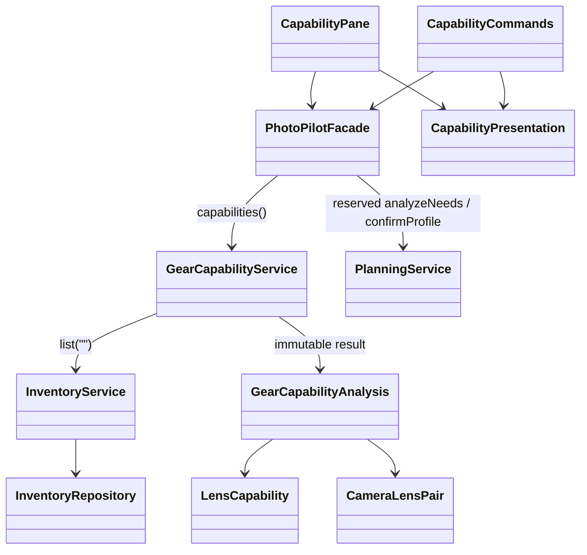
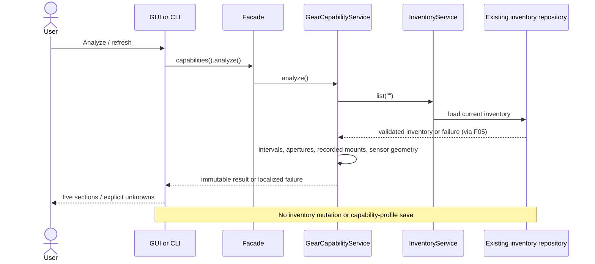

# F06 inventory capability analysis extension

## Scope and original design

Stage1/Stage1PPP.pdf pp. 4–5 and 25, UC06 and SD02 define **shoot capability requirement derivation**, followed by review, confirmation, validation against current requirements and atomic session save. They do not define an inventory coverage report. The user explicitly requested preserving Stage 1 and reserving its interfaces after this difference was identified.

Original design → a separate deterministic inventory capability report accessible from F06 → fulfills the requested inventory analysis without replacing the original hybrid workflow → `PhotoPilotFacade.analyzeNeeds`, `PlanningService.analyzeNeeds/confirmProfile`, `RequirementService.deriveProfile`, and capability profile models remain reserved and unavailable. No F03, F07, F10, Gemini or agent implementation is claimed. Overall F06 stays **IN PROGRESS**; the inventory extension is independently usable. Stage1 artifacts remain unchanged.

## Architecture and files

| Source | Responsibility |
| --- | --- |
| `model/GearCapabilityAnalysis.java` | Immutable report, intervals, lens observations, mount comparison and conditional equivalent focal values |
| `service/GearCapabilityService.java` | `analyze()` reads fresh F05 inventory; `analyzeItems()` validates and performs all calculations |
| `application/PhotoPilotFacade.java` | Context-bound `capabilities()` service uses the existing InventoryService |
| `application/CapabilityPresentation.java` | Shared bilingual formatting of five report sections, without analysis algorithms |
| `model/Lens.java`, `EquipmentType.java`, `EquipmentData.java` | Optional longest-focal-end aperture, unchanged old constructor and schema-v1 loading |
| `ui/gui/CapabilityPane.java` | Existing feature layout, shared CSS classes, background Task, refresh, five report cards and live localization |
| `ui/gui/FeaturePane.java`, `PhotoPilotWorkspace.java`, `GuiProfileController.java` | Route, lifecycle, context switching and navigation verification |
| `ui/cli/CapabilityCommands.java`, `PhotoPilotCLI.java` | CLI report sections and F06 alias, shared Facade/service/formatting |
| `config/FeatureCatalog.java` | Honest partial F06 status |
| `resources/i18n/messages*.properties` | English and Simplified Chinese captions, report statements and validation |
| `test/.../capability/*`, `test/.../ui/gui/CapabilityGuiTest.java` | Deterministic service/storage/CLI/GUI acceptance tests |
| `BootstrapTest`, `FeaturePresentationTest` | Updated availability expectations |

Facade is the exercised Stage 1 pattern. The existing Repository boundary supplies data; immutable result values and a dedicated service separate analysis from presentation. No artificial Strategy/Adapter/Command/State implementation is added. Existing patterns and F08 calculators are retained unchanged.

## Calculation rules

- Actual focal ranges are closed intervals. Primes have identical endpoints. Sort by lower/upper endpoint, merge when the next lower endpoint is at most the current upper endpoint. No tolerance fills small real gaps. Overall extrema do not imply uninterrupted coverage.
- Gaps are the **open** intervals between merged components. There are no invented gaps outside the recorded extrema. A closed-endpoint sweep counts starts before evaluating the endpoint and ends afterward, keeping prime points and shared zoom endpoints exact. Sweep regions with at least two distinct inventory records yield overlap intervals/points. Complexity is O(n log n), excluding camera/lens pair output. Quantities count physical units but do not duplicate focal contributions.
- No crop factor is inferred from a model name or generic sensor label. For a camera with both finite positive sensor dimensions and matching recorded mount labels, conditional full-frame diagonal-FOV equivalent is `focal * hypot(36,24) / hypot(width,height)`. Results explicitly assume full sensor coverage and do not establish compatibility. Missing/overflowing geometry yields unknown. Actual focal length and aperture never change. Equivalent display uses eight significant digits; recorded focal intervals are not rounded to fabricate adjacency.
- Lens `maxAperture` retains its original meaning when the new optional `maxApertureAtMaxFocal` is absent. Legacy zooms report a recorded value and unknown constant/variable behavior. With an endpoint supplied, the first value describes the short end; an equal endpoint explicitly declares constant aperture in the F05 field caption. Different endpoints describe only endpoints; intermediate values are unknown. Primes cannot have contradictory endpoint values. Largest recorded aperture is the smallest recorded f-number; this is not a transmission/image-quality/equal-focal performance score.
- Mount strings are stripped and compared case-insensitively. Matching labels are reported as matching **records**, not certified usable combinations. Differing labels mean direct compatibility is unestablished, not a fabricated adapter recommendation. Empty/unknown markers produce unknown. Lens image-circle, reliable mount alias rules, adapter capabilities and electronic constraints are absent from F05, so full compatibility remains explicitly unknown. No external database was added.
- Malformed persisted inventories produce the existing F05 failure and are never reset, overwritten or silently analyzed as empty. Invalid direct analysis inputs fail validation; absent optional values remain unknown. Reports preserve inventory IDs, categories and physical quantities. These are user-entered specifications, not newly verified manufacturer facts.

## F05, F01 and F08 boundaries

The existing F05 metadata-driven forms and CLI accept the new optional aperture endpoint; the original Lens constructor delegates with an empty Optional. `EquipmentData` reads and writes the existing `specs` map. No new file, database, dependency, schema version or migration is introduced. Old files remain readable; older binaries will reject the new spec safely rather than discard it. GearSnapshot includes it through the existing specification map. Changes to a field retain F05 evidence-invalidation rules.

F01 has no standalone equipment selection: selected gear belongs to F07/F10 plans and historical snapshots. No new selector or mutation of saved plans is added. An inventory report does not require a session. F08 exposure, ND, DOF, hyperfocal and field-of-view calculator behavior is not duplicated or changed; conditional diagonal equivalence is an F06 observation absent from the existing F08 API.

## Usage

- GUI: Equipment → Capability Analysis. Opening it loads current inventory. **Analyze current inventory** refreshes after edits; leaving/reopening also reloads. Failures clear prior results. User switching rebuilds scoped services/panes; generation checks reject stale completions and listeners are disposed.
- CLI: `F06`, `capability all`, `capability overview`, `capability coverage`, `capability aperture`, `capability compatibility`, `capability summary`, `capability help`. Invalid arguments return status 2. Each command reloads F05. Existing `--lang` and profile selection apply.
- For a variable-aperture lens, use the ordinary F05 form or `gear` command with `maxAperture` and optional `maxApertureAtMaxFocal`. Leave the endpoint blank when unknown. Do not infer constant aperture for an old zoom record.

## Verification and limitations

Verification results are recorded after execution below. Test fixtures use actual persisted F05 entries in isolated temporary profiles. No sample data is injected into production inventories. The local user's profile directories contained no inventory.json files at inspection, so nonempty private-inventory acceptance could not be performed.

No live AI, original UC06 completion, manufacturer compatibility certification, other OS/DPI, native file-picker run or submission video is claimed. The existing structural audit flags a pre-existing `return null` in the GUI's `Task<Void>` startup helper, already present before this task; this does not originate in F06. The untouched Stage1 hashes are checked separately before commit.

### Executed checks (2026-11-02, Windows / JDK 21)

- Baseline `./mvnw.cmd -B -o test`: 175/175 passed.
- Focused `-Dtest=GearCapabilityTest,CapabilityCliTest,CapabilityGuiTest,TranslationResourcesTest,FeaturePresentationTest,BootstrapTest`: 23/23 passed.
- Final `./mvnw.cmd -B -o test package javafx:run '-Djavafx.args=--smoke-test'`: 190/190 passed, zero failures/errors/skips, JAR and GUI_SMOKE_OK. Existing `.tools/jdk21` and `.mvn` cache, no dependency download.
- 15 added tests cover overlapping/adjacent/disconnected/prime/nested intervals, empty/camera-only/lens-only inventory, constant/variable/legacy aperture, mounts, actual sensor equivalence, invalid/missing specs, duplicate IDs, F05 CRUD/restart, old schema/corrupt files, CLI sections/errors/Chinese, and actual GUI refresh/navigation/errors/localization/minimum width. F01/F05/F08/storage/profile regressions pass.
- Inspected generated `target/f06-wide.png`, `f06-wide-results.png`, `f06-zh-narrow.png`, `f06-zh-narrow-results.png`; existing styling, wrapped text and no horizontal clipping. Images/logs remain ignored.
- Initial failures (resolved): sandbox JavaFX cache access, an exact floating-point equality assertion, and old scaffold-only navigation expectations. The separate source audit retains the unrelated pre-existing Task<Void> null-return finding.

- Packaged CLI acceptance: separate JVMs used F05 commands to save a camera and variable-aperture lens, analyze 20–70 mm actual / 30–105 mm conditional equivalent, edit to 20–200 mm, delete and reanalyze, and reject an invalid command with exit code 2. `PACKAGED_CLI_ACCEPTANCE_OK`; isolated `target/f06-cli-acceptance` data only.
- Commit isolation: existing uncommitted UI changes were preserved outside the F06 commit. An independent committed-baseline + F06 source tree passed **187/187** tests, JAR and GUI_SMOKE_OK; the current working tree passed **190/190** because its pre-existing UI work contains three additional tests. No nested repository was created. Stage1 file bytes match the pre-task baseline; all F06 source/docs passed the credential-pattern scan and whitespace check. The isolated tree's source audit additionally cannot resolve external coursework paths from its temporary location; no source-audit success is claimed.
