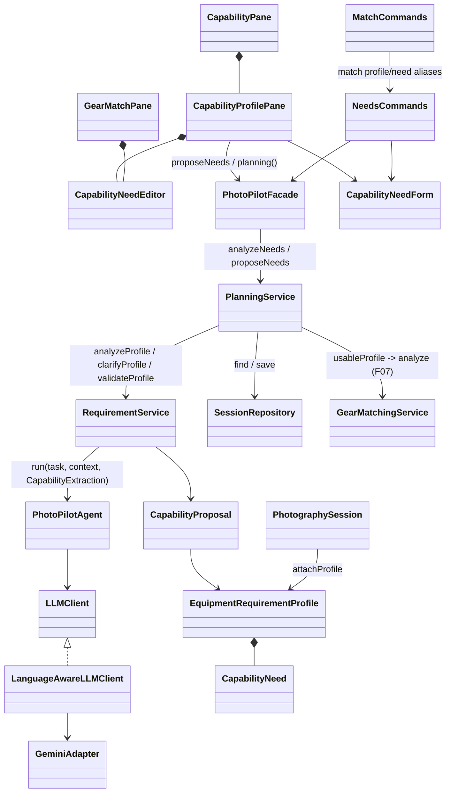
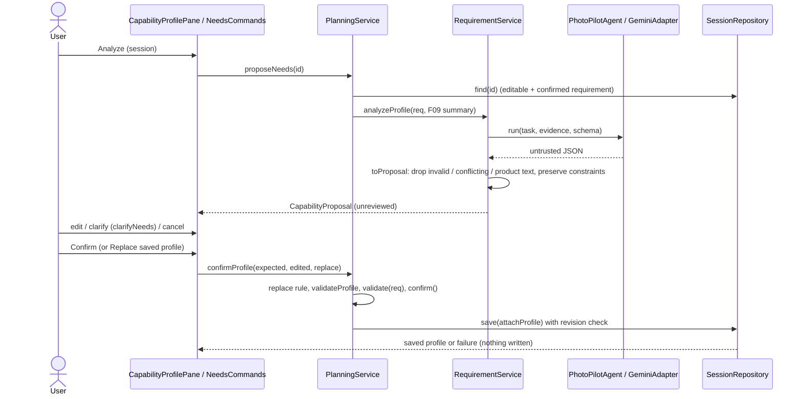

# F06 AI photography equipment capability requirement analysis

F06 / UC06 / SD02 answers: *what equipment capabilities does this photography session require?* It derives capability needs (never products) from a session's confirmed F03 requirement with Gemini, validates them deterministically, lets the user review/edit/clarify them, requires explicit confirmation, saves the confirmed `EquipmentRequirementProfile` to the session, and hands it to F07. The F06 page also keeps the separately requested deterministic **inventory capability report** (bottom of this document).

Status (2026-11-03): **implemented and verified** with offline Gemini fakes through GUI and CLI. Live Gemini verification: see [verification](#verification-2026-11-03-windows--jdk-21).

## What was incomplete before this change

| Problem | Root cause |
| --- | --- |
| `PlanningService.analyzeNeeds`, `PhotoPilotFacade.analyzeNeeds` and `RequirementService.deriveProfile` returned `error.notImplemented` | UC06 had been reserved; only a manual path was added for F07 |
| No Gemini prompt, response schema or conversion for capability needs | Never designed beyond the Stage 1 signature |
| F06 page only showed the inventory report; the only profile editor lived inside F07 (GUI and CLI), labelled "not AI-generated; F06 not available" | Minimal F07 dependency path, duplicated editor code in `GearMatchPane` / `MatchCommands` |
| A saved profile was silently overwritten by any later confirmation | `confirmProfile` had no replacement rule |
| F07 used any reviewed profile, even after F03 was re-confirmed with contradicting values | Consistency was checked only at confirmation time |
| No cross-need contradiction rules (lens count vs bodies, lens-change restriction) | Validation only covered camera count and weight |
| No provenance or trade-off explanation stored with the profile | Profile model held only needs + reviewed flag |
| Catalog/status, `verifyNavigation` smoke check and docs reported F06 as in progress | Consequence of the above |

## Workflow

1. **Open session** (GUI session selector / `needs show <id>`): editable (Draft/Planned) sessions only; the confirmed F03 requirement and any saved profile are shown. A saved profile that no longer matches the current requirement is flagged "Not usable for matching".
2. **Analyze** (`Facade.proposeNeeds` → `PlanningService.proposeNeeds`; Stage 1 `analyzeNeeds(id)` returns just the draft). Requires a confirmed requirement (`needs.error.requirement`, nothing sent otherwise).
3. **Evidence sent to Gemini** (`RequirementService.analyzeProfile`): confirmed requirement fields (original request, subject, goals, date, time window, duration, camera count, lens-change flag, weight limit, portability, gear constraints, priorities, fixed constraints), `supportedCapabilities` (name, unit, accepted bounds, limit) and — only if an F09 assessment was made for the session in this run — accepted shooting windows, light phases and fresh weather values. No place label, coordinates, session/inventory identifiers or owned gear. `responseJsonSchema` = `CapabilityExtraction.SCHEMA` (capability enum = the 12 deterministically checkable capabilities).
4. **Deterministic conversion** (`RequirementService.toProposal`): unsupported or malformed needs, missing priority/mandatory, invalid bounds/values (`CapabilityNeed.problems`) are dropped with their reasons; a capability proposed twice with different values is dropped as contradictory (never guessed); rationale/trade-off/question text naming a brand or product line is removed (`CapabilityExtraction.namesProduct`, token-exact). Confirmed constraints then override the proposal: camera count → `cameraCount` min = max = n; weight limit → `totalWeight` max ≤ limit (mandatory); lens changes avoided + n bodies → `lensCount` max = n. Every change is listed as an adjustment. If no AI need survives, the result is a failure (`needs.ai.noUsable`), never an empty "successful" analysis.
5. **Review** (GUI review card / CLI draft): source line (proposed by Gemini vs entered manually), needs with priority (1 = most important … 10) and mandatory/preferred, trade-offs, needs F07 cannot check, adjustments, unspecified sizing inputs (duration, camera count, lens changes), Gemini's questions and live validation against the confirmed requirement.
6. **Edit / clarify**: the shared `CapabilityNeedEditor` (GUI) / `needs set|remove` (CLI) parse through `CapabilityNeedForm`; `needs clarify` / **Send answers to Gemini** resubmit the current edited draft plus answers (`PlanningService.clarifyNeeds`); constraints are re-applied afterwards. Failures keep the open draft unchanged.
7. **Confirm** (`PlanningService.confirmProfile(expected, edited, replace)`): editable session, confirmed requirement, explicit replacement of an existing confirmed profile (`needs.error.replaceRequired` otherwise), structural rules (`RequirementService.validateProfile`), consistency (`EquipmentRequirementProfile.validate(req)`), `confirm()`, `PhotographySession.attachProfile`, atomic `SessionRepository.save` with the revision check. Success is reported only after the save.
8. **Retrieve after restart**: `PlanningService.profile(id)` (reviewed only); GUI/CLI show it with provenance and trade-offs.
9. **F07**: `matchGear` and `selectLoadout` use `PlanningService.usableProfile(session)`: reviewed **and** still consistent with the current confirmed requirement; otherwise `needs.error.stale` plus the specific findings.

Cancel discards the draft and writes nothing. Manual entry (`Enter capability needs` / `needs manual <id>`) never calls Gemini and is labelled "entered manually".

## Validation rules (domain, deterministic)

- `CapabilityNeed`: supported capability, fixed unit, only accepted bounds, at least one bound where bounds apply, 0 < value ≤ limit, whole numbers for counts, priority 1–10, note ≤ 500.
- `EquipmentRequirementProfile.problems()`: 1–20 needs, no duplicate capability, `lensCount` max ≥ `cameraCount` min (`needs.error.lensesForBodies`), known origin, ≤ 8 trade-offs of ≤ 400 chars.
- `validate(req)`: confirmed requirement; camera bounds contain the confirmed count; weight max ≤ confirmed limit; lens changes avoided ⇒ `lensCount` min ≤ bodies (`needs.error.lensChangeConflict`).
- Priority meaning is shared with F07: 1 = most important; F07 weights unmet needs by `MAX_PRIORITY + 1 - priority`; `mandatory` = hard constraint (F07 `mandatoryUnmet`, F10 `plan.violation.need`).

## Architecture and files

| Source | Change |
| --- | --- |
| `model/EquipmentRequirementProfile.java` | `origin` (MANUAL / AI_ASSISTED), `tradeOffs`, cross-need and lens-change rules, `withNeeds`, provenance kept by `confirm/asDraft` |
| `service/CapabilityExtraction.java` (new) | Gemini DTO + schema, draft evidence, product-name check |
| `service/CapabilityProposal.java` (new) | Review package: draft, questions, unsupported needs, adjustments, missing fields, environment flag |
| `service/RequirementService.java` | `deriveProfile`, `analyzeProfile`, `clarifyProfile`, `toProposal`, constraint preservation, `capabilityGaps` |
| `service/PlanningService.java` | `analyzeNeeds`, `proposeNeeds`, `clarifyNeeds`, `manualNeeds`, F09 summary, `confirmProfile(..., replace)`, `usableProfile` used by F07 match/select |
| `application/PhotoPilotFacade.java` | `proposeNeeds` beside Stage 1 `analyzeNeeds` |
| `application/CapabilityNeedForm.java` | provenance-preserving `put/remove`, shared `profile/review/questions` formatting |
| `repository/SessionDomainAdapters.java`, `SessionJson.java` | read new fields; earlier v1 profiles load as MANUAL with no trade-offs (no rewrite) |
| `ui/gui/CapabilityProfilePane.java` (new), `CapabilityNeedEditor.java` (new), `CapabilityPane.java`, `GearMatchPane.java`, `GuiProfileController.java`, `PhotoPilotWorkspace.java` | F06 workflow on the F06 page; one shared editor; dirty tracking; navigation smoke check |
| `ui/cli/NeedsCommands.java` (new), `MatchCommands.java`, `PhotoPilotCLI.java` | `needs` commands; `match profile/need` aliases share the same state and save path; `F06` shows both parts |
| `config/FeatureCatalog.java`, `resources/i18n/messages*.properties` | F06 implemented; 50 new and 9 revised keys in English and Simplified Chinese |

**Patterns:** Facade (shared GUI/CLI entry), Adapter (`GeminiAdapter` / `LanguageAwareLLMClient` behind `LLMClient`), Repository (atomic session save with revision check), and the existing domain validation gates. `CapabilityNeedEditor` is a reused composite view. No new pattern machinery was introduced.

## Stage 1 deviations (for the Stage 2 report)

- `analyzeNeeds(id)` and `deriveProfile(req)` keep their Stage 1 signatures; GUI/CLI use `proposeNeeds` / `analyzeProfile`, which return the same draft plus review context (questions, adjustments, unsupported needs). `clarifyNeeds` and `manualNeeds` are additional operations for UC06's review and Gemini-unavailable alternative flows.
- `confirmProfile` gained an explicit `replace` flag (two-argument form never replaces); `attachProfile` returns a `Result` copy (as already recorded for F07).
- `EquipmentRequirementProfile` gained `origin` and `tradeOffs` (optional v1 additions, migrated on read). Capabilities are restricted to the 12 kinds F07 can check deterministically; other relevant needs are shown as "not checked automatically" and not saved.
- F09 evidence is the process-local assessment (F09 is not persisted).
- F07 now refuses profiles that contradict the current requirement (`usableProfile`).

## Inventory capability report (separate extension, unchanged behavior)

`GearCapabilityService` reads F05 through the Facade and reports focal coverage (closed-interval union, open gaps, overlap sweep), aperture endpoints (`maxApertureAtMaxFocal`), recorded mount-label comparisons (no adapter or compatibility certification) and conditional 36 × 24 mm diagonal equivalents from recorded sensor sizes. `CapabilityPresentation` formats five sections for `CapabilityPane` (below the UC06 workflow, under "Inventory capability analysis") and `capability all|overview|coverage|aperture|compatibility|summary|help`. It never changes the shoot capability profile. Earlier verification (2026-11-02): focused 23/23 and full suite 190/190 at that time; packaged CLI acceptance.

## Verification (2026-11-03, Windows / JDK 21)

All runs from `Stage2` with the project's `.tools/jdk21` and `.mvn` cache, offline (`-o`).

- Baseline before the change, `./mvnw.cmd -B -o test`: 352 run, 0 failures/errors, 2 skipped (opt-in live tests).
- Focused `-Dtest=F06WorkflowTest,NeedsCliTest,CapabilityProfileGuiTest,CapabilityGuiTest,CapabilityCliTest,GearMatchGuiTest,MatchCliTest,F07WorkflowTest,FeaturePresentationTest,TranslationResourcesTest,PersistenceReadinessTest`: 33/33 passed.
- First full run after the change: 4 errors, all from `PhotoPilotWorkspace.verifyNavigation` still expecting F06 "In Progress" (InventoryGuiTest, GearImportGuiTest, LocalizationGuiTest, StorageNoticeGuiTest). Fixed.
- Final `./mvnw.cmd -B -o package`: **365 run, 0 failures, 0 errors, 3 skipped** (the opt-in live F06, F10 and F11 tests); JAR built. `./mvnw.cmd -B -o javafx:run -Djavafx.args=--smoke-test`: `GUI_SMOKE_OK` (all 11 features, minimum-size layout).
- Live Gemini (`PHOTOPILOT_LIVE_GEMINI=1`, `-Dtest=LiveGeminiCapabilitySmokeTest`, isolated temp data, local key never printed): 1/1 passed. Real F03 parse of the acceptance request (2 bodies, avoid lens changes, 3 h, around sunset) → F06 proposal of 8 capability-only needs (focal length 300–600 mm mandatory, f/5.6 or brighter, autofocus, ≥ 10 fps, stabilization, exactly 2 bodies, ≤ 2 lenses, ≥ 4 batteries), two trade-offs (reach vs. portability; two bodies vs. weight), "weather sealing" / "high ISO" as not automatically checked, two questions (subject distance, hand-held vs. tripod); no adjustments were needed; confirmed and saved (AI_ASSISTED); F07 returned 21 verified recommendations with AI ranking. Transcript: `target/f06-live-smoke.txt` (ignored build output).
- New tests: `F06WorkflowTest` (9: acceptance → restart → F07 select; untrusted output/product names/constraint preservation/invalid values/conflicting duplicates; provider failure, malformed and empty output with manual fallback; missing requirement and unspecified fields; contradictions; clarification with manual edits; explicit replacement and stale save; requirement change keeps the profile out of F07; legacy profiles; F09 context without location), `NeedsCliTest` (2: full CLI workflow, restart, replace/cancel, F07 aliases, Chinese; GUI/CLI share the service result), `CapabilityProfileGuiTest` (1: real JavaFX controls for failure, analysis, edit, invalid input, live contradiction, clarify, cancel, confirm, replace, edit-saved, restart, Chinese at 880 × 600 without clipping), `LiveGeminiCapabilitySmokeTest` (opt-in).
- Inspected `target/f06-profile-start.png`, `f06-profile-review.png`, `f06-profile-review-zh-narrow.png`: existing surfaces, cards, buttons, spacing and typography; no horizontal clipping.

Not verified: a live Gemini run driven through GUI clicks (live evidence is service-level through the Facade), macOS/Linux rendering, other display scales, submission video.
