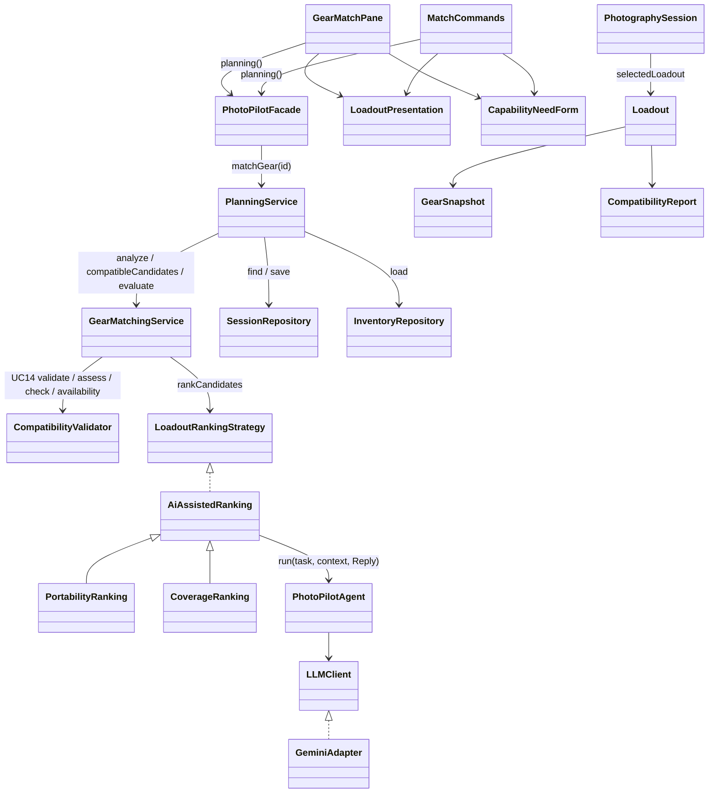
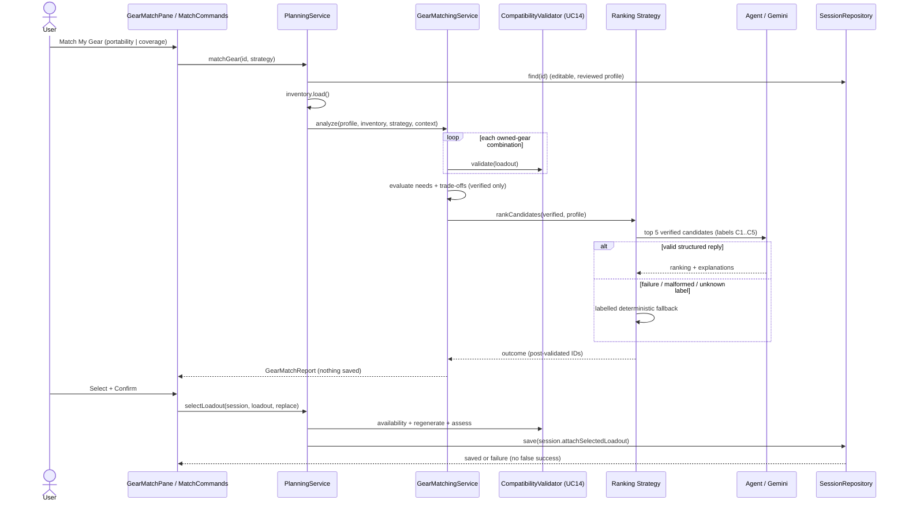

# F07 owned gear matching and compatibility validation

F07 / UC07 with included UC14 / SD03. Question answered: *which combinations of my existing equipment best satisfy this shoot's capability requirements?* Status: **implemented and verified** through GUI and CLI with offline Gemini fakes; one live Gemini run reached the labelled deterministic fallback (timeout), see [verification](#verification-2026-11-03-windows--jdk-21).

## Scope and dependency on F06

F07 needs a reviewed `EquipmentRequirementProfile`. Stage 1 produces it in F06/UC06 by AI derivation plus confirmation, which was reserved and unimplemented. The user chose (2026-11-03) a **minimal deterministic F06 confirmation path**. Capability needs are entered manually, validated, explicitly confirmed and saved. They are labelled as manual and never as AI output.

| F06 element | Status after this change |
| --- | --- |
| `CapabilityNeed.validate()`, `problems()`, `of(...)`, getters, `SUPPORTED` definitions | Implemented (deterministic) |
| `EquipmentRequirementProfile.validate(req)`, `confirm()`, `problems()`, `asDraft()`, `need()`, getters | Implemented (deterministic) |
| `RequirementService.validateProfile(profile)` | Implemented (structural gate) |
| `PhotographySession.attachProfile(profile)` | Implemented; returns a `Result` copy (see deviations) |
| `PlanningService.confirmProfile(id/session, edited)`, new `profile(id)` | Implemented; atomic save with stale-revision protection |
| **`PlanningService.analyzeNeeds(id)` / `PhotoPilotFacade.analyzeNeeds(id)`** | **Unfinished**: still `error.notImplemented` |
| **`RequirementService.deriveProfile(req)`** | **Unfinished**: still `error.notImplemented` |
| F06 GUI page (Capability Analysis) | Unchanged except the scope sentence, which now points to manual entry in F07 |

Overall F06 remains **IN PROGRESS**. Its AI capability-requirement analysis workflow is out of scope here.

## Architecture

Existing Facade, Strategy, Adapter and Repository boundaries are reused. GUI and CLI call the same services. No new dependency, schema version or storage file was added.





## UC14 deterministic rules (`validation/CompatibilityValidator`)

Each relationship is **COMPATIBLE**, **INCOMPATIBLE** (a known conflict) or **UNVERIFIED** (a specification is missing). Only recorded F05 values on `GearSnapshot`s are read. Brand or model names are never used as evidence. Gemini has no say.

| Relationship | Rule |
| --- | --- |
| Camera–lens | Mount labels stripped, compared case-insensitively. Blank or `unknown` is UNVERIFIED. Differing mounts are INCOMPATIBLE; no adapter is ever assumed (the model records none). |
| Lens–filter | Filter `diameterMm` must equal lens `filterDiameterMm`. No step ring is assumed. A missing thread is UNVERIFIED. |
| Camera–battery | Battery `batteryType` must appear in the camera's `batteryTypes`. An empty list is UNVERIFIED. |
| Camera–storage | Storage `format` must appear in the camera's `storageFormats`. An empty list is UNVERIFIED. Camera capacity/speed limits are not in the F05 model, so they are not checked. |
| Loadout | At least one body and one lens; every carried item fits at least one partner in the loadout; assignments pair a camera with a lens and never exceed lens units. |
| Essentials | A body without a compatible battery or card is reported as an unmet essential: a partial match, not a conflict. |
| Availability (selection) | Every item is still in inventory, unchanged (type, brand, model, all specs including weight) and the selected quantity is within the owned quantity. |

`CompatibilityReport.isUsable()` requires `compatible` with no violations and nothing unverified. Unverified is never usable. `fullySuitable()` additionally requires no unmet needs.

## Candidate generation and capability matching (`service/GearMatchingService`)

- Combinations use per-record unit counts within owned quantities: 1–3 bodies and 1–4 lenses. These limits grow to a profile's camera/lens-count minimum, capped at 6. At most 5000 combinations are checked; a limited search is reported. Compatible batteries, cards and filters are added with their owned quantity, using the validator's pair check. One mounted lens per body record is assigned, preferring the longest compatible lens.
- Candidate IDs are name-based UUIDs of the composition (item IDs and quantities), so re-matching yields the same ID.
- All combinations go through UC14. Rejected ones are counted, and their distinct reasons are listed with inventory-level exclusions (for example *Excluded (incompatible): Canon EF lens on Sony E bodies*).
- Needs are compared with verified values only: focal coverage (merged closed intervals, no tolerance), maximum aperture (smallest recorded f-number), lens autofocus, stabilization per mounted pair, burst rate, resolution, body/lens/battery counts, total weight (unknown if any weight is missing), card capacity and write speed. Results are MET, UNMET or UNKNOWN. A loadout with any UNMET/UNKNOWN need or missing essential is a **partial match** with the unmet items listed. Mandatory needs are never relaxed.
- Deterministic trade-offs: verified total weight or which items lack weights, focal coverage and gaps, lens changes needed (lenses > bodies), and the mounted pairs.

## Ranking strategies and Gemini constraints (`strategy/`)

- Strategy pattern: `LoadoutRankingStrategy` ← `AiAssistedRanking` (shared skeleton, no duplicated algorithm) ← `PortabilityRanking` / `CoverageRanking`. Both start with full matches, then fewer unmet mandatory needs, then lower priority-weighted unmet needs. **Portability** then prefers the lowest verified weight (unknown last), then fewer items and lenses. **Coverage** then prefers the widest logarithmic focal span, then the longest reach, then lower weight.
- The user picks the strategy per request (GUI combo box, CLI `match run <id> portability|coverage`); `PHOTOPILOT_RANKING` remains the default. The shared default is never mutated per request.
- Gemini receives at most 5 verified candidates as labels C1..C5. It gets their gear names, quantities and ranking-relevant recorded values, their unmet needs, the capability needs, and a short context (subject, priorities, portability wording, lens-change preference). It never receives inventory or session IDs, notes, locations or credentials. The key stays in the adapter header.
- The structured reply (`responseJsonSchema`) is strictly decoded by the agent, then validated: every label known, each exactly once, all present, non-blank explanations of at most 600 characters, a summary of at most 1200. Any failure (network, auth, rate limit, timeout, malformed, unknown/duplicate/missing label) keeps the deterministic order. The notice reads *AI ranking unavailable; showing the deterministic ranking instead. Reason: …*. No AI text is fabricated.
- After AI ordering, fully suitable loadouts are stably moved ahead of partial ones. `GearMatchingService` post-validates that the strategy returned exactly the verified candidate IDs. AI explanations are labelled *advice, not verified facts* and are never saved into the loadout.

## Selection and persistence

`PlanningService.selectLoadout(expected, loadout, replace)` requires all of the following before the atomic save:

1. The session exists and is Draft/Planned.
2. A reviewed profile is present.
3. The inventory loads.
4. Every item is still owned, unchanged and within quantity.
5. The ID equals the composition ID and the candidate is regenerated from the current inventory; unknown or stale IDs are rejected.
6. UC14 re-assessment passes.
7. Needs are re-evaluated against the current profile.

An existing selection is replaced only with `replace=true`: the GUI *Replace selection* button or CLI `match confirm replace`. The reviewed session revision is used, so concurrent changes fail with `error.session.changed`. Failures write nothing, and success is reported only after the save. Partial matches can be selected; their unmet needs are listed in the confirmation and stored with the loadout.

The selection is stored in a new optional v1 session field `selectedLoadout` (immutable `GearSnapshot`s with captured specs). Older files without the field load unchanged, because `SessionJson` fills only that exact absence. `JsonSessionRepository.referencingGear` now also scans it, so F05 warns before removing selected gear and history keeps the snapshot. `PlanningService.selection(id)` returns the saved loadout re-checked against current inventory and profile, for display and for F10.

## Design changes (Original design → Implemented change → Reason → Impact)

| Original design | Implemented change | Reason | Impact |
| --- | --- | --- | --- |
| SD03 has no operation that attaches a selected loadout | `PhotographySession.selectedLoadout` (optional v1 field) + `attachSelectedLoadout`, `PlanningService.selectLoadout/selection` | Required by F07 selection and later F10 use; the documented Stage 1 gap | Additive schema field; older binaries reject new files safely (same policy as F03); UC07/SD03 extended |
| `PhotographySession.attachProfile(profile): void` | Returns `Result<PhotographySession>` copy | Matches F03 `attachRequirement`, keeps aggregate immutable and revision-checked | F06 confirm path; UML signature differs |
| `LoadoutRankingStrategy.rank(candidates, profile)` only | Kept, plus `name()` and `rankCandidates(candidates, profile, context)` returning `RankingOutcome` | AI explanations, labelled fallback and runtime selection need more than a list | Strategy interface extended; both concrete strategies share `AiAssistedRanking` |
| Strategy chosen at bootstrap via `setRanking` | `GearMatchingService` also keeps named alternatives; per-request `analyze(..., strategyName, ...)` | Runtime GUI/CLI choice without mutating shared state across threads | `setRanking` retained; `PlanningService.rankingStrategies()` added |
| `match(profile, gear): List<Loadout>` | Retained; richer `analyze(...)`: `GearMatchReport` with rejections, counts and ranking notice; `evaluate`, `tradeOffs`, `candidateId` helpers | UI must show rejected/unverified items and the ranking source | `PlanningService.matchGear(id)` kept; `matchGear(id, strategy)` added |
| `CompatibilityValidator.validate/matchNeeds` only | Plus `check(pair)`, `assess`, `availability`, static `evaluateNeeds`/`focalCoverage` | Reuse the same rules for generation, exclusions, selection revalidation and saved-selection status | No duplicated rules |
| F06 analyzeNeeds/confirmProfile reserved | Minimal deterministic confirm path only (table above) | User decision 2026-11-03 | F06 stays IN PROGRESS; F06 AI methods unchanged |
| `Result` exposes rendered errors only | `Result.messages()` accessor | Carry a provider failure's localized reason into the fallback notice | Additive |

Unchanged structural scaffolds: `GearMatchingTool` (agent tool for F10) and `PlanValidator` remain as before.

## Files

Created: `model/GearMatchReport.java`, `strategy/AiAssistedRanking.java`, `strategy/RankingOutcome.java`, `application/CapabilityNeedForm.java`, `application/LoadoutPresentation.java`, `ui/cli/MatchCommands.java`, `ui/gui/GearMatchPane.java`. Tests: `matching/GearFixtures`, `CompatibilityValidatorTest`, `GearMatchingTest`, `F07WorkflowTest`, `MatchCliTest`, `ui/gui/GearMatchGuiTest`.

Modified: `model/CapabilityNeed`, `EquipmentRequirementProfile`, `CompatibilityReport`, `Loadout`, `PhotographySession`; `validation/CompatibilityValidator`; `strategy/LoadoutRankingStrategy`, `PortabilityRanking`, `CoverageRanking`; `service/GearMatchingService`, `PlanningService`, `RequirementService`; `common/Result`; `config/ApplicationBootstrap`, `FeatureCatalog`; `repository/SessionJson`, `SessionDomainAdapters`, `JsonSessionRepository`; `ui/cli/PhotoPilotCLI`; `ui/gui/FeaturePane`, `PhotoPilotWorkspace`, `GuiProfileController`; `resources/i18n/messages*.properties` (new `needs.*`, `compat.*`, `need.*`, `trade.*`, `match.*` keys in English and Chinese, and the F06 `capability.scope` sentence). Tests updated for the new status: `BootstrapTest`, `FeaturePresentationTest`; `PersistenceIntegrationTest` got a bounded retry (below).

GUI: no global CSS, theme, font, navigation, Home or other page was changed. `GearMatchPane` reuses `inventory-content`, `feedback-box`, `section-title`, `secondary-text`, `feedback-text`, `primary-button`/`secondary-button`, the RequirementPane field layout (two columns that wrap to one), `SessionPane.reveal`, `FxLocalizer` and the background `Task` pattern.

## Usage

- **GUI**: Equipment → Compatibility Check. Choose a session (Draft/Planned) with confirmed F03 requirements, then: Enter capability needs → choose a capability, minimum/maximum, priority, mandatory → Add or update need → Confirm and save profile. Then Ranking preference → Match My Gear → review the cards (owned equipment, UC14 verification, matched/unmet needs, trade-offs, any labelled AI note, and rejected items) → Select this loadout → Confirm selection (or Replace selection). The saved selection card re-checks it on every visit.
- **CLI**: `F07` or `match help`. Commands: `match profile <id>`, `match need <capability> minimum=.. maximum=.. priority=1..10 mandatory=yes|no note=".."`, `match need remove <capability>`, `match profile show|confirm|cancel`, `match capabilities`, `match run <id> [portability|coverage]`, `match details <n>`, `match select <n>`, `match confirm [replace]`, `match cancel`, `match show <id>`. Invalid input returns exit status 2.

## Demonstration script (Stage 2 video, F07)

Use an isolated data root (`PHOTOPILOT_DATA_DIR`, `PHOTOPILOT_CONFIG_DIR`) and the fixture gear below; never show `.env`.

1. Show the feature ID: Equipment → **Compatibility Check (F07)**, then Check status.
2. **Inventory input (F05)**: Sony A1 and Sony A7 IV (Sony E, NP-FZ100, SD), FE 200-600mm G (95 mm thread), FE 100-400mm GM (77 mm), FE 24-105mm G, Canon EF 100-400mm L II (incompatible), Vintage 300mm f/4 with mount `unknown` (incomplete), 4× NP-FZ100, 2× LP-E6NH (incompatible), 2× SD 128 GB, B+W 77 mm CPL. CLI seed (fictional demo data, fixed IDs):

   ```text
   gear add camera id=11111111-0000-0000-0000-000000000001 brand=Sony model=A1 quantity=1 weightGrams=737 mount="Sony E" batteryTypes=NP-FZ100 storageFormats=SD,CFexpress-A burstFps=30 resolutionMP=50 stabilization=true
   gear add camera id=11111111-0000-0000-0000-000000000002 brand=Sony model="A7 IV" quantity=1 weightGrams=658 mount="Sony E" batteryTypes=NP-FZ100 storageFormats=SD burstFps=10 resolutionMP=33 stabilization=true
   gear add lens id=22222222-0000-0000-0000-000000000001 brand=Sony model="FE 200-600mm G" quantity=1 weightGrams=2115 mount="Sony E" minFocalMm=200 maxFocalMm=600 maxAperture=5.6 maxApertureAtMaxFocal=6.3 filterDiameterMm=95 autofocus=true stabilization=true
   gear add lens id=22222222-0000-0000-0000-000000000002 brand=Sony model="FE 100-400mm GM" quantity=1 weightGrams=1395 mount="Sony E" minFocalMm=100 maxFocalMm=400 maxAperture=4.5 maxApertureAtMaxFocal=5.6 filterDiameterMm=77 autofocus=true stabilization=true
   gear add lens id=22222222-0000-0000-0000-000000000003 brand=Sony model="FE 24-105mm G" quantity=1 weightGrams=663 mount="Sony E" minFocalMm=24 maxFocalMm=105 maxAperture=4 maxApertureAtMaxFocal=4 filterDiameterMm=77 autofocus=true stabilization=true
   gear add lens id=22222222-0000-0000-0000-000000000004 brand=Canon model="EF 100-400mm L II" quantity=1 weightGrams=1640 mount="Canon EF" minFocalMm=100 maxFocalMm=400 maxAperture=4.5 filterDiameterMm=77 autofocus=true
   gear add lens id=22222222-0000-0000-0000-000000000005 brand=Vintage model="300mm f/4" quantity=1 mount=unknown minFocalMm=300 maxFocalMm=300 maxAperture=4
   gear add battery id=33333333-0000-0000-0000-000000000001 brand=Sony model=NP-FZ100 quantity=4 weightGrams=83 batteryType=NP-FZ100 capacityMah=2280
   gear add battery id=33333333-0000-0000-0000-000000000002 brand=Canon model=LP-E6NH quantity=2 weightGrams=80 batteryType=LP-E6NH capacityMah=2130
   gear add storagemedia id=44444444-0000-0000-0000-000000000001 brand=SanDisk model="Extreme 128GB" quantity=2 weightGrams=2 format=SD capacityGB=128 writeSpeedMBps=200
   gear add filter id=55555555-0000-0000-0000-000000000001 brand=B+W model="77mm CPL" quantity=1 weightGrams=30 diameterMm=77
   session create title="Lakeshore airshow" date=2026-11-14
   requirement manual <session-id> Fast aircraft at an airshow, two bodies, strong telephoto, minimal lens changes, portability matters.
   requirement set subject="Aircraft at an airshow" cameraCount=2 lensChanges=avoid portability="minimize weight"
   requirement confirm
   ```
3. **Session and requirement (F01/F03)**: session "Lakeshore airshow"; confirm requirements: fast aircraft, two bodies, avoid lens changes, minimize weight.
4. **Capability profile**: focal length 100–600 mm (mandatory, priority 1), camera bodies exactly 2, burst ≥ 10 fps, autofocus, lenses ≤ 2, total weight ≤ 6000 g (preferred). Point out the "not AI-generated" notice. Confirm.
5. **Match My Gear** with Portability. Show the summary (combinations checked / verified / rejected), the ranking line (Gemini-ranked, or the labelled fallback), card #1 *Full match* (A1 + A7 IV + 200-600 + 100-400, 5271 g, no lens changes), a *Partial match* with its unmet needs, and the rejected list (Canon EF mount, unverified vintage lens, LP-E6NH).
6. Switch to Coverage and run again to show the different order.
7. **Select** #1 → confirmation → **Confirm selection**. Try selecting another: the button becomes *Replace selection*.
8. **Persistence**: close and reopen the app (or run `match show <id>` in a new CLI process); the saved card says *Rechecked now: still owned, unchanged and compatible*.
9. **CLI**: run `match run <id> coverage`, `match select 2`, `match confirm` (refused: needs `replace`), `match cancel`.

## Verification (2026-11-03, Windows / JDK 21)

- Full `./mvnw.cmd -B -o test package javafx:run '-Djavafx.args=--smoke-test'` from Stage2: **245/245** tests passed, zero failures/errors/skips; JAR built; `GUI_SMOKE_OK` (its navigation check now expects F07 IMPLEMENTED with the F07 ready message). Baseline before this work: 223.
- 22 new tests:
  - `CompatibilityValidatorTest` (8): compatible/incompatible/missing mount, filter match/mismatch/unknown, battery mismatch/unverified, unsupported storage, missing essentials, availability (removed/changed/over-allocated), need evaluation with unknown weight and focal gap.
  - `GearMatchingTest` (8): missing/unconfirmed profile, no gear/camera/lens, unknown strategy, airshow full match with incompatible/unverified items excluded, three-body partial matches within owned quantities, no verified loadout, portability vs coverage order, valid AI ranking that cannot lift a partial above the full match and sees no IDs, unknown/duplicate/missing/malformed AI output and provider failure falling back, strategy/service post-validation.
  - `F07WorkflowTest` (3): profile validation against the F03 requirement, no Gemini call for F06, analyzeNeeds still unavailable; the airshow acceptance end to end (fallback, AI-ranked via the real GeminiAdapter to the loopback fake, select, no silent replacement, F05 removal warning, restart retrieval, explicit replacement with a partial); forged/not-owned/null/stale-session/changed-inventory selections rejected with byte-identical storage.
  - `MatchCliTest` (2): the full CLI workflow including cancel, replace and show, consistent with a direct service call; Chinese output.
  - `GearMatchGuiTest` (1): real JavaFX controls; profile entry with an invalid need rejected; non-blocking match; select/cancel/confirm; restart and re-check; Chinese at 880 × 600.
- Rendered `target/f07-profile-wide.png`, `f07-results-wide.png` and `f07-results-narrow-zh.png` were inspected against `f03-review-wide.png`: same surfaces, typography, buttons and wrapping, with no clipping.
- **Separate-process CLI** (built classes + Gson; isolated scratch data):
  - Seeded the fixture inventory and session with `gear add …` / `session create …`.
  - In a second JVM ran `requirement manual/set/confirm`, `match profile/need/confirm`, `match run <id> portability`, `match select 1`, `match confirm`. Result: 90 combinations, 21 verified, 69 rejected, one full match, Canon EF / vintage / LP-E6NH excluded, saved.
  - A third JVM (`--lang=zh-CN`) ran `match show <id>` and listed the restored selection, re-checked as current.
- **Live Gemini**: `ai-test` connectivity succeeded (about 23 s for the trivial prompt in this environment). Two live `match run` ranking requests exceeded the existing 30 s adapter timeout, so the labelled deterministic fallback was shown with the timeout reason. The evidence payload was then reduced (ranking-relevant specs, 5 candidates); the retry still timed out. **A live Gemini-ranked result was not observed**; the AI-ranked path is verified only through the real adapter against the offline loopback fake. The key never appeared in any output (scan of captured files: 0 matches).
- `PersistenceIntegrationTest.terminatedWriterLeavesLastCommittedVersionReadableAndRetryable` failed only with the new `MatchCliTest` in the same JVM. Windows releases a killed process's file lock asynchronously (LockFileEx), and the test re-saved immediately. Passed 3/3 in isolation and 223/223 without the new tests. The test now retries only `error.session.busy` for up to 5 s, which matches its "retryable" intent; production locking is unchanged.

## Limitations

- F06 AI capability analysis (`analyzeNeeds`, `deriveProfile`) is not implemented; profiles are manual only. No provenance field marks a profile as manual. Today every confirmed profile is manual, and the UI says so.
- No adapters, step rings, alias mounts, camera card-capacity/speed limits or image-circle data exist in F05, so those cases stay unverified or are not checked; nothing is assumed.
- Assignments record one mounted lens per camera *record*. Two identical bodies stored as one record with quantity 2 get one recorded mounted lens. Lens-change and stabilization checks use those assignments.
- Partial matches are ordered by count/priority of unmet needs, not by how close a value is (for example 2 of 3 bodies vs 1 of 3).
- Search is capped at 5000 combinations (reported). Batteries, cards and filters are carried with their full owned quantity.
- A live Gemini-ranked result, other OS/DPI, screen readers and a recorded video were not verified. `GearMatchingTool` (F10 agent tool) remains scaffolded.
