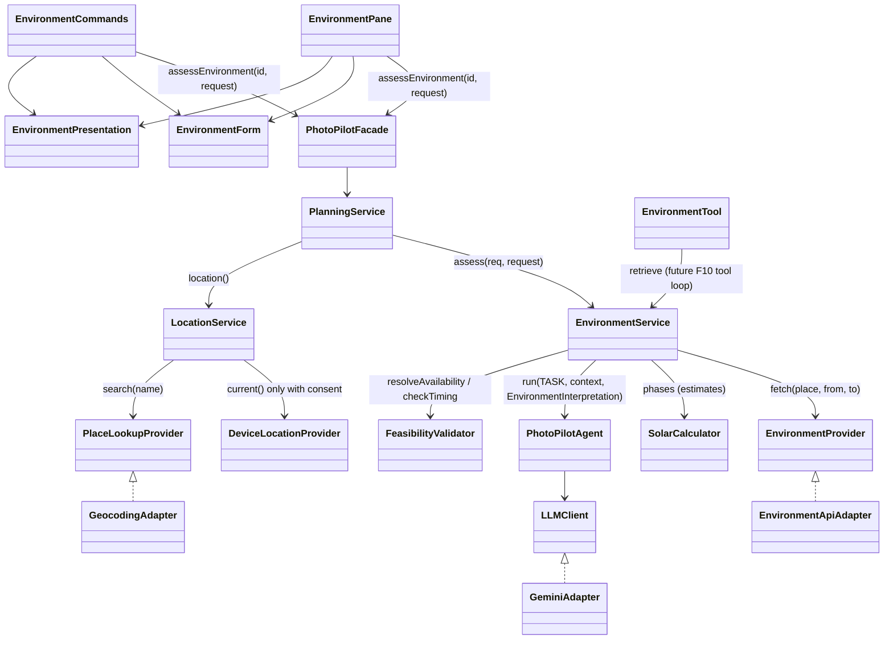

# F09 location, time and environment-aware photography planning

F09 / UC09 / SD03. Question answered: *when, and under what conditions, should I shoot this session?* Status: **implemented and verified** through GUI and CLI with offline provider and Gemini fakes, plus live CLI runs against the real providers and Gemini (2026-11-03). F10 plan generation is not part of F09.

## Workflow (UC09 / SD03)

1. The user opens a Draft or Planned session (completed/reviewed sessions keep their history: `env.error.historical`).
2. The confirmed F03 requirement (subject, goals, date, timing preference, duration, fixed constraints) is shown read-only and used to prefill. A session without one gets a minimal F09-only *activity/goals* input that is never saved into F03.
3. The user reviews or enters location, date and on-site availability (local wall-clock times) and an optional preparation lead time.
4. `PhotoPilotFacade.assessEnvironment(id, request)` → `PlanningService` (reads the session/requirement) → `EnvironmentService.assess(req, request)`:
   `retrieve` → `EnvironmentProvider.fetch` (`EnvironmentApiAdapter`) → `EnvironmentContext.staleFields` → availability resolved in the verified zone → `SolarCalculator` phases → `PhotoPilotAgent.run(..., EnvironmentInterpretation.class)` → `GeminiAdapter` → `FeasibilityValidator.checkTiming(assessment)`.
5. The result shows validated windows with arrival suggestions, the AI interpretation, provider evidence, computed estimates, rejected proposals and limitations. The user changes inputs and reassesses. Nothing is persisted and the session state never changes.

Patterns: **Facade** (`assessEnvironment`), **Adapter** (`EnvironmentApiAdapter`, `GeocodingAdapter`, existing `GeminiAdapter`). No new pattern was introduced.

## Providers, coverage and configuration

| Data | Provider (free, no API key) | Fields used | Limits |
| --- | --- | --- | --- |
| Weather | [Open-Meteo forecast API](https://open-meteo.com/en/docs) | hourly temperature, cloud cover, precipitation probability/amount, wind speed/gusts/direction, visibility, WMO weather code; daily min/max temperature, max precipitation probability, precipitation sum, max wind/gusts, sunrise/sunset; location IANA time zone (`timezone=auto`) | today + 15 days (16-day horizon); `timeformat=unixtime`, so every timestamp is UTC. Free for non-commercial use, attribution "Weather data by Open-Meteo.com" (CC BY 4.0). |
| Sun | [sunrise-sunset.org API](https://sunrise-sunset.org/api) | sunrise, sunset, solar noon, civil/nautical/astronomical twilight | any date; reports an event that does not occur as the 1970 epoch, which F09 treats as unavailable; silently answers in UTC for unknown zones, so the returned `tzid` is checked. Attribution requested. |
| Place lookup | [Open-Meteo geocoding API](https://open-meteo.com/en/docs/geocoding-api) | name, region, country, coordinates, time zone | gazetteer points (approximate); up to 5 matches are shown, never auto-selected. |
| Golden/blue hour | `SolarCalculator`: NOAA Solar Calculator equations (after Meeus) | geometric solar elevation; golden hour -4° to +6°, blue hour -6° to -4° (common photographic convention) | always labelled *computed estimate*; terrain, buildings and haze are not modelled. Verified within 2 min of sunrise-sunset.org for Toronto (`SolarCalculatorTest`). |

Endpoints are overridable with `PHOTOPILOT_WEATHER_ENDPOINT`, `PHOTOPILOT_SUN_ENDPOINT` and `PHOTOPILOT_GEOCODING_ENDPOINT` (tests use loopback fakes). No new dependency: the JDK `HttpClient` and the existing Gson are reused. Provider timeout is 15 s per request; Gemini keeps the existing 30 s adapter timeout.

## Data validity, freshness and provenance

- `EnvironmentContext` keeps, per group (`dailyForecast`, `hourlyForecast`, `sunEvents`), the source endpoint (no coordinates in it) and the retrieval timestamp; each forecast hour keeps its applicable instant; each sun event keeps its local date and source name. Units are documented in `EnvironmentContext.UNITS`.
- Missing variables, null hours, implausible values (outside physical ranges, non-integer WMO codes), events on the wrong date, provider disagreements over 5 min, an unverified zone and data for a different location are **dropped and named** (`unavailableFields`, `notices`). Nothing is substituted, clamped or averaged.
- If sunrise-sunset.org fails, Open-Meteo's own sunrise/sunset are used and labelled with their source; twilight is then unavailable.
- Freshness is type-specific (`EnvironmentContext.staleFields(now, maxAge)`): forecasts **3 h** (`WEATHER_MAX_AGE`, providers revise short-range forecasts several times a day); sun events **30 days** (`SUN_MAX_AGE`, astronomical predictions for a fixed date do not age). A timestamp more than 5 min in the future is invalid and also reported. `EnvironmentService` reuses an in-memory context (16 entries) only while nothing is stale and refetches otherwise; `PlanningService.environmentStaleFields(assessment)` lets F10 recheck an older assessment.
- Dates beyond the forecast horizon return sun data only (weather explicitly unavailable); for a midnight-crossing period whose second day is beyond the horizon, only that day's weather is unavailable. Past dates are rejected (`env.error.pastDate`; historical weather is not supported by this provider). With neither hourly weather for the availability nor sun data for the date, no recommendation is attempted (`env.notice.insufficient`, no Gemini call). With no data at all, the assessment fails with the provider errors.
- Deterministic adverse-weather indicators within the availability: thunderstorm/fog/snow WMO codes, gusts ≥ 50 km/h, visibility < 1000 m, precipitation probability ≥ 70%. Forecasts more than 7 days ahead are flagged as less reliable.

## Time zones and scheduling

- All arithmetic uses `java.time`. The location zone comes from the weather provider (or, flagged, from the chosen place-lookup match); the computer's zone is never assumed. Without a verified zone the assessment fails (`env.error.zone`).
- Availability is entered as local wall-clock times and resolved by `FeasibilityValidator.resolveAvailability`. An end not after the start continues to the next day; equal times are rejected. A DST-gap time is rejected (`env.error.timeGap`). A DST-overlap time is resolved so the period can only shrink (later occurrence for the start, earlier for the end) and labelled (`env.notice.timeAmbiguous`).
- Model times must be ISO local date-times; with an offset it must be valid for that local time in the zone, without one, gap and overlap times are rejected (`parseProposed`).
- Arrival = window start − the user's lead time, limited to the availability start (labelled). Without a lead time the arrival is the start. Travel time is never estimated; every result says so. Displayed times carry the zone abbreviation (and date when not the shooting date); the summary shows the IANA zone and UTC offset.

## Gemini interpretation and deterministic validation

Gemini receives (as labelled evidence JSON, with `responseJsonSchema`): subject, goals, timing preference, desired duration, priorities and fixed constraints from the confirmed requirement; the place **label and time zone only (never coordinates)**; the availability marked as a fixed user constraint; provider sun events, computed phases (marked estimates), the daily summary and forecast hours around the availability, each with an evidence id; unavailable and stale fields. The task forbids inventing measurements, sun times, travel or crowds, requires windows inside the availability with offset times, a declared light category and cited evidence ids, and forbids arrival times.

`EnvironmentService` converts the untrusted reply (at most 4 windows; unparseable or reversed times rejected immediately). `FeasibilityValidator.checkTiming` then rejects, with every reason, any window that: fails structural checks; is in another zone; leaves the availability; has an arrival before the availability; is under 5 min; is already over; declares light inconsistent with the sun data (daylight within sunrise–sunset, golden/blue overlapping a computed phase, twilight overlapping civil twilight, night within civil dusk–dawn, ±2 min) or unverifiable because the sun data is missing; cites no or unknown evidence; quotes a measurement absent from the provider data (number + unit, incl. Chinese units; °F/mph/m/s always unsupported); or duplicates another window. Valid alternatives are kept. AI considerations/alternatives/summary quoting absent values are removed and counted. Gemini failure (timeout, auth, rate limit, malformed output) keeps the factual assessment with `env.notice.aiUnavailable`.

## Location and privacy

`LocationService.manual(label, lat, lon)` validates label and ranges (inclusive ±90/±180). `current(explicitConsent)` calls the device provider only with consent, never after a recorded denial (`recordDenial`) and fails when unsupported. Bootstrap has no desktop device provider (no new location SDK), so the GUI reports *unsupported* without prompting; with a provider, the GUI asks once through the existing confirmation dialog and remembers a denial for the application session; the CLI needs `env device consent`. Nothing is tracked or stored. `search(name)` returns every match; the chosen match stays *approximate*. Coordinates go only to the weather/sun providers; the place label never leaves the application except to Gemini; shoot details never go to the providers.

## Domain model and F10 compatibility

`EnvironmentAssessment` holds the context, the reviewed `EnvironmentRequest`, subject, resolved `Availability`, `LightPhase` estimates, validated `ShootingWindow`s (label, declared light, AI conditions/rationale, cited evidence, arrival, notes), `RejectedWindow`s, the `Interpretation`, localized notices, stale groups and the assessment instant; `limitations()` renders English text. `evidenceIndex` gives deterministic evidence ids. `EnvironmentTool` (agent tool registry, `retrieve()` only, strict JSON arguments) returns factual evidence JSON for the future F10 tool loop. No confidence numbers are invented; uncertainty is expressed by the estimate flags, horizon/long-range notices and stale/unavailable fields.

## GUI and CLI

GUI: `EnvironmentPane` in the existing `FeaturePane` content flow (same `inventory-content`, `feedback-box`, `section-title`, `secondary-text`, primary/secondary button classes, two-column wrapping fields, background `Task` lifecycle, `FxLocalizer`, `SessionPane.reveal`). Cards: Assessment summary, one card per window, AI interpretation, Verified provider data, Computed light estimates, Rejected AI proposals, Limitations. Opening F09 contacts nothing. Inputs survive validation/provider failures and navigation; edited inputs count as unsaved for user switching. No global CSS, navigation or Home change.

CLI (`env` / `F09`): `env show <id>`, `env place <name>`, `env device consent|deny`, `env assess <id> [place=<n>|device] location=.. latitude=.. longitude=.. date=.. from=.. until=.. lead=.. activity=.. goals=..`, `env again key=value`. Both interfaces use `EnvironmentForm` and `EnvironmentPresentation`, so identical inputs and evidence produce identical lines (asserted by `F09WorkflowTest` and `EnvironmentGuiTest`).

## Design changes (Original design → Implemented change → Reason → Impact)

| Original design | Implemented change | Reason | Impact |
| --- | --- | --- | --- |
| `assessEnvironment(id)` takes only the session id | Added `assessEnvironment(id, EnvironmentRequest)` on Facade and PlanningService; `EnvironmentService.assess(req, request)`. The original `assess(req)` / `assessEnvironment(id)` work when the confirmed requirement has coordinates, a start time and a duration, otherwise they name the missing inputs | UC09 requires the user to review location, date and available time, which F03 does not store (F03 locations are labels; nothing may be written into the confirmed requirement) | SD03 call chain unchanged; one extra parameter carries reviewed inputs. Nothing persisted. |
| `EnvironmentProvider.fetch(place, date)` | Added default `fetch(place, from, to)` (at most one extra day) | Availability past midnight needs the following day's weather and sun data | Original method retained. |
| `EnvironmentContext` flat `weather` map + sunrise/sunset | Additive constructor/fields: place, date range, verified zone, hourly series, all sun events with sources, notices; `staleFields` implemented | Hourly forecasts and twilight are needed for windows; provenance per group | Original constructor retained; not persisted. |
| `EnvironmentAssessment(context, windows, limitations)` | Additive fields: request, subject, availability, light phases, rejected windows, interpretation, notices, stale groups, assessed time | Separate facts, estimates, AI and limitations; F10 reuse | Original constructor retained; not persisted. |
| `ShootingWindow(start, end, arrival, conditions, estimated)` | Added `transient` label, light, rationale, evidence, notes; `validate()` implemented | Validation and display need the declared light and cited evidence | Transient: the saved v1 session schema (ShootPlan windows) is unchanged; F10 decides whether to persist them. |
| `LocationService(Optional<DeviceLocationProvider>)` | Overload with `PlaceLookupProvider` + clock; `search`, `deviceSupported`, `recordDenial`; new `PlaceLookupProvider`/`GeocodingAdapter`, `PlaceCandidate` | "Do not guess a location from a vague name; let the user choose among matches" | Additive; manual entry unchanged. |
| `FeasibilityValidator()` | Clock overload; `resolveAvailability`, `resolveLocal`, `parseProposed`, `unsupportedMeasurements`; `checkTiming` implemented | Deterministic time and evidence gates | F02 `validate` was implemented later with F02 ([f02](f02-discovery.md)). |
| — | `SolarCalculator`, `EnvironmentInterpretation`, `EnvironmentRequest`, `EnvironmentForm`, `EnvironmentPresentation`, `EnvironmentPane`, `EnvironmentCommands` | Golden/blue-hour estimates from a documented model; shared GUI/CLI parsing and text | No new pattern; Facade/Adapter reused. |
| Placeholder endpoints `unconfigured.invalid` | Real default endpoints, overridable by environment variables | Selected free, key-less providers | Constructing adapters still sends nothing. |

The structural UML audit (`tools/verify_sources.py`) was not run (no Python here) and may flag these additive members and the HTTP calls.

## Verification (2026-11-03, Windows / JDK 21)

- Full: `./mvnw.cmd -B -o test package javafx:run '-Djavafx.args=--smoke-test'` → **270/270** tests (245 existing + 25 new), zero failures/errors/skips, JAR, `GUI_SMOKE_OK`. A first full run exposed that new `ShootingWindow` fields broke strict v1 session decoding (two legacy-fixture tests); the fields were made transient and the full run then passed. A later live run exposed that a chosen place was labelled as entered coordinates; fixed (`EnvironmentForm.parse(..., PlaceCandidate)`) and covered, the affected classes were rerun (9/9) and the final full command again passed **270/270**, JAR and `GUI_SMOKE_OK`.
- New tests: `EnvironmentApiAdapterTest` (6), `LocationServiceTest` (5), `EnvironmentAssessmentTest` (8), `SolarCalculatorTest` (2), `F09WorkflowTest` (3), `EnvironmentGuiTest` (1). Updated: `BootstrapTest`, `FeaturePresentationTest` (F09 status). Coverage map for the requested cases: manual location, invalid/missing coordinates, denied consent, verified device location → `LocationServiceTest`; weather, sun, partial, network/API failure, horizon, missing sun → `EnvironmentApiAdapterTest` + `EnvironmentAssessmentTest`; stale data, local-time conversion, DST ambiguity, cross-midnight, outside availability, invalid Gemini timing, Gemini failure → `EnvironmentAssessmentTest`; Facade assessment and GUI/CLI consistency → `F09WorkflowTest`, `EnvironmentGuiTest`. Offline fakes only (`FakeEnvironmentProviders`, `FakeGemini`).
- **Live** CLI (isolated scratch data dir; key never printed): `env place Toronto` returned 5 real matches; `env place Billy Bishop Toronto City Airport` 1; `env device consent` → unsupported; `env assess … place=1 date=2026-11-06 from=13:00 until=18:30 lead=30` retrieved real Open-Meteo hourly/daily data (overcast, 100% cloud) and sunrise-sunset.org events (sunset 17:02 EST), and Gemini proposed two windows that both passed validation (every quoted value present in the data); `env again from=15:30 until=21:00` and `env again date=2026-11-30` (beyond horizon: weather unavailable, sun only, session-date notice) also succeeded. Whole runs took 4–8 s. Rendered EN 1120×760 and ZH 880×600 results inspected.
- Not verified: a live GUI run, a real device-location provider (none exists), other OS/DPI, the source/UML audit. The implementation run made no commit or push; subsequent publication checks are recorded in [project memory](../../docs/PROJECT_MEMORY.md#git-publication-and-verification-2026-11-03).

## Demonstration (Stage 2)

1. F01: create a session dated within the next 15 days; F03: confirm "aircraft at the Toronto airshow, afternoon and evening".
2. F09 GUI: the session's subject/date appear read-only; enter *Toronto*, **Find place coordinates**, show the three-plus Toronto matches, choose Ontario or enter Billy Bishop Airport. Show **Use device location** → unsupported, no prompt.
3. Enter 13:00 – 18:30, lead 30, **Assess environment**: show the summary (zone, UTC offset, sources, retrieval time), windows with arrivals, the separate AI card, provider data, estimates, rejected proposals and limitations.
4. Change until to 21:00 (or a date beyond 16 days) and reassess; show the horizon limitation.
5. CLI: `env show`, `env place`, `env assess … place=1`, `env again from=15:30 until=21:00`.

## Limitations

- Weather is forecast only (no observations, no historical archive); quality depends on Open-Meteo models; sun/phase data ignore terrain and refraction anomalies.
- Gemini text is advice; the numeric check matches number+unit pairs, not paraphrased quantities ("about forty percent").
- Light checks use overlap with phases, so a window may extend beyond the declared phase.
- Requirement start times are F03 timestamps in the computer's zone; F09 compares their wall-clock time with the availability and only reports differences.
- No travel-time, parking, crowd or event-schedule data exists; arrival suggestions exclude travel.
- Assessments are kept only while PhotoPilot is open (by design: forecasts go stale within hours). F10 checks `environmentStaleFields`; after a restart F06 and F10 say that no current F09 assessment exists and ask the user to reassess (`F10WorkflowTest.anF09AssessmentDoesNotOutliveTheProcessAndItsAbsenceIsStatedNeverPresentedAsCurrent`).
