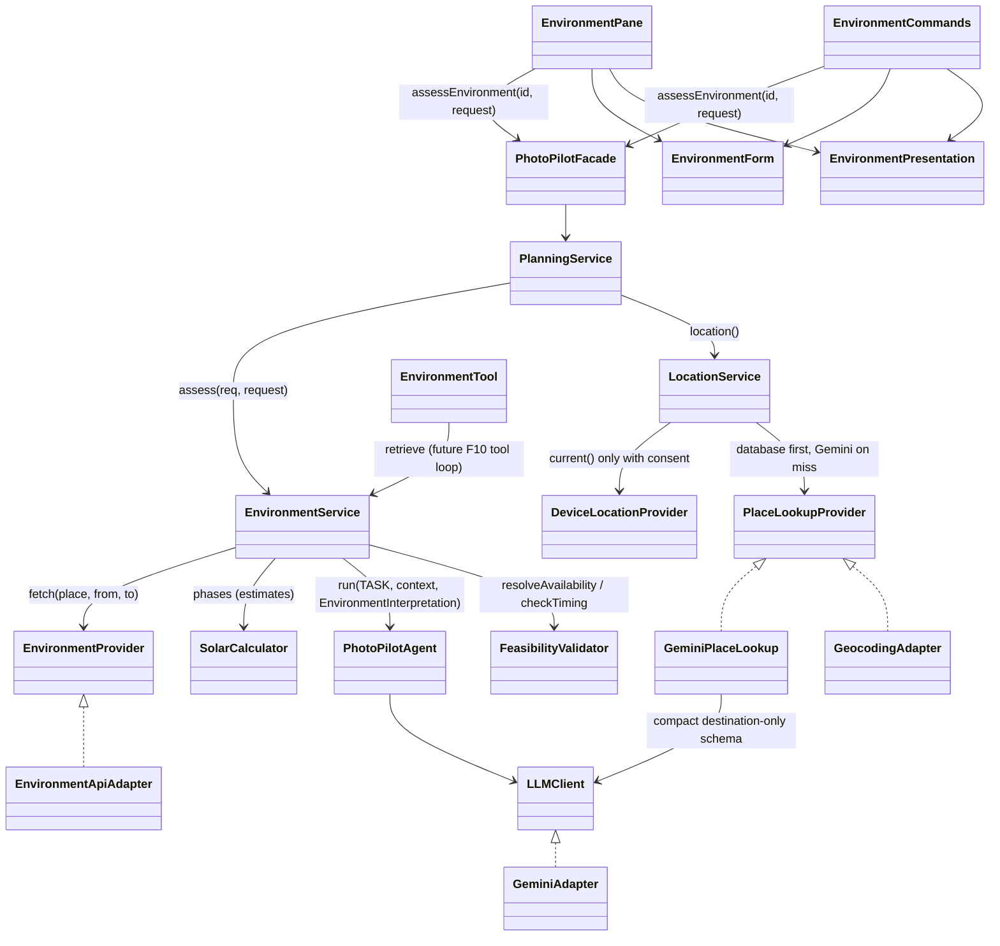
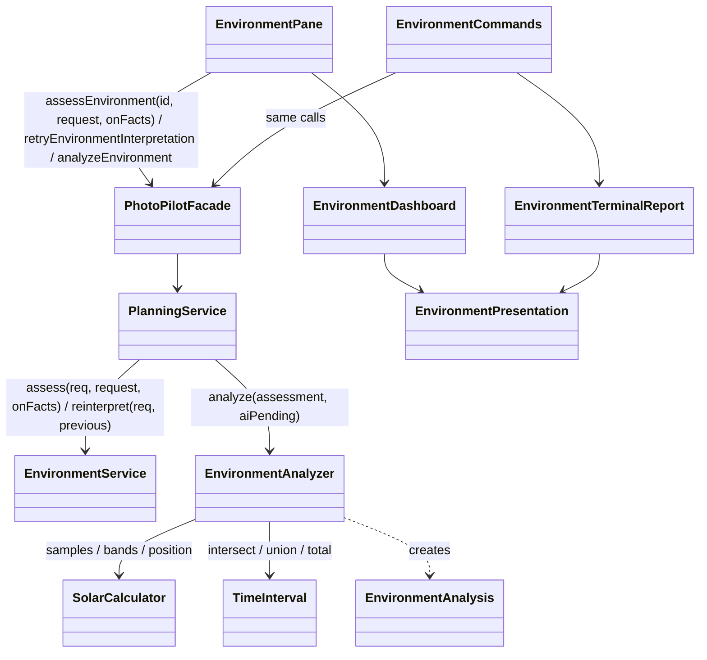

# F09 location, time and environment-aware photography planning

F09 / UC09 / SD03. Question answered: *when, and under what conditions, should I shoot this session?* The original assessment workflow was verified with offline and live services on 2026-11-03. The destination lookup changed on 2026-11-24. F10 plan generation is not part of F09.

## Workflow (UC09 / SD03)

1. The user opens **Environment Assessment** (sidebar Active session, step 04, optional) for a Draft or Planned session; the chooser follows the window's current session (completed/reviewed sessions keep their history: `env.error.historical`).
2. The confirmed F03 requirement (subject, goals, date, timing preference, duration, fixed constraints) is shown read-only and used to prefill. A session without one gets a minimal F09-only *activity/goals* input that is never saved into F03.
3. The user enters a shooting destination and chooses **Find location**. **Assess environment** also starts lookup when coordinates are missing. Review and confirm a returned candidate. The date, local availability and optional preparation lead time remain editable. **Advanced location options** accepts manual coordinates and an optional regional IANA time zone.
4. `PhotoPilotFacade.assessEnvironment(id, request)` → `PlanningService` (reads the session/requirement) → `EnvironmentService.assess(req, request)`:
   `retrieve` → `EnvironmentProvider.fetch` (`EnvironmentApiAdapter`) → `EnvironmentContext.staleFields` → availability resolved in the verified zone → `SolarCalculator` phases → `PhotoPilotAgent.run(..., EnvironmentInterpretation.class)` → `GeminiAdapter` → `FeasibilityValidator.checkTiming(assessment)`.
5. The result shows validated windows with arrival suggestions, the AI interpretation, provider evidence, computed estimates, rejected proposals and limitations. The user changes inputs and reassesses. Nothing is persisted automatically and the session's lifecycle state never changes.
6. Optionally the user adds the reviewed assessment to the session with **Add to session** (CLI `env record <id>`, for an assessment made earlier in the same process): `PlanningService.recordEnvironment` stores an `EnvironmentCheck` with identifying metadata only (assessment time, shooting date, place with coordinates, reviewed availability in the place's zone, number of validated windows, and the confirmed requirement's location and time-window text). No weather values, provider payloads or AI text are stored. It is refused without an assessment, when a newer assessment replaced the one shown, when the assessment is incomplete or for another day than the shooting date, when it does not apply to the confirmed requirement, and for historical sessions. The check completes milestone 04 while it still applies (place, date and time unchanged), otherwise the milestone shows *Needs review*; without a check the step stays optional and is skipped once a plan is approved. F06 and F10 still use only the in-process assessment ([session workflow](session-workflow.md#environment-check-persistence-minimal-backward-compatible)).



Patterns: **Facade** (`assessEnvironment`), **Adapter** (`EnvironmentApiAdapter`, `GeocodingAdapter`, existing `GeminiAdapter`). No new pattern was introduced.

## Providers, coverage and configuration

| Data | Provider or calculation | Fields used | Limits |
| --- | --- | --- | --- |
| Weather | [Open-Meteo forecast API](https://open-meteo.com/en/docs) | hourly temperature, cloud cover, precipitation probability/amount, wind speed/gusts/direction, visibility, WMO weather code; daily min/max temperature, max precipitation probability, precipitation sum, max wind/gusts, sunrise/sunset; location IANA time zone (`timezone=auto`) | today + 15 days (16-day horizon); `timeformat=unixtime`, so every timestamp is UTC. Free for non-commercial use, attribution "Weather data by Open-Meteo.com" (CC BY 4.0). |
| Sun | [sunrise-sunset.org API](https://sunrise-sunset.org/api) | sunrise, sunset, solar noon, civil/nautical/astronomical twilight | any date; reports an event that does not occur as the 1970 epoch, which F09 treats as unavailable; silently answers in UTC for unknown zones, so the returned `tzid` is checked. Attribution requested. |
| Primary place lookup | [Open-Meteo geocoding API](https://open-meteo.com/en/docs/geocoding-api) | name, region, country, coordinates, time zone | up to five gazetteer matches. The user chooses among ambiguous results and confirms the point. |
| Fallback place lookup | Configured Gemini model and existing API key | Destination description in, structured candidates out | Up to one model request per search. Uses the configured Gemini quota. Estimates require explicit acceptance. |
| Golden/blue hour | `SolarCalculator`: NOAA Solar Calculator equations (after Meeus) | geometric solar elevation; golden hour -4° to +6°, blue hour -6° to -4° (common photographic convention) | always labelled *computed estimate*; terrain, buildings and haze are not modelled. Verified within 2 min of sunrise-sunset.org for Toronto (`SolarCalculatorTest`). |

Endpoints are overridable with `PHOTOPILOT_WEATHER_ENDPOINT`, `PHOTOPILOT_SUN_ENDPOINT` and `PHOTOPILOT_GEOCODING_ENDPOINT` (tests use loopback fakes). No new dependency: the JDK `HttpClient` and the existing Gson are reused. Provider timeout is 15 s per request; Gemini uses the existing adapter timeout (30 s by default, configurable with `GEMINI_TIMEOUT_SECONDS`).

## Data validity, freshness and provenance

- `EnvironmentContext` keeps, per group (`dailyForecast`, `hourlyForecast`, `sunEvents`), the source endpoint (no coordinates in it) and the retrieval timestamp; each forecast hour keeps its applicable instant; each sun event keeps its local date and source name. Units are documented in `EnvironmentContext.UNITS`.
- Missing variables, null hours, implausible values (outside physical ranges, non-integer WMO codes), events on the wrong date, provider disagreements over 5 min, an unverified zone and data for a different location are **dropped and named** (`unavailableFields`, `notices`). Nothing is substituted, clamped or averaged.
- If sunrise-sunset.org fails, Open-Meteo's own sunrise/sunset are used and labelled with their source; twilight is then unavailable.
- Freshness is type-specific (`EnvironmentContext.staleFields(now, maxAge)`): forecasts **3 h** (`WEATHER_MAX_AGE`, providers revise short-range forecasts several times a day); sun events **30 days** (`SUN_MAX_AGE`, astronomical predictions for a fixed date do not age). A timestamp more than 5 min in the future is invalid and also reported. `EnvironmentService` reuses an in-memory context (16 entries) only while nothing is stale and refetches otherwise; `PlanningService.environmentStaleFields(assessment)` lets F10 recheck an older assessment.
- Dates beyond the forecast horizon return sun data only (weather explicitly unavailable); for a midnight-crossing period whose second day is beyond the horizon, only that day's weather is unavailable. Past dates are rejected (`env.error.pastDate`; historical weather is not supported by this provider). With neither hourly weather for the availability nor sun data for the date, no recommendation is attempted (`env.notice.insufficient`, no Gemini call). With no data at all, the assessment fails with the provider errors.
- Deterministic adverse-weather indicators within the availability: thunderstorm/fog/snow WMO codes, gusts ≥ 50 km/h, visibility < 1000 m, precipitation probability ≥ 70%. Forecasts more than 7 days ahead are flagged as less reliable.

## Time zones and scheduling

- All arithmetic uses `java.time`. The location zone comes from the weather provider (or, flagged, from the chosen place-lookup match, or from a zone the user entered, below); the computer's zone is never assumed. Without a verified or confirmed zone the assessment fails (`env.error.zone`), and the message names both ways forward.

### Entered time zone (Stage2OptRe1 C16)

The audit's `env assess … latitude=43.65 longitude=-79.38` was refused with `env.error.zone`, while Toronto chosen from the place lookup worked: for manual coordinates the only zone source is Open-Meteo's `timezone=auto` answer, and a lookup match carries its own zone as a fallback. The refusal is the intended safety rule (the source cannot tell whether the provider failed then or answered `GMT`; both are refused alike), but there was no manual way forward. Since 2026-11-23 the optional **Time zone (IANA)** field (GUI, under the coordinates) / `zone=<IANA zone>` (CLI `env assess`, kept by `env again`) lets the user confirm the zone:

- only a regional IANA id is accepted (`America/Toronto`); offsets, `UTC`, `GMT`, `EST`, `Etc/…` and unknown ids are refused (`env.error.zoneId`), because they say nothing about daylight saving at the place;
- it must be plausible for the coordinates: its UTC offset on the date within 3.5 h of the mean solar time (longitude / 15), measured round the clock (`env.error.zoneImplausible`; Asia/Tokyo for Toronto is refused, Asia/Shanghai for Kashgar or Pacific/Kiritimati at 157° W are accepted);
- a provider-verified zone still wins (`env.notice.zoneMismatchEntered` when they differ), and when it is used the result says so (`env.notice.zoneFromUser`);
- `EnvironmentRequest.zoneEntered` marks the source; the request is not persisted, so stored data is unchanged.

Tests: `ManualTimeZoneTest` (weather provider down: refusal without a zone, the entered zone used and labelled, implausible and non-regional zones refused, provider precedence, the CLI path). DST transitions with an entered zone use the same `resolveAvailability` rules as verified zones (`EnvironmentAssessmentTest`).
- Availability is entered as local wall-clock times and resolved by `FeasibilityValidator.resolveAvailability`. An end not after the start continues to the next day; equal times are rejected. A DST-gap time is rejected (`env.error.timeGap`). A DST-overlap time is resolved so the period can only shrink (later occurrence for the start, earlier for the end) and labelled (`env.notice.timeAmbiguous`).
- Model times must be ISO local date-times; with an offset it must be valid for that local time in the zone, without one, gap and overlap times are rejected (`parseProposed`).
- Arrival = window start − the user's lead time, limited to the availability start (labelled). Without a lead time the arrival is the start. Travel time is never estimated; every result says so. Displayed times carry the zone abbreviation (and date when not the shooting date); the summary shows the IANA zone and UTC offset.

## Gemini interpretation and deterministic validation

Gemini receives (as labelled evidence JSON, with `responseJsonSchema`): subject, goals, timing preference, desired duration, priorities and fixed constraints from the confirmed requirement; the place **label and time zone only (never coordinates)**; the availability marked as a fixed user constraint; provider sun events, computed phases (marked estimates), the daily summary and forecast hours around the availability, each with an evidence id; unavailable and stale fields. The task forbids inventing measurements, sun times, travel or crowds, requires windows inside the availability with offset times, a declared light category and cited evidence ids, and forbids arrival times.

`EnvironmentService` converts the untrusted reply (at most 4 windows; unparseable or reversed times rejected immediately). `FeasibilityValidator.checkTiming` then rejects, with every reason, any window that: fails structural checks; is in another zone; leaves the availability; has an arrival before the availability; is under 5 min; is already over; declares light inconsistent with the sun data (daylight within sunrise–sunset, golden/blue overlapping a computed phase, twilight overlapping civil twilight, night within civil dusk–dawn, ±2 min) or unverifiable because the sun data is missing; cites no or unknown evidence; quotes a measurement absent from the provider data (number + unit, incl. Chinese units; °F/mph/m/s always unsupported); or duplicates another window. Valid alternatives are kept. AI considerations/alternatives/summary quoting absent values are removed and counted. Gemini failure (timeout, auth, rate limit, malformed output) keeps the factual assessment with `env.notice.aiUnavailable`.

## Hybrid destination lookup (2026-11-24)

The original adapter submitted the entire trimmed name once using UTF-8 query encoding. Live queries returned zero matches for **Humber Bay Park in Toronto**, **Humber Bay Park, Toronto** and **Humber Bay Park**. A **Toronto** control returned five matches. These observations establish an empty search result for those queries. Coverage under other names is unknown. [Open-Meteo geocoding documentation](https://open-meteo.com/en/docs/geocoding-api)

Both interfaces use `LocationService.resolve`. It normalizes whitespace, preserves Unicode and extracts comma-separated or “in/near” qualifiers. Up to two distinct database queries try the qualified and entity names. A matching entity and compatible qualifiers are required. Multiple matches remain separate choices. A returned city or regional qualifier may be offered explicitly as a broader alternative if the exact lookup and model fail. Discover continues to use the original database-only `search` method.

A miss, unsuitable result, timeout, rate limit or transient outage triggers one request through the configured Gemini adapter and model. Interruptions stop the operation. The location request contains only the destination, as JSON data, alongside application-authored instructions. Session history, equipment, photos, coordinates from location fields and user credentials are absent from the content. Coordinate pairs and recognizable private paths entered into the name field are rejected before lookup. No provider or credential was added.

The schema is an object with `status` and `candidates`. RESOLVED requires one candidate, AMBIGUOUS requires two to five distinguishable candidates, and UNRESOLVED requires an empty array. Candidates require a name, finite numeric latitude and longitude in range, and a geographic scope. City, region, country and an IANA timezone are optional. Java rejects unexpected fields (including verification claims), invalid types, coordinates, zones, cardinalities and conflicting qualifiers. When Gemini supplies a distinct normalized name, one final database call may replace the estimate with a geographically compatible database match. Maximum per search is three database calls and one Gemini call. Timeouts and transport failures do not trigger a database retry storm.

Database points carry Open-Meteo attribution. Model points carry Gemini attribution and remain geographically unverified after acceptance. Models may be wrong even when the values pass all structural checks. The UI rounds estimated coordinates to two decimal places in the candidate and assessment summaries. The request and local solar calculations retain the accepted numeric values. The existing HTTP weather/sun adapter formats its coordinate parameters to five decimal places. Manual coordinates bypass both lookup providers. Device position is available only with an injected provider and consent. This desktop build has no device provider.

Accepted locations flow through the existing weather, sunrise/sunset, deterministic solar and interpretation services. The provider timezone takes precedence and a conflict is reported. Existing local wall-clock, DST and overnight rules apply. A suggested timezone used without weather verification is attributed to the accepted estimate and checked against longitude on the shooting date. Editing destination, coordinates, date, time or timezone clears incompatible in-process evidence. GUI callbacks check input generation. F06 evidence identifies the location source. F10 evidence also identifies the geographic scope of a confirmed lookup. Only explicitly recording the assessment saves its reviewed coordinates under the existing environment check. Lookup-based records also identify the source. A saved place label or existing requirement can contain the same words the user searched. The application creates no query history and stores neither the candidate list nor the raw provider response.

## Environment Assessment dashboard and structured CLI (2026-11-24)

User request: the assessment was a long plain-text report (and the advanced location options used JavaFX's grey title bar), so photographers could not see at a glance where, when and under which conditions they would shoot, nor whether Gemini had succeeded. The four supplied mock-ups (location and time input, overview, hourly forecast, sun and shooting windows) became one dashboard in the GUI and an equivalent structured report in the CLI. Providers, location resolution, freshness, validation and storage rules are unchanged.

### One analysis, two presentations



- `service.EnvironmentAnalyzer` builds `model.EnvironmentAnalysis` from one assessment snapshot, locally and deterministically (no provider or Gemini request): forecast hours within 3 h of the availability with their role (before, inside, after); shooting-window statistics; the provider's daily summary kept separately; forecast coverage; 10-minute solar samples (elevation and azimuth) and one-minute light bands; provider sun events; the overlap of each golden/blue phase with the availability; validated-window totals; seven stage statuses; the AI outcome; and the findings. Both interfaces render only this object, through `application.EnvironmentPresentation` (text, units and rounding at the presentation boundary). The GUI never parses CLI text and the CLI never touches JavaFX.
- Window statistics use the forecast hours whose timestamps lie in the availability, both ends included. When none does (a period between two hours), the forecast hour at or less than one hour before the start stands for it and is labelled *Nearest forecast hour*. Minimum–maximum per metric; probabilities are never summed or averaged; nothing is interpolated; a value the provider did not give stays *Unavailable* (never 0) and makes the weather stage *Completed with limitations*. Wind direction is shown per hour as compass sectors (circular values are not averaged). The primary condition is the most frequent WMO code of the window hours; a tie goes to the higher, more severe code.
- `model.TimeInterval` does the overlap arithmetic on instants (`max(starts)..min(ends)`; zero length = boundary contact). Totals use unions, so golden and blue hour, or several windows, never count a minute twice. Midnight crossings, next-day phases and DST days need no special case. A mathematical overlap is labelled as such and is never a recommendation.
- `SolarCalculator` gained `position` (azimuth: degrees clockwise from true north, from the same NOAA equations; elevation values unchanged), `samples` (chart sampling only) and `bands` (night, astronomical, nautical and civil twilight, daylight at −18°, −12°, −6° and −0.833°). The light timeline and the curve therefore come from one model; provider sunrise, solar noon and sunset are drawn as markers, and every band, phase and curve is labelled a computed estimate. Golden (−4° to +6°) and blue hour (−6° to −4°) keep their earlier definitions.
- Stage statuses: Completed, Completed with limitations, Pending, Failed, Timed out, Unavailable, Skipped, Not performed — always in words, with a symbol (GUI) or tag (`[OK]`, `[WARN]`, `[FAIL]`, `[--]`, `[..]` in the CLI); colour is never the only cue. The AI outcome is read from the structured failure reason the service attached (`ErrorKind` of its key): timed out, unavailable (5xx, rate limit, network, credentials), rejected by validation (unusable reply), skipped (not enough evidence), failed. Recommendation validation is *Not performed* when there was nothing to validate.

### AI-only retry and the pending state

- `EnvironmentService.assess` now hands the factual snapshot to an optional callback before Gemini is asked; the GUI analyses it on the worker and shows the dashboard with *Gemini interpretation in progress* while the request runs (the inputs stay locked, the views can be read, retry and record wait).
- `EnvironmentService.reinterpret(req, previous)` interprets the retained snapshot again: same `EnvironmentContext` object (provider data and retrieval times), request and provenance, computed phases, availability and `assessedAt`. Only the AI notices are replaced, and `env.notice.aiRetried` records when and with which evidence. It contacts neither the place lookup (database or Gemini fallback) nor the weather or sun providers. The Gemini interpretation and the Gemini location fallback remain separate requests.
- `PlanningService.retryEnvironmentInterpretation(id, shown)` refuses, with the reason: no current assessment; a newer assessment or any input change (place, coordinates, date, times, zone) replaced or cleared it; a retry already running for the session; the interpretation already succeeded or was skipped for lack of evidence; the session date or the confirmed requirement changed; stale evidence (3 h forecast limit); an availability that has ended. A late reply is discarded if the session's assessment was replaced or cleared meanwhile. `environmentRetryPrecheck` is the in-memory part an interface uses to decide whether to offer the action. A retry that fails again is reported as such (GUI message; CLI exit code 2) and keeps the facts. Gemini timeouts are not lengthened.
- New operation `ENV_RETRY_AI` (stages: load session, check the retained evidence, Gemini, validation) in the shared progress model.

### GUI

- Input (mock-up 01): one *Shooting Location* field with **Find location**; a location card shows the search, the matches (a structured list: name, then region, country, source and specificity; estimates marked), an AI estimate with **Use approximate location** / **Search again** and the notice *Approximate location — not independently verified*, or, once confirmed, only the place, its source and specificity, its time zone and where the zone comes from, and **Change location**. Acceptance never changes provenance. **Advanced location options** (manual coordinates, IANA zone, consented device location) and *Data sources and privacy* are closed disclosures in the calculators' *Calculation details* style. Date, times and lead time are one aligned row. Conflicts with the session (`EnvironmentForm.conflicts`, the same rule as the assessment) appear under the fields before anything is requested, with **Restore Session Values**. After an assessment the inputs fold into one summary line with **Edit inputs**.
- Dashboard: overall status, stage chips and six views (segmented, as in the calculators): **Assessment Overview** (weather hero card with icon, temperature and condition for the window, context rows; metric cards for precipitation chance, precipitation, cloud cover, wind with direction, gusts, visibility, sunrise, sunset, golden and blue hour, each with its scope or full-day value; key findings; service status with the AI outcome and **Retry AI Analysis**; Session progress), **Weather Forecast** (hour cards, window hours accented and context hours dashed; a selectable metric trend chart on real timestamps with the window shaded, gaps left open, hover and keyboard reading; source and freshness), **Sun and Light** (solar elevation curve with horizon, golden/blue elevation bands, availability and provider markers, hover reading time, elevation, azimuth and light; natural-light timeline; event cards; twilight and model details), **Shooting Windows** (available time and overlap cards, one interval chart for availability, preparation, golden and blue hour and validated windows with sunrise/sunset markers and overlap emphasis, the overlap table, validated recommendations), **AI Analysis** (status and reason, interpretation, validated count, rejected proposals, retry) and **Technical Details** (provenance and retrieval times, stage lines, every finding and notice, the earlier summary/evidence/estimates/limitations text, **Copy Technical Report**). Switching views, metrics or hours requests nothing. The overview is shown after each assessment.
- Charts extend the calculators' `CalculatorDiagram` (theme tokens, interface font, redraw on theme change). Styles are scoped to `.env-page`; status and light colours are local `ladder()` colours for Light and Dark. Only the F09 page uses the wide content width (1760 px) the capability report already used.

### CLI

- `env assess` / `env again` print the structured overview (shooting context with provenance, weather for the window with full-day values beside them, natural light, overlap analysis, service status, findings, the list of detail commands) instead of the earlier full report. Date/time conflicts with the session are printed before the request. The complete earlier report, unchanged line for line, is `env report technical` (with provenance, stage lines and every notice).
- `env report hourly` (one row per forecast hour, `*` for window hours, `-` for missing values, units underneath), `trend <metric>` (ASCII bars on a stated linear axis next to each exact value), `sun` (provider events, computed phases, a day timeline, hourly solar elevation and azimuth), `windows` (overlaps, an interval timeline, validated recommendations), `ai`, `status`, `technical`; `env retry-ai`; `env menu` (numbered sections for an interactive terminal; the retry entry says why it is unavailable; without interactive input it only lists the commands, so scripts are never prompted). Report sections never contact a provider or Gemini.
- Plain ASCII marks, no ANSI colour or screen control. Tables fit `COLUMNS` (default 80) and stack one value per line when very narrow; charts are drawn only where they fit and never replace the numbers; sentences are printed whole so redirected output stays searchable. English and Chinese.

### Corrected defect: date versus start-time conflict

Observed: confirmed requirement 2026-11-20 15:00, assessment 2026-11-30 15:00–16:00, and the result said the start time 15:00 was outside the availability. Cause: `EnvironmentService.consistency` compared full local date-times, so any other date put the requirement time outside the period, and the message named only the clock time. Fix: `FeasibilityValidator.requirementConflicts` reports the date difference (`env.notice.dateDiffers`) and checks the wall-clock start time separately against the availability (midnight-crossing aware); `env.notice.timeOutside` now names the availability. The same rule drives the pre-flight check. Regression: `EnvironmentAnalysisTest.requirementConflictsCompareTheDateAndTheWallClockTimeSeparately` and the CLI conflict test.

### Files (relative to `Stage2/src/main/java/com/photopilot/`)

New: `model/EnvironmentAnalysis.java`, `model/TimeInterval.java`, `service/EnvironmentAnalyzer.java`, `ui/cli/EnvironmentTerminalReport.java`, `ui/gui/EnvironmentDashboard.java`, `ui/gui/IntervalTimelineChart.java`, `ui/gui/SolarElevationChart.java`, `ui/gui/WeatherTrendChart.java`, `ui/gui/WeatherGlyph.java`. Changed: `service/SolarCalculator.java`, `service/EnvironmentService.java`, `service/PlanningService.java`, `validation/FeasibilityValidator.java`, `application/EnvironmentForm.java`, `application/EnvironmentPresentation.java`, `application/PhotoPilotFacade.java`, `application/OperationKind.java`, `application/NextSteps.java`, `ui/cli/EnvironmentCommands.java`, `ui/cli/TextTable.java` (stacked narrow tables print a header-less marker column as its value alone; no other table has one), `ui/gui/EnvironmentPane.java`, `ui/gui/FeaturePane.java` (F09 page width only). Resources: the three `i18n` bundles and `photopilot.css` (the F09 block replaces the earlier `#env-location-status:estimated` rule). Tests: new `environment/EnvironmentAnalysisTest`, `environment/EnvironmentRetryTest`, `ui/cli/EnvironmentTerminalReportTest`, `ui/gui/EnvironmentDashboardGuiTest`; updated `environment/F09WorkflowTest` (its parity assertions now read `env report technical`, plus overview checks).

### Verification (2026-11-24)

- Windows, bundled JDK 21, isolated scratch copy (sources, `third-party`, own `.mvn`), offline, no `.env`, `PHOTOPILOT_LIVE_GEMINI=0`: `mvnw.cmd -B -o clean package javafx:run -Djavafx.args=--smoke-test` → **877 run, 0 failures, 0 errors, 6 skipped** (19 new: `EnvironmentAnalysisTest` 10, `EnvironmentRetryTest` 4, `EnvironmentTerminalReportTest` 4, `EnvironmentDashboardGuiTest` 1; skips: four opt-in live Gemini, two private camera samples), JAR built, `GUI_SMOKE_OK`. All 20 F09-related classes passed, including the unchanged `EnvironmentGuiTest`, `HybridLocationCliTest` and `ManualTimeZoneTest`.
- New tests cover: the 15:00–16:00 vs 15:57–17:02 fixture (3 min golden, 0 min blue), no/partial/full/identical/contact overlaps, unions without double counting, midnight and DST; window vs daily statistics, inclusive boundaries, nearest hour, missing values and hours, negative temperatures, condition tie-break; solar samples on a 25-hour DST day, azimuth east/south/west in Toronto and north in Sydney, solstice culmination, contiguous bands, polar day and night; AI timed out / unavailable / invalid / skipped / pending / success and their stages; AI-only retry with request counts (no provider request, one Gemini request), unchanged context and retrieval time, failed retry, replaced, cleared during the request, concurrent, requirement changed, stale (no prompt sent), real Gemini timeout; every CLI section, parity of CLI and GUI values with the shared presentation, narrow and Chinese output, the interactive menu and a script that is never prompted, pre-flight conflicts; and in a real JavaFX window the location card states and candidate list, conflicts and restore, the pending state, every view, hour and metric selection, chart data and hover readings, retry, copy and record.
- Real CLI process (scratch profile, run outside the repository): live Open-Meteo geocoding/forecast and sunrise-sunset.org for Toronto with no Gemini key — five matches, `pick=1`, overview with real snow, gust and visibility warnings, every report section, `env retry-ai` reported as not succeeded (exit 2) without any provider request, `env record`; repeated in Chinese with `COLUMNS=50`.
- Screenshots (real windows, `target/f09-*.png` in the build copy) of input, candidate list, every view, light and dark, English and Chinese, 1440×900 and 1280×800 were inspected.
- Not verified: a hands-on pointer session, a live Gemini interpretation, other operating systems and display scales.

### Limitations

- Charts sample the solar model every 10 minutes; event and phase times keep one-minute resolution. Terrain, buildings, local horizon and atmosphere are not modelled; azimuth is true north, not magnetic.
- Forecast hours are instants; the provider's hourly values may describe the preceding hour for some variables, which the window rule does not reinterpret.
- The AI-only retry needs fresh evidence (3 h); after that a full assessment is required. It replaces the session's in-process assessment; nothing is persisted until **Add to session**.
- The rejected-proposal lines keep the model's proposed time text as before.

## Domain model and F10 compatibility

`EnvironmentAssessment` holds the context, the reviewed `EnvironmentRequest`, subject, resolved `Availability`, `LightPhase` estimates, validated `ShootingWindow`s (label, declared light, AI conditions/rationale, cited evidence, arrival, notes), `RejectedWindow`s, the `Interpretation`, localized notices, stale groups and the assessment instant; `limitations()` renders English text. `evidenceIndex` gives deterministic evidence ids. `EnvironmentTool` (agent tool registry, `retrieve()` only, strict JSON arguments) returns factual evidence JSON for the future F10 tool loop. No confidence numbers are invented; uncertainty is expressed by the estimate flags, horizon/long-range notices and stale/unavailable fields.

## GUI and CLI

GUI (since 2026-11-24, see [the dashboard section](#environment-assessment-dashboard-and-structured-cli-2026-11-24)): `EnvironmentPane` in the existing `FeaturePane` content flow, with a location card, the date-and-time form and the six-view `EnvironmentDashboard`. The earlier cards (Assessment summary, windows, AI interpretation, Verified provider data, Computed light estimates, Rejected AI proposals, Limitations) keep their text and ids and now live in the Shooting Windows, AI Analysis and Technical Details views; *Session progress* with **Add to session** ends the overview. Opening F09 contacts nothing. Inputs survive validation/provider failures and navigation; edited inputs count as unsaved for user switching. No global CSS, navigation or Home change.

CLI examples use one quoted command per shell argument, or one command per line inside PhotoPilot.

```text
env help
env place Toronto
env assess <id> place=1 from=13:00 until=16:00
env assess <id> location="Humber Bay Park in Toronto" pick=1 acceptApprox=yes from=13:00 until=16:00
env assess <id> location="Shooting spot" latitude=43.6 longitude=-79.4 zone=America/Toronto from=13:00 until=16:00
env again lead=15
env report [overview | hourly | trend <metric> | sun | windows | ai | status | technical]
env retry-ai
env menu
env record <id>
```

An interactive terminal prompts for candidate selection, confirmation and recovery. A script can request candidates with `env place`, then select `place=<n>` in the same CLI process. Alternatively `pick=<n>` selects a candidate from the lookup performed by the assess command itself. Accept an unverified estimate explicitly with `acceptApprox=yes`. Changing the location or submitting an invalid candidate clears the previous CLI assessment inputs. A bare `env again` cannot replay an older destination after a failed change. A session without a confirmed shooting requirement also needs `activity="..."`. A failed or declined lookup makes no weather request.

## Design changes (Original design → Implemented change → Reason → Impact)

| Original design | Implemented change | Reason | Impact |
| --- | --- | --- | --- |
| `assessEnvironment(id)` takes only the session id | Added `assessEnvironment(id, EnvironmentRequest)` on Facade and PlanningService; `EnvironmentService.assess(req, request)`. The original `assess(req)` / `assessEnvironment(id)` work when the confirmed requirement has coordinates, a start time and a duration, otherwise they name the missing inputs | UC09 requires the user to review location, date and available time, which F03 does not store (F03 locations are labels; nothing may be written into the confirmed requirement) | One extra parameter carries the reviewed inputs through the SD03 call chain. Explicit recording is described in workflow step 6. |
| `EnvironmentProvider.fetch(place, date)` | Added default `fetch(place, from, to)` (at most one extra day) | Availability past midnight needs the following day's weather and sun data | Original method retained. |
| `EnvironmentContext` flat `weather` map + sunrise/sunset | Additive constructor/fields: place, date range, verified zone, hourly series, all sun events with sources, notices; `staleFields` implemented | Hourly forecasts and twilight are needed for windows; provenance per group | Original constructor retained; not persisted. |
| `EnvironmentAssessment(context, windows, limitations)` | Additive fields: request, subject, availability, light phases, rejected windows, interpretation, notices, stale groups, assessed time | Separate facts, estimates, AI and limitations; F10 reuse | Original constructor retained; not persisted. |
| `ShootingWindow(start, end, arrival, conditions, estimated)` | Added `transient` label, light, rationale, evidence, notes; `validate()` implemented | Validation and display need the declared light and cited evidence | Transient: the saved v1 session schema (ShootPlan windows) is unchanged; F10 decides whether to persist them. |
| `LocationService(Optional<DeviceLocationProvider>)` | Overload with `PlaceLookupProvider` + clock; `search`, `deviceSupported`, `recordDenial`; new `PlaceLookupProvider`/`GeocodingAdapter`, `PlaceCandidate` | "Do not guess a location from a vague name; let the user choose among matches" | Additive; manual entry unchanged. |
| Database-only F09 search | `LocationService.resolve` composes two implementations of `PlaceLookupProvider`. `GeminiPlaceLookup` adapts the existing LLM client. `DestinationQuery` checks names and qualifiers. | Parks and descriptive destinations may yield an empty database result. | The existing Facade and Adapter design covers GUI and CLI. Weather and solar services retain their responsibilities. |
| `FeasibilityValidator()` | Clock overload; `resolveAvailability`, `resolveLocal`, `parseProposed`, `unsupportedMeasurements`; `checkTiming` implemented | Deterministic time and evidence gates | F02 `validate` was implemented later with F02 ([f02](f02-discovery.md)). |
| — | `SolarCalculator`, `EnvironmentInterpretation`, `EnvironmentRequest`, `EnvironmentForm`, `EnvironmentPresentation`, `EnvironmentPane`, `EnvironmentCommands` | Golden/blue-hour estimates from a documented model; shared GUI/CLI parsing and text | No new pattern; Facade/Adapter reused. |
| Placeholder endpoints `unconfigured.invalid` | Real default endpoints, overridable by environment variables | Selected free, key-less providers | Constructing adapters still sends nothing. |
| One `assess` step from retrieval to interpretation; text-only presentation | `EnvironmentService.assess(req, request, onFacts)` and `reinterpret(req, previous)`; Facade/PlanningService `assessEnvironment(id, request, onFacts)`, `retryEnvironmentInterpretation`, `environmentRetryRefusal`/`Precheck`, `analyzeEnvironment`; new `EnvironmentAnalysis`, `EnvironmentAnalyzer`, `TimeInterval`; `SolarCalculator.position/samples/bands` (2026-11-24) | Dashboard and structured CLI need deterministic structured data, a visible pending state and an AI-only retry ([section](#environment-assessment-dashboard-and-structured-cli-2026-11-24)) | Additive; nothing persisted; the original `assess` overloads and every earlier presentation method keep their output. `env assess` prints the overview; the earlier report is `env report technical`. |

*(2026-11-23: the assessment itself is still not persisted, but one the user adds to the session is recorded as a minimal `EnvironmentCheck`; see step 6 of the workflow.)*

The original November 3 implementation did not run the structural UML audit (`tools/verify_sources.py`).

## Verification of the hybrid lookup (2026-11-24)

### Build and regression tests

On Windows with the bundled JDK 21, `mvnw.cmd -B -o package` selected **858 tests**. **851 passed, one failed, zero errored and six were skipped**. The single failure was the global dropdown pointer test. Its diagnostic reported that the pointer moved after the test positioned it. Maven stopped before packaging on this invocation. The last time-zone edit preserves a warning when an explicitly entered zone agrees with the weather provider and the AI candidate suggests a different zone. The final code also rejects common relative photo paths, single-component absolute paths, and coordinates with cardinal directions before sending a name search. The focused package run below covers the time-zone change and these additional privacy cases.

The final code passed all 56 tests in `com.photopilot.environment`, including seven resolver tests, seven hybrid CLI tests, twelve downstream evidence tests and six manual time-zone tests. The default suite uses injected clients or loopback HTTP for provider scenarios. Four opt-in live Gemini smoke tests were skipped because `PHOTOPILOT_LIVE_GEMINI` was unset. Two real camera-file checks were skipped because their required samples were unconfigured.

The final JDK 21 package run passed **111 of 111 tests** with zero failures, errors or skips and produced `target/photopilot-0.1.0-SNAPSHOT.jar`. The selection included the F09 service, both interfaces, compatibility with Discover, Gemini integration, persisted environment checks, F06/F10, localization and bootstrap. The JAR contained both new resolver classes and the GUI/CLI entry components. Running `PhotoPilotCLI` from that JAR with its dependencies and a temporary profile printed the updated help and rejected a relative private photo path with exit code 2.

```powershell
.\mvnw.cmd -B -o '-Dtest=Environment*Test,HybridLocation*Test,LocationServiceTest,ManualTimeZoneTest,SolarCalculatorTest,F09WorkflowTest,GeminiAdapterTest,F06WorkflowTest,F10WorkflowTest,Discovery*Test,BootstrapTest,TranslationResourcesTest' package
```

Local Maven logs are `Stage2/target/f09-release-verification.log` (all tests) and `Stage2/target/f09-final-package.log` (final code, focused selection and JAR).

An intermediate full run selected 856 tests. Its only failure was `DropdownGuiTest.everyThemeModeAndCustomColourRestylesTheOpenListAndTheKeyboardStillWorks`, which timed out waiting for a mouse hover. The November 23 audit's `build/repeat-suite.log` records the same method and hover assertion before this change. That intermediate run passed both F09 JavaFX tests. The project-wide dropdown test and its assertions were left intact.

### Hands-on results

| Interface and provider | Action | Observed result |
| --- | --- | --- |
| Windows JavaFX desktop, isolated profile and loopback providers | Find **Humber Bay Park in Toronto**, review the estimate, choose **Use approximate location**, then assess | The interface showed Gemini attribution, geographically unverified status, landmark vicinity and a two-decimal display. The resulting assessment retained the estimate warning and showed weather, sun times and the Toronto time zone from the fixtures. |
| Same desktop | Replace the destination with **Toronto** and choose **Assess environment** directly | The old assessment disappeared. The interface offered Ontario, Ohio and Kansas. Choosing and confirming Ontario resumed assessment and showed Open-Meteo attribution and the new solar results. |
| Same desktop | Search for **Unlisted fixture destination**, then open advanced options and apply a manual point | The unresolved response displayed recovery guidance. Applying the manually entered coordinates produced an assessment attributed to the user. |
| Real CLI process and live services | Run `env place Toronto` and `env place Humber Bay Park in Toronto` | Toronto returned five Open-Meteo candidates. The park search reached the configured Gemini service and received HTTP 503. The terminal offered another search or manual coordinates. A successful live park estimate remains unverified. |
| Real CLI processes, isolated profiles and loopback HTTP | Run database selection, ambiguous AI selection, declined and accepted estimates, manual coordinates, invalid input and explicit record | The corresponding integration tests checked output, exit status and external requests. A declined or unconfirmed estimate made zero forecast calls. An explicit record retained the accepted precision and source after reopening the profile. |
| Interactive CLI command loop with scripted terminal input | Decline an estimate, search a second name, then enter coordinates manually | The loop stayed in the application and produced a manual assessment. The separate time-zone conflict case checked that the CLI names both zones and preserves the entered local times, including when the user supplies the provider’s zone explicitly. |

The desktop walkthrough used English/light mode. A Chinese/dark JavaFX screenshot was inspected, and the GUI test also exercises a narrower Chinese layout. The fixture park and weather values exercise the application. Their coordinates and forecasts are test inputs. This verification did not establish the real park's coordinates or repeat a live weather/sun assessment. The existing device-provider hook has no implementation on this desktop.

### Changes relative to the working tree at task start

Production Java paths below are relative to `Stage2/src/main/java/com/photopilot/`. The inventory excludes unrelated prior edits in the working tree.

| Package | Files |
| --- | --- |
| `application` | `EnvironmentForm.java`, `EnvironmentPresentation.java` |
| `config` | `ApplicationBootstrap.java` |
| `integration` | `GeocodingAdapter.java`, **new** `GeminiPlaceLookup.java` |
| `model` | `PlaceCandidate.java`, `EnvironmentRequest.java`, `EnvironmentCheck.java` |
| `repository` | `SessionDomainAdapters.java`, `SessionJson.java` |
| `service` | **new** `DestinationQuery.java`, `LocationService.java`, `EnvironmentService.java`, `PlanningService.java`, `PlanAssembly.java` |
| `validation` | `EnvironmentEvidence.java` |
| `ui/gui` | `EnvironmentPane.java` |
| `ui/cli` | `EnvironmentCommands.java`, `PhotoPilotCLI.java` |

Resources under `Stage2/src/main/resources/` are `i18n/messages.properties`, `i18n/messages_en.properties`, `i18n/messages_zh_CN.properties` and `com/photopilot/ui/gui/photopilot.css`. The CSS change targets the F09 estimated-location status.

Tests under `Stage2/src/test/java/com/photopilot/` are **new** `environment/HybridLocationTest.java` (bounded resolution, semantic matching, validation, privacy), **new** `environment/HybridLocationCliTest.java` (real processes and interactive command loop), `environment/F09WorkflowTest.java` (shared assessment and invalidated selection), `environment/EnvironmentEvidenceTest.java` (accepted aliases and downstream evidence) and `ui/gui/EnvironmentGuiTest.java` (confirmation, manual recovery and late asynchronous responses). Repository documentation updated for this change comprises this feature guide, [feature status](../../docs/FEATURE_STATUS.md) and [project memory](../../docs/PROJECT_MEMORY.md).

Suggested commit message: `feat(environment): add Gemini location fallback with shared GUI and CLI resolution`.

## Verification (2026-11-03, Windows / JDK 21)

- Full: `./mvnw.cmd -B -o test package javafx:run '-Djavafx.args=--smoke-test'` → **270/270** tests (245 existing + 25 new), zero failures/errors/skips, JAR, `GUI_SMOKE_OK`. A first full run exposed that new `ShootingWindow` fields broke strict v1 session decoding (two legacy-fixture tests); the fields were made transient and the full run then passed. A later live run exposed that a chosen place was labelled as entered coordinates; fixed (`EnvironmentForm.parse(..., PlaceCandidate)`) and covered, the affected classes were rerun (9/9) and the final full command again passed **270/270**, JAR and `GUI_SMOKE_OK`.
- New tests: `EnvironmentApiAdapterTest` (6), `LocationServiceTest` (5), `EnvironmentAssessmentTest` (8), `SolarCalculatorTest` (2), `F09WorkflowTest` (3), `EnvironmentGuiTest` (1). Updated: `BootstrapTest`, `FeaturePresentationTest` (F09 status). Coverage map for the requested cases: manual location, invalid/missing coordinates, denied consent, verified device location → `LocationServiceTest`; weather, sun, partial, network/API failure, horizon, missing sun → `EnvironmentApiAdapterTest` + `EnvironmentAssessmentTest`; stale data, local-time conversion, DST ambiguity, cross-midnight, outside availability, invalid Gemini timing, Gemini failure → `EnvironmentAssessmentTest`; Facade assessment and GUI/CLI consistency → `F09WorkflowTest`, `EnvironmentGuiTest`. Offline fakes only (`FakeEnvironmentProviders`, `FakeGemini`).
- **Live** CLI (isolated scratch data dir; key never printed): `env place Toronto` returned 5 real matches; `env place Billy Bishop Toronto City Airport` 1; `env device consent` → unsupported; `env assess … place=1 date=2026-11-06 from=13:00 until=18:30 lead=30` retrieved real Open-Meteo hourly/daily data (overcast, 100% cloud) and sunrise-sunset.org events (sunset 17:02 EST), and Gemini proposed two windows that both passed validation (every quoted value present in the data); `env again from=15:30 until=21:00` and `env again date=2026-11-30` (beyond horizon: weather unavailable, sun only, session-date notice) also succeeded. Whole runs took 4–8 s. Rendered EN 1120×760 and ZH 880×600 results inspected.
- Not verified: a live GUI run, a real device-location provider (none exists), other OS/DPI, the source/UML audit. The implementation run made no commit or push; subsequent publication checks are recorded in [project memory](../../docs/PROJECT_MEMORY.md#git-publication-and-verification-2026-11-03).

## Demonstration (Stage 2)

1. F01: create a session dated within the next 15 days; F03: confirm "aircraft at the Toronto airshow, afternoon and evening".
2. In the F09 GUI enter *Toronto*, choose **Find location**, select the Ontario candidate and confirm. For a landmark, review any AI estimate and its geographic scope before choosing **Use approximate location**. **Advanced location options** also accepts manual coordinates.
3. Enter 13:00 – 18:30, lead 30, **Assess environment**: show the summary (zone, UTC offset, sources, retrieval time), windows with arrivals, the separate AI card, provider data, estimates, rejected proposals and limitations.
4. Change until to 21:00 (or a date beyond 16 days) and reassess; show the horizon limitation.
5. CLI: `env show`, `env place`, `env assess … place=1`, `env again from=15:30 until=21:00`.

## Limitations

- Weather is forecast only (no observations, no historical archive); quality depends on Open-Meteo models; sun/phase data ignore terrain and refraction anomalies.
- Gemini text is advice; the numeric check matches number+unit pairs, not paraphrased quantities ("about forty percent").
- Light checks use overlap with phases, so a window may extend beyond the declared phase.
- Requirement start times are F03 timestamps in the computer's zone; F09 compares their wall-clock time with the availability and only reports differences.
- No travel-time, parking, crowd or event-schedule data exists; arrival suggestions exclude travel.
- Assessments are kept only while PhotoPilot is open (by design: forecasts go stale within hours). F10 checks `environmentStaleFields`; after a restart F06 and F10 say that no current F09 assessment exists and ask the user to reassess (`F10WorkflowTest.anF09AssessmentDoesNotOutliveTheProcessAndItsAbsenceIsStatedNeverPresentedAsCurrent`). A recorded `EnvironmentCheck` keeps milestone 04 after a restart but does not restore the assessment.
- Earlier builds cannot read a session store once one of its sessions has a recorded check.
