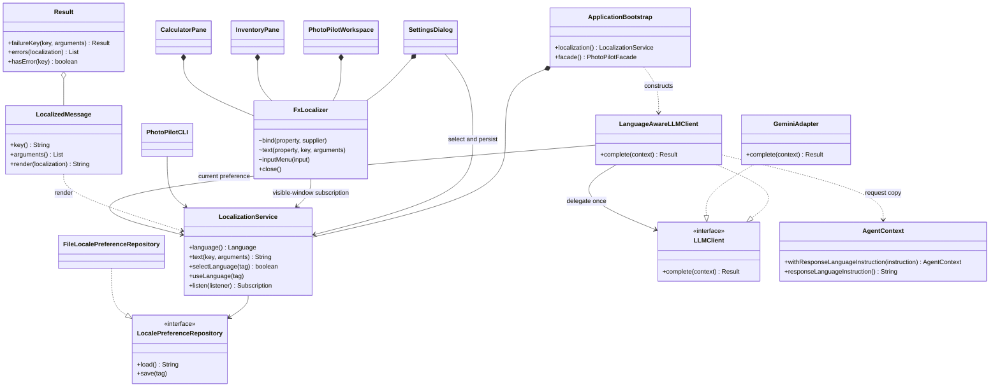
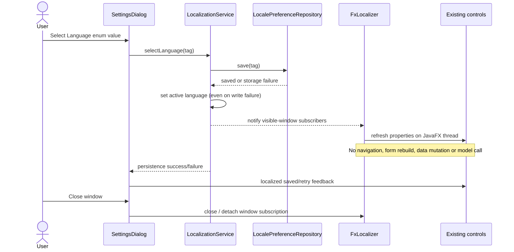

# Localization implementation UML (Stage 2 addition)

This supplements the unchanged Stage 1 diagrams with implemented localization participants. It does not claim that the original AI business workflows are operational.

`GeminiAdapter.complete` and `PhotoPilotAgent.run` remain unavailable. The implemented decorator is verified through the existing port using a capturing test double. Provider serialization of the separate response-language instruction awaits Gemini implementation.

F05 (UC05/SD02), F08 (UC08/SD03), existing Facade/service contracts and deterministic tool evidence remain unchanged. Localization adds Observer, a localization Facade and a narrow LLM port Decorator; it does not satisfy the minimum business feature count or certify five completed operational course patterns.
