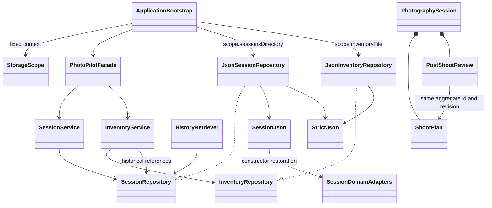

# Phase 1: architecture audit and persistence readiness

Verified 2026-10-31, America/Toronto. Baseline commit: `e097e9d`. This phase improves the existing application; it does not deliver profile management or additional business features.

## Architecture findings

The audit covered the tracked repository inventory, all production packages, build configuration, tests, storage access and dependency references, current implementation documentation, Stage1 report and seven UMLet sources, and the local Stage 2 instructions. Current implementation takes precedence over historical scaffold descriptions. Before changes: 115 main Java sources, 19 test sources, 95 passing tests. After changes: 118 main sources and 21 test sources.

| Layer | Existing implementation and ownership |
| --- | --- |
| Entry points | `PhotoPilotGUI.main/init/start/stop` and `PhotoPilotCLI.main/run/execute`; both construct `ApplicationBootstrap` and use `PhotoPilotFacade`. |
| Presentation/application | Workspace, FeaturePane, SessionPane, InventoryPane, CalculatorPane; CLI SessionCommands, InventoryCommands, CalculationCommands; shared SessionForm, EquipmentForm, CalculationForm parsing. View collections, selections and unsaved drafts are per-instance presentation state. No UI JSON/file access or mutable static business-record collections were found. |
| Services | SessionService and InventoryService implement CRUD; TechnicalCalculator implements F08. Discovery, requirement, recognition, matching, environment/location, planning and review producers remain scaffolds. UI does not own business persistence rules. |
| Agent/integration | PhotoPilotAgent, ToolRegistry, HistoryRetriever, four tool objects, LLMClient/GeminiAdapter plus language policy, EXIF/environment/catalog/location ports. History retrieval and CalculationTool work; the agent loop, Gemini calls and other provider workflows remain unavailable. Agent/tool consumers receive repository interfaces. |
| Domain | PhotographySession is the saved aggregate; GearInventory owns immutable typed Equipment values. Plans, loadouts, snapshots, requirements, capability needs, reviews, EXIF statistics, saved ideas and calculation evidence are already modeled. Do not create duplicate Session/Equipment/Plan models. |
| Persistence | Existing SessionRepository/JsonSessionRepository and InventoryRepository/JsonInventoryRepository already implement local JSON. LocalePreferenceRepository/FileLocalePreferenceRepository separately persist language in UTF-8 properties. No database is needed. |
| Build | Java 21, JavaFX 21.0.6, Gson 2.11.0, JUnit 5.11.4, Maven wrapper/caches. No dependency/configuration changes in this phase. |

Existing storage is retained: `PHOTOPILOT_DATA_DIR/inventory.json` and `PHOTOPILOT_DATA_DIR/sessions/sessions.json`, default root `data`. Both use schemaVersion 1, process locks, flushed temporary files and atomic replacement; inventory has a 10 MiB limit, sessions 20 MiB. Missing storage is empty; malformed/unrecognized storage is an error. Inventory uses store revisions; sessions use per-record revisions. Preferences remain at `PHOTOPILOT_CONFIG_DIR/settings.properties` or `${user.home}/.photopilot/settings.properties`.

## Domain assessment and changes

| Concept | Identity / relationships / persistence decision |
| --- | --- |
| Equipment and five subtypes | Existing UUID, immutable values, typed Optionals, validation and EquipmentData transport mapping retained. A GearSnapshot keeps historical sourceGearId, quantity, specifications and provenance independently of live inventory. Snapshot construction now rejects invalid type, empty identity text and nonpositive quantity. |
| PhotographySession | Existing UUID, dates/timestamps, copied lists, four State types and transient optimistic revision retained. Validation now rejects duplicate `(planId, revision)` pairs, duplicate review IDs and reviews not referencing an approved revision in the same aggregate. Metadata edits preserve identity and creation time. |
| ShootPlan / PostShootReview | Existing UUID identities reused. Revisions must be positive; approved plans cannot carry provisional reasons. Read-only review identity/reference getters support aggregate validation; a calculations getter supports immutable history access. No generation/approval/command workflow is enabled. |
| Loadout | UUID and historical GearSnapshots retained; duplicate sourceGearId entries and assignments referencing absent gear are rejected. Matching and actual camera/lens compatibility remain F07 responsibilities. |
| Requirements / capability profile | ShootRequirement remains a session-owned value, with nonnegative duration, positive camera count and finite positive optional weight. CapabilityNeed bounds must be finite and ordered. EquipmentRequirementProfile is a photography capability profile, **not a local user profile**. Confirmation and contextual validation remain F03/F06 work. |
| Suggestions / windows | Saved ActivitySuggestion values inherit session ownership; negative duration/travel or nonfinite travel is rejected. ShootingWindow rejects reversed start/end and arrival after start. No recommendation generation, ranking or weather validation is implied. |
| EXIF | ExifStatistics rejects impossible sample counts, invalid numeric measurements and histogram counts exceeding available samples; missing values stay explicit. ExifRecord remains a transient extraction candidate, not a new independently stored entity. Metadata extraction and full per-field completeness/denominator semantics remain F11 work. |
| Calculations / location | Existing numeric maps, units, assumptions, Infinity representation and Optional coordinates retained. CalculationResult restoration preserves both historical text and localized descriptors without rerendering them; collections remain immutable. GeoLocation gains an explicit coordinate-presence constructor without inventing coordinates or consent. |
| Other transient data | DiscoveryContext, EnvironmentContext/Assessment, GearImportDraft, AgentContext, ModelReply/ToolCall, commands and SanitizedImage remain workflow/request data. No chat/image/credential persistence is added. |
| Preferences / local users | Existing language preference remains application-wide. No new User/Profile entity, default user UUID, authentication or profile catalogue is invented in Phase 1. |

`SessionDomainAdapters` explicitly reconstructs all 15 domain types reachable from a saved session through their constructors. `SessionJson` disables Gson Unsafe construction. This restores constructor invariants and defensive collection copies on disk reads, while retaining existing field names, null-as-Optional, ISO dates/times, state tags and calculator Infinity strings. Serialization is still field-based; future field changes must deliberately version the schema and extend these mappings. Missing, unknown or coerced fields continue to fail the exact round-trip check. JSON support does not establish business approval or real AI output validation.

`StrictJson` extracts the existing bounded duplicate-key parser. JsonSessionRepository no longer depends on a method inside JsonInventoryRepository. No generic CRUD framework or replacement storage backend was added.

`JsonInventoryRepository.save` now returns the committed aggregate with its new revision; previously, saving that returned value again could falsely report a stale write. JsonSessionRepository calculates returned revisions from the restored representation actually written, accounting for constructor map copies. Stale-write protection, failed transaction rollback and atomic replacement remain intact.

## Profile ownership boundary

`StorageScope(root, Optional<UUID> profileId)` is an immutable address/ownership context, not a profile manager. `legacy(root)` resolves the exact existing paths. `forProfile(root, uuid)` reserves `root/profiles/<canonical UUID>/` without performing any IO. Records belong to the fixed repository scope; session children inherit their aggregate's scope, and inventory entries belong to the scoped inventory. IDs remain unchanged and no profileId field is injected into the v1 exported JSON.

The existing bootstrap constructor delegates to a legacy scope. A new constructor accepts an explicit scope and binds **all** business repositories, services, HistoryRetriever and tools to it for the bootstrap's lifetime. There is no global active-profile variable, environment profile flag, automatic fallback to legacy data, or UI/CLI switching workflow. Language preferences remain outside the business scope.

This is preparation, not complete cross-profile enforcement: detached records do not carry an ownership token, arbitrary file copies are not blocked, filesystem links are not a security boundary, and direct repository constructors still accept paths. Phase 3 must validate selected profile existence, prevent stale/cross-profile UI drafts and imports, and dispose/rebuild the application context on switching. Do not claim comprehensive profile isolation based on path resolution tests.



Original design -> targeted implementation change -> reason -> impact:

- Shared repository ports -> one fixed StorageScope at composition -> consistent future ownership without schema breakage -> F01/UC01/SD01 and F05/UC05/SD02; all future repository consumers inherit the same scope.
- Constructor-based domain values -> explicit constructor restoration instead of Unsafe allocation -> preserve invariants/encapsulation after reload -> session/history and linked F02/F03/F06/F07/F08/F09/F10/F11 data; no producer workflow enabled.
- Atomic saves with revision tokens -> return token for actual committed content -> correct consecutive saves and retain stale-editor protection -> F01/F05 repository contracts.
- Existing aggregate links -> checked review and plan identities -> reject ambiguous or foreign history references -> F01 plus future F10/F11 producers. The existing historical-plan regression fixture was made referentially valid so it still specifically tests the immutable-plan guard.

Facade, Strategy, Adapter, Command and State structures remain intact. F01 exercises Facade/State and F05/F08 shared services; Strategy, external Adapter and Command workflows still are not five completed operational patterns. Original Stage1 artifacts are unchanged; the diagram above supplements current implementation documentation.

## Changed-file inventory

Paths below are relative to Stage2 unless prefixed with `../`.

- Added production: `src/main/java/com/photopilot/repository/{StorageScope,SessionDomainAdapters,StrictJson}.java`.
- Modified composition: `src/main/java/com/photopilot/config/ApplicationBootstrap.java`.
- Modified domain: `src/main/java/com/photopilot/command/ShootPlan.java`; `src/main/java/com/photopilot/model/{ActivitySuggestion,CalculationResult,CapabilityNeed,ExifStatistics,GearSnapshot,GeoLocation,Loadout,PhotographySession,PostShootReview,ShootRequirement,ShootingWindow}.java`.
- Modified repositories: `src/main/java/com/photopilot/repository/{InventoryRepository,SessionRepository,JsonInventoryRepository,JsonSessionRepository,SessionJson}.java`.
- Modified translations: `src/main/resources/i18n/messages{,_en,_zh_CN}.properties` (one matching error key).
- Added tests: `src/test/java/com/photopilot/repository/{PersistenceReadinessTest,StorageScopeTest}.java`; `src/test/resources/persistence/legacy-v1-sessions.json`.
- Modified test: `src/test/java/com/photopilot/session/SessionTest.java`.
- Documentation: this file added; `README.md`, `../docs/PROJECT_MEMORY.md`, `../docs/FEATURE_STATUS.md` updated.
- No files removed. No Stage1, UI layout, CLI syntax, provider configuration, media, runtime data or secret files changed.

The legacy fixture is synthetic SessionFixtures output generated using separately compiled pristine `e097e9d` source, not user data. Temporary baseline source/classes and all logs/build outputs remain ignored under target.

## Verification

Executed on Windows with the existing portable JDK 21 and offline Maven cache:

```powershell
./mvnw.cmd -B -o test
./mvnw.cmd -B -o test '-Dtest=PersistenceReadinessTest,StorageScopeTest,SessionTest,InventoryTest,TranslationResourcesTest'
./mvnw.cmd -B -o test package javafx:run '-Djavafx.args=--smoke-test'
python tools/verify_sources.py
```

- Baseline: 95 tests passed, zero failures/errors/skips.
- All 118 production and 21 test sources were explicitly recompiled after clearing only target/classes, target/test-classes and target/maven-status. This was not Maven clean; JavaFX native caches were preserved.
- Final full suite: **106 tests passed, zero failures/errors/skips**, packaged JAR, **GUI_SMOKE_OK**. Existing real JavaFX session/inventory/calculator/localization controls and separate CLI JVM create/restart/edit tests passed.
- Added coverage: pristine old-file read without rewrite/edit, immutable restored calculation maps, revision/content agreement after map copying, optional/nested data round trips, malformed relationships/numbers preserving files, constructor invariants, early service rejection, consecutive inventory saves/stale writes, failed transaction rollback, deterministic scope paths and unchanged default startup.
- Structural audit: 87 original types, 267 fields, 184 operations, 83 recorded relationships and 20 original artifact hashes preserved. Its historical blanket unimplemented footer is not current business-feature status.
- Intermediate issues resolved: sandbox access to cached JARs required escalation for compilation; JShell fixture generation could not access Windows preferences, so pristine sources were compiled independently instead; the historical-plan test needed a referentially valid fixture; a manually entered test timestamp needed the existing canonical ISO representation. No baseline test failures were observed.

Limits: no live LLM/provider execution, profile management/switching, cross-platform runtime certification, power-loss simulation, or new visual-layout review. Constructor invariants are storage sanity checks, not completed F03/F06/F07/F09/F10/F11 validation. Invalid historical files are preserved and rejected, never repaired or destructively migrated automatically. No new runtime service/API/database dependency exists.

## Phase 2 handoff

Actual inventory/session JSON IO already exists. Phase 2 should extend and consolidate it, not implement a parallel store or replace it with placeholders. Reuse SessionRepository, InventoryRepository, JsonSessionRepository, JsonInventoryRepository, SessionJson/SessionDomainAdapters, StrictJson, EquipmentData and StorageScope. Keep IO/locking/version checks in repository implementations and business validation in models/services.

Phase 2 can add explicit versioned document envelopes/ownership metadata, deliberate non-destructive migration and recovery policies, and reusable storage mechanics if the requirements justify them. Preserve the v1 compatibility fixture, read-only startup, malformed-file rejection, atomic writes, revisions and current GUI/CLI regression tests. Any new domain field requires explicit mapping and compatibility policy; do not silently infer ownership of legacy data.

Phase 3 owns UUID profile metadata, catalogue/selection/lifecycle, validated ownership and isolation. Phase 4 owns GUI/CLI profile selection and draft handling. Phase 5 owns comprehensive persistence/multi-profile, concurrency and failure testing. No full implementation of those phases is included here.
