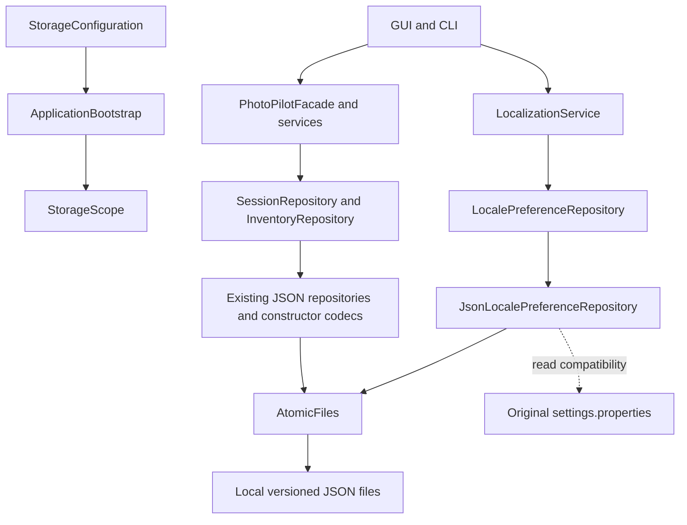

# Phase 2: integrated local JSON persistence

Verified 2026-10-31 (America/Toronto), starting from Phase 1 commit `a28ef2b`. This extends the existing working F01/F05 persistence; it does not introduce parallel repositories or implement scaffolded AI producers.

## Initial architecture and integration

The repository/source/test inventory, Phase 1 audit, services, GUI/CLI entry points, codecs, build and configuration were rechecked. Existing Gson 2.11.0, SessionRepository/JsonSessionRepository, InventoryRepository/JsonInventoryRepository, EquipmentData, SessionJson/SessionDomainAdapters, StrictJson and StorageScope were reused. No new dependencies or domain models were needed.

- GUI SessionPane and CLI SessionCommands -> PhotoPilotFacade.sessions() -> SessionService -> SessionRepository: create/read/edit/search/delete, guarded state and linked aggregate history persist.
- GUI InventoryPane and CLI InventoryCommands -> PhotoPilotFacade.inventory() -> InventoryService -> InventoryRepository: equipment add/read/update/remove, duplicate handling, historical references and stale editor checks persist.
- SettingsDialog and CLI `lang` -> LocalizationService -> LocalePreferenceRepository: bootstrap now supplies JsonLocalePreferenceRepository, with non-destructive legacy properties support.
- HistoryRetriever and future planning/review consumers retain the same scoped repository objects. Previously saved aggregate outputs require no LLM call to reload.

No controller/service business signatures required changes: they already used the correct ports. Composition and concrete IO implementations changed. GUI/CLI entry points display a legacy-location notice; the GUI reuses the workspace's styling in a persistent wrapping notice above navigation. Feature navigation and business forms remain intact. Existing tests that omitted configuration paths now use temporary paths, so they no longer read real user preferences.

## Paths and initialization

The default is based on Java `user.home`, independent of current working directory, classpath, IDE or packaged JAR location:

```text
${user.home}/.photopilot/
  preferences.json
  settings.properties         # optional legacy original, never deleted or modified by the JSON repository
  data/
    inventory.json
    sessions/
      sessions.json
```

`StorageConfiguration.resolve(environment)` owns this policy. `PHOTOPILOT_DATA_DIR` overrides the business root; `PHOTOPILOT_CONFIG_DIR` independently overrides the preferences directory. Prefer absolute values. Explicit relative overrides remain compatible and resolve against the launch directory; blank values are rejected. `.env.example` remains documentation only; there is no automatic `.env` loader. Gemini configuration and API-key behavior are unchanged.

Construction and normal reads create no business files. The first successful save creates required parents and the document; there is no requirement to precreate empty JSON files. A missing store is an empty collection/default preference. An existing empty JSON file is corruption and causes a visible error.

### Existing business data

Older versions defaulted to `<working directory>/data`. No automatic move, deletion, merge or ownership inference is performed. If that directory contains an inventory file or sessions directory and no explicit data override is present, GUI/CLI display both the detected legacy path and active new path. The GUI notice remains across navigation and follows language changes; CLI diagnostics use UTF-8. This is a notice, not an automatic selection of old data. Legacy stores in other directories cannot be discovered reliably; configure their absolute paths explicitly.

To continue using old records, close the application and set the actual environment variable before launching either interface:

```powershell
$env:PHOTOPILOT_DATA_DIR = 'C:\absolute\path\to\existing\data'
./mvnw.cmd javafx:run
# Or launch the CLI in the same configured environment.
```

To relocate manually, close all writers, retain a backup and copy the entire existing business root to an **empty** chosen destination, then set PHOTOPILOT_DATA_DIR to that destination and verify records before retiring the original. Do not merge stores by overwriting individual JSON files. The application does not perform this optional manual procedure for the user. Version-one inventory/session files remain readable and retain their identities, field names and nested relationships.

## Formats and coverage

| Store | JSON envelope / coverage | Operations |
| --- | --- | --- |
| inventory.json | `{schemaVersion: 1, items: [...]}`; five Equipment subtypes, UUIDs, optional specifications and provenance | Existing service CRUD/search/filter and repository load/save/transact |
| sessions/sessions.json | `{schemaVersion: 1, sessions: [...]}`; metadata/notes/state, requirements, capability profile, saved ideas, plans/loadout snapshots/calculations, reviews and EXIF statistics | Existing service create/open/update/delete/search/transition; aggregate save/find/search/reference lookup |
| preferences.json | `{schemaVersion: 1, values: {language: "en"}}`; string settings, including preserved unknown legacy properties | Language load/save through the existing settings service; no invented preference CRUD screens |

Nested session records are saved atomically with their parent, not split into independent plans/reviews files. Their generation/approval remains in the respective F02-F04/F06-F07/F09-F11 future workflows; fixture round trips do not establish those features. F08 remains deterministic; saved calculation evidence is supported without automatically saving every standalone calculation. Original images, credentials and transient agent context are not added to storage.

The Phase 1 constructor codec, ISO temporal values, UUIDs, null-as-Optional, field/type rejection, defensive collection copies and Infinity strings remain. `StrictJson` continues to use Gson's strict token reader, retaining existing duplicate-key and depth checks rather than introducing another parser library. Inventory revisions still reflect complete stored bytes. Session revisions now hash recursively key-sorted JSON objects while preserving array order, preventing unrelated record writes/map iteration order in a different JVM from causing false conflicts. Revisions are transient tokens, so no on-disk migration is required. Restart running older app versions before using this version; mixed-version writers are not certified.

## Preferences compatibility

JsonLocalePreferenceRepository(Path jsonFile, Path legacyPropertiesFile) implements the existing LocalePreferenceRepository port. Both paths must be distinct.

1. If JSON exists, it is authoritative. Invalid JSON never falls back to properties or defaults for writing; LocalizationService presents a read failure and keeps the UI usable.
2. If JSON is absent, read the existing UTF-8 properties file without changing it. Empty legacy properties remain valid. Unsupported legacy language values retain the existing English fallback behavior.
3. On explicit language save, lock the JSON sidecar and legacy properties sidecar, reload, preserve all string settings, update language, and atomically write JSON. The original properties file is untouched. No migration occurs merely by opening the app or using `--lang`.
4. Subsequent saves merge current JSON values under the lock. Explicit simultaneous language changes serialize with last successful save winning; sessions/inventory retain their stronger revision/editor safeguards.

Do not use an older application to edit the properties file after JSON becomes authoritative; that old format will no longer govern this version. The legacy FileLocalePreferenceRepository remains available for compatibility and its original tests remain intact.

## File safety and consistency

`AtomicFiles` is package-private shared infrastructure used by the existing session/inventory implementations and the new preference implementation. It performs bounded reads, strict UTF-8 decoding, parent creation, OS sidecar locks, same-directory temporary writes, complete buffer writes, `force(true)`, replacement and cleanup. Serialization, domain validation and Result/localized error mapping stay with repositories/services.

- Limits: inventory 10 MiB, session store 20 MiB, preferences 64 KiB. Missing files are distinct from empty, malformed, incompatible, inaccessible or oversized files.
- Writers lock across reload -> validation/revision comparison -> serialization -> replacement. No stale in-memory collection replaces freshly read data. Busy/conflict results tell GUI/CLI to retry/refresh without reporting success or losing drafts.
- Original files are not truncated. Only a successfully flushed temporary file is moved over the destination. Failed writes and unsupported atomic moves preserve the original.
- **Safe fallback policy:** if ATOMIC_MOVE is unsupported, fail explicitly and retain the original; do not attempt a non-atomic overwrite or silently weaken crash safety. Use a local filesystem supporting atomic replacement. No backup/recovery success is claimed when it did not occur.
- A terminated writer before replacement can leave a temporary file. Stores ignore recognized temp files; they never promote one automatically or delete another writer's temporary data. OS locks release on process cleanup; an immediate busy result can be retried after cleanup completes. Physical power-loss durability, directory fsync and network filesystem behavior are not guaranteed by the tested contract.
- Locks coordinate PhotoPilot processes; external editors that ignore them and malicious filesystem changes are outside the consistency contract. There is no cross-file transaction across inventory and sessions, although historical gear snapshots remain independent and deletion warnings use existing reference checks.

Runtime data/caches already remain ignored. Stage2/.gitignore additionally excludes preferences.json, its lock/temp files and .photopilot directories. Custom data paths should remain outside source/Git directories; ignore rules cannot sanitize credentials embedded in tracked files. No real local data or configuration was read into committed fixtures.

## Architecture change record



Original -> change -> reason -> impact:

- CWD-relative default -> centralized home-based default plus legacy notice/explicit override -> consistent IDE/JAR/CLI launches without silently relocating files -> F01/F05 bootstrap and both entry points.
- Properties preference adapter -> JSON implementation of the same port with original preservation -> complete JSON coverage of the existing settings workflow -> GUI Settings/CLI lang; language policy unchanged.
- Duplicated file mechanics -> AtomicFiles shared by three repositories -> consistent byte bounds, UTF-8, locks and atomic failure behavior -> persistence-only refactor; Facade/State and retained Strategy/Adapter/Command structures preserved.
- Order-sensitive session hashes -> canonical object-key hashing -> another JVM's serialization order must not invalidate an unchanged record -> F01 concurrency contract; genuine content conflicts still rejected.

## Verification and limitations

Windows, existing JDK 21 and offline Maven cache. Fresh baseline: **106/106**. Final complete build:

```powershell
./mvnw.cmd -B -o test package javafx:run '-Djavafx.args=--smoke-test'
# Focused new persistence verification:
./mvnw.cmd -B -o test '-Dtest=JsonPreferencesTest,PersistenceIntegrationTest'
python tools/verify_sources.py
```

All **124 JUnit tests passed**, zero failures/errors/skips; all 121 main and 25 test sources recompiled, JAR packaged and GUI_SMOKE_OK. This is not a Maven clean build. Existing GUI session/inventory/calculator/settings tests and CLI restart tests passed. GUI-created gear was read through a separate CLI instance, CLI changes refreshed in GUI, and the persistent legacy notice was visually inspected at 880x600 in Chinese (`target/phase2-storage-notice.png`, ignored).

New tests exercise temporary repositories, malformed/empty/oversized/invalid-UTF8 data, preference compatibility and failure/retry, actual CLI JVM CRUD/Unicode/default storage from different working directories, cross-process locks, genuine stale conflict vs unrelated session writes, forced process termination before replacement, Windows read-only files, and unsupported-atomic-move fault injection. A separate packaged-JAR CLI check repeats cross-directory persistence and the UTF-8 legacy notice with a temporary user.home.

The first lock test conflated forced termination with synchronous lock release; it now verifies normal lock release explicitly, while a separate test verifies interrupted-write preservation and retry. Packaged execution exposed Windows stderr's native encoding for Chinese notices; an explicit UTF-8 PrintStream and a real CLI regression corrected it. These were resolved before the final passing run. Original source/UML audit passes 87 types/267 fields/184 operations and 20 source hashes; its historical unimplemented footer is not current feature status.

No live LLM/provider tests, profile creation/switching, complete profile-isolation suite, cross-platform runtime certification, physical power-loss simulation or automatic repair/relocation is claimed. F01/F05/F08 remain the three implemented business features. Persistence reads do not need an LLM, remote database or service.

## Phase 3 handoff

Reuse `StorageScope.forProfile(root, UUID)` -> `<root>/profiles/<uuid>/inventory.json` and `<root>/profiles/<uuid>/sessions/sessions.json`. Pass that immutable scope to `ApplicationBootstrap(Map<String,String>, StorageScope)`; its session/inventory/history/tool consumers share the selected context. Rebuild/dispose that context on switching instead of mutating a global active path.

For profile-specific language settings, Phase 3 can set PHOTOPILOT_CONFIG_DIR to `scope.directory()` before constructing bootstrap, or deliberately retain global settings; `JsonLocalePreferenceRepository(jsonPath, legacyPath)` supports explicit paths. Avoid importing global legacy settings into a profile without a deliberate policy. Current default preferences remain application-wide.

Profile metadata/catalogue, UUID creation, selected-profile existence checks, ownership of legacy records, stale draft cancellation and cross-profile detached-record/import guards remain Phase 3/4 responsibilities. The repositories are path-scoped storage, not authentication or an ownership security boundary. Keep the v1 compatibility fixture, constructor mappings, malformed-file preservation, revision semantics and existing regression suites when extending schemas.

## File inventory

New production: `config/StorageConfiguration.java`, `repository/AtomicFiles.java`, `repository/JsonLocalePreferenceRepository.java` under src/main/java/com/photopilot.

Modified production: `config/ApplicationBootstrap.java`, `repository/{JsonInventoryRepository,JsonSessionRepository,StrictJson}.java`, `ui/cli/PhotoPilotCLI.java`, `ui/gui/{PhotoPilotGUI,PhotoPilotWorkspace}.java`, and three i18n message bundles.

New tests: `repository/{JsonPreferencesTest,PersistenceIntegrationTest,PersistenceProcess}.java`, `ui/gui/StorageNoticeGuiTest.java` under src/test/java/com/photopilot. Existing BootstrapTest, CalculationCliTest, CalculationInventoryTest, InventoryCliTest, InventoryTest, CalculatorGuiTest and InventoryGuiTest now isolate configuration; InventoryGuiTest also verifies GUI-to-CLI retrieval. LocalizedCliTest checks that invocation-only overrides do not create JSON preferences.

Updated configuration/docs: Stage2/.gitignore, .env.example, README.md, this document, f01-sessions.md, f05-inventory.md, localization.md, localization-architecture.md, phase1-persistence-readiness.md, and root docs/PROJECT_MEMORY.md plus FEATURE_STATUS.md. No files removed, no new dependencies, no Stage1 changes.
