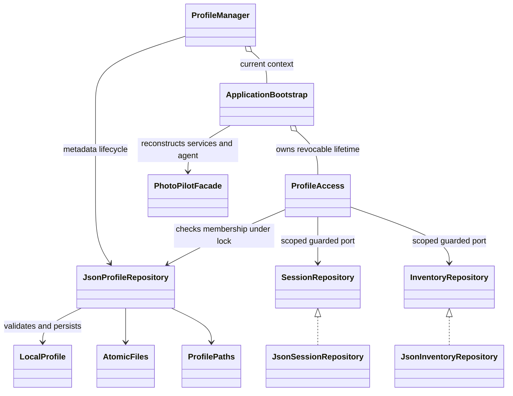

# Phase 3: local UUID profiles and isolated storage

Implemented 2026-10-31 (America/Toronto), starting from Phase 2 commit `0200cfe`. This is the historical Phase 3 snapshot; the subsequent [Phase 4 implementation](phase4-profile-ui.md) adds the GUI/CLI management described as future work below. This is local data organization, not authentication or access control against a malicious local user. F01/F05/F08 remain the three implemented business features.

## Architecture review and scope

Rechecked the repository, Phase 1/2 reports, Stage 1 traceability/source evidence, current models, services, repositories, GUI/CLI startup, tests and Maven configuration. Reused Gson 2.11.0, StorageConfiguration, StorageScope, AtomicFiles, StrictJson, SessionJson/SessionDomainAdapters, EquipmentData and the SessionRepository/InventoryRepository ports. No replacement JSON framework or dependency was introduced. Stage1 files and provider/agent prompts were not changed.

Previously, normal bootstrap constructed repositories at the unscoped root. A scoped path alone did not establish a registered identity, migration ownership, deletion lifecycle or invalidate a retained service after switching. ProfileAccess now owns that lifetime; normal bootstrap always opens the registered stable default. All session, inventory, planning, review, discovery, history and gear-tool dependencies receive the same guarded ports for the selected profile. Facade/service business signatures remain unchanged.

The agent currently has per-instance model/tools/history fields and no implemented conversation cache or running model loop. Switching rebuilds that entire graph and revokes the previous persistence access. This verifies dependency isolation, not live Gemini functionality. Deterministic calculators remain stateless and usable offline.

## Identity, registry and paths

LocalProfile is an immutable record with `UUID id`, `String displayName`, `Instant createdAt`, `Instant updatedAt`. New identities use UUID.randomUUID(). Names are trimmed, nonempty, at most 80 Unicode code points and cannot contain control characters. Duplicate names are allowed; names never participate in path resolution. Rename preserves UUID and creation time. Registry UUID strings must be canonical; dates use ISO Instant strings.

StorageConfiguration still resolves PHOTOPILOT_DATA_DIR, default `${user.home}/.photopilot/data`, independently of the working directory. This is now the **registry root**, not an individual profile directory. Prefer absolute overrides. Explicit relative overrides retain their existing launch-directory semantics. `.env.example` is documentation only, not an automatic environment loader.

```text
${user.home}/.photopilot/
  preferences.json                   # application-wide display language
  settings.properties                # original preference compatibility, unchanged
  data/                              # PHOTOPILOT_DATA_DIR override applies here
    profiles.json                    # versioned registry, default UUID, initialization journal
    profiles.lock                    # shared coordination lock, not an active-profile pointer
    profiles/
      <uuid-a>/
        inventory.json
        sessions/sessions.json
      <uuid-b>/
        inventory.json
        sessions/sessions.json
    profile-staging/<uuid>/           # only during preparation/recovery
    inventory.json                   # optional retained Phase 2 original
    sessions/sessions.json           # optional retained Phase 2 original
```

Display language deliberately remains **application-wide configuration**, controlled by PHOTOPILOT_CONFIG_DIR as before. It is not profile-owned photography data, is not copied into each profile, and is never removed by profile deletion. Existing settings compatibility and invocation-only `--lang` behavior remain. All equipment/session/linked business records are profile-owned.

Registry schema 1 has exactly `schemaVersion`, `defaultProfileId`, `profiles`, `pending`. Each profiles entry contains `profile` metadata and a boolean `archived` tombstone. A non-null pending entry contains the new profile metadata and a `files` map of allowlisted relative business filenames to SHA-256 fingerprints. No user-selected path is stored in the registry. The registry is bounded to 1 MiB and uses the existing strict token reader, duplicate-key detection, UTF-8 validation, sidecar locking and atomic replacement. Unsupported versions, fields, duplicate UUIDs, invalid timestamps/names/types and malformed content fail without resetting it.

The default UUID is persisted once. Normal GUI/CLI launches always choose that default; a manager's current selection is process-local and does not change another running process or a later default launch. The default may be renamed but cannot be archived. Other profiles begin with an empty directory; business JSON is created on the first successful operation. Startup now writes profile metadata/directories and may migrate existing business data, so the former assertion that bootstrap creates no storage at all is intentionally superseded.

## ProfileManager API and switching boundary

`application.ProfileManager(Map<String,String> environment)` is AutoCloseable and opens the stable default. Its public operations are:

| API | Behavior |
| --- | --- |
| `createProfile(String)` | Validate name, persist a new UUID and prepare independent storage; return Result<LocalProfile> |
| `listProfiles()` | Return non-archived, fully initialized profiles ordered by creation time then UUID |
| `getProfile(UUID)` | Retrieve registered non-archived metadata; unknown/null IDs fail |
| `renameProfile(UUID, String)` | Atomically update metadata without touching business files |
| `activeProfile()` | Retrieve current non-archived metadata, including updated display name |
| `activeContext()` | Obtain the current ApplicationBootstrap and its shared Facade/localization/scope; closed managers throw |
| `selectProfile(UUID, boolean pendingChangesHandled)` | Require the caller's explicit transition acknowledgement; validate/prepare target, close the previous context, then publish the replacement |
| `deleteProfile(UUID, boolean confirmed)` | Require explicit confirmation, reject this manager's active/default profile, then archive metadata |
| `close()` | Close/revoke the active context; subsequent manager operations fail |

Management methods return Result failures with semantic localization keys; construction reports a configuration error when no valid default context can be established. GUI startup shows a storage error dialog instead of opening an empty workspace. CLI startup writes a UTF-8 diagnostic and exits with status 2. A failed target lookup or corrupted target keeps the previous valid active context. Selecting the already-active valid identity is a no-op.

The transition acknowledgement means the presentation caller has saved or explicitly discarded drafts, stopped scheduling old tasks and handled their UI callbacks. It is not automatic draft detection. ProfileAccess serializes its operations with close; close waits for a currently executing operation, marks the context closed and makes all retained old service/history/repository references reject later persistence operations. GUI/CLI switching controls are intentionally absent in Phase 3.

Each managed operation rechecks registry membership/path safety while holding the root coordination lock. A concurrent writer receives a retryable failure. Nested F05 removal -> session-reference reads reuse the same thread's lock ownership; the ThreadLocal contains only lock paths, no profiles or business data. Existing inventory/session file locks and optimistic revisions are retained underneath. Registry rename/archive and business operations cannot interleave a partial write through the managed APIs. This is a conservative local coordination policy, not a high-throughput database.

Managed session and full-inventory revisions include the profile UUID in their transient token; another profile cannot reuse them for save/delete. Arrays and nested session fields retain the original v1 format; no new owner field is inserted into historical business JSON. Session insert rejects an already-saved detached record unless the caller deliberately reconstructs a fresh record for an explicit import. Equipment values remain ordinary domain values: Phase 4 must discard old UI drafts rather than deliberately passing them as new entries to another context. Local profiles do not prevent trusted code/users from explicitly copying files or domain values.

`ApplicationBootstrap(environment, StorageScope.forProfile(root, id))` opens only a registered, non-archived profile. The explicit `StorageScope.legacy(root)` overload and direct Json repositories remain low-level compatibility/test utilities; normal application entry points never select them. Those utilities do not supply managed profile-lifecycle guarantees.

## Legacy migration and recovery

Migration runs only when initializing the default registry at the configured root. It imports only `inventory.json` and `sessions/sessions.json`; complete nested plans, reviews, notes, requirements, saved ideas, EXIF statistics and calculations remain part of the session aggregate. Record identities and relationships are preserved byte-for-byte. Unrelated root files, photographs, configuration and secrets are never imported. Existing Phase 2 validation rejects unknown/corrupt session storage rather than guessing its format.

1. Lock the registry and both legacy writer sidecars; read/validate bounded legacy documents. If invalid, do not register a default or overwrite source files.
2. Persist the generated default UUID and source fingerprints in the initialization journal before creating its destination.
3. Recheck the source snapshot, create/resume `profile-staging/<uuid>`, write only missing matching files with the existing atomic utility and verify every expected fingerprint. Conflicting staging content fails without overwrite.
4. Atomically move the complete staged directory to `profiles/<uuid>`, verify fingerprints and load through the existing domain codecs.
5. Atomically register the ready profile and clear its journal. Until this commit it is not selectable/listed as a ready profile.

A terminated process before publication resumes the same UUID from the durable journal. A failure after directory publication but before registry commit verifies that directory and completes registration on retry. A changed source, conflicting destination, unsupported atomic move or IO failure preserves all data and reports an error. Rename/archive of another ready profile preserve an outstanding initialization journal. Existing ready contexts remain usable when a separate creation is pending. A later initialization or create attempt resumes that pending operation; it may therefore finish a previously reported failed creation.

Once migration succeeds, later startup does **not** re-import old files, even if an old application edits them. Close older versions before migration and do not mix old and new writers. The application retains original source files; it never merges newer profile data with later legacy changes. If profiles/staging directories exist but profiles.json is missing, initialization refuses to invent replacement identities. Missing registered directories also fail; they are not silently recreated.

For recovery, stop writers, retain the full root and its current journal, resolve the reported conflict using a verified backup, then retry. For a pending source fingerprint mismatch, restore that original source snapshot before retrying; the application does not guess which version to prefer. No automatic repair, arbitrary import, backup rotation or permanent deletion tool is provided. Legacy CWD data outside the configured Phase 2 root still uses the existing notice: set PHOTOPILOT_DATA_DIR to its absolute root to migrate it deliberately.

## Deletion and filesystem safety

Deletion is a **recoverable logical archive**, not recursive filesystem removal. With confirmation, a non-active/non-default profile receives an atomic archived tombstone and disappears from normal list/get/select operations; its UUID directory and every data byte remain. Tombstones retain UUID ownership and prevent accidental reuse. A failed registry write leaves the profile available and all files intact. Permanent deletion and a restore UI are not implemented. Archived files are retained for deliberate offline recovery/future restoration, so deletion does not reclaim disk space.

A profile active in this manager cannot be deleted. Another manager/process may archive a non-default profile selected elsewhere: the peer's next managed operation detects the tombstone and fails instead of reading or recreating that profile. An in-progress managed operation completes before the archive can obtain the coordination lock. The peer must select another profile; the deletion never removes its saved data.

Paths derive exclusively from normalized roots and UUID objects. Existing symbolic links and special/reparse entries, including Windows junctions in checked ancestors or business paths, are rejected. Archive validates the retained tree without following links (bounded to 10,000 entries). There is no recursive delete/move of arbitrary user paths, and no global configuration deletion. These checks prevent normal API path escapes; they are not a security boundary against a malicious local process racing filesystem changes. OS permissions, backups and filesystem atomicity still matter.

## Architecture changes for the Stage 2 report



Original -> implemented change -> reason -> impact:

- Unowned default paths -> persisted default UUID plus registry/context -> stable isolated ownership without login -> both entry points and all repository consumers.
- Reusable scoped paths only -> revocable guarded ports and fresh bootstrap per selection -> prevent old services/history from crossing a transition -> retained Facade/services/agent composition, no business signature changes.
- Global business files -> verified one-time snapshot/journal migration -> preserve users' Phase 2 records and recover interruption -> original v1 codecs and source bytes retained.
- No profile deletion contract -> confirmed metadata archive with retained files -> avoid irreversible/partial tree deletion -> no permanent delete or authentication claim.
- Global UI language -> deliberately retained global configuration -> preserve existing GUI/CLI preference behavior -> independent of profile-owned photography records.

## Verification

Fresh baseline: **124/124** tests passed. Final Windows/JDK 21 verification:

```powershell
# From Stage2 with the existing JDK/cache configured; smoke uses an isolated target data/config root.
./mvnw.cmd -B -o test package javafx:run '-Djavafx.args=--smoke-test'
# Focused profile tests:
./mvnw.cmd -B -o test '-Dtest=ProfileManagerTest,ProfileRecoveryTest'
python tools/verify_sources.py
```

Final suite: **152 tests**, zero failures/errors/skips; JAR packaging and GUI_SMOKE_OK. All 126 main and 27 test sources were recompiled during implementation; this is not a Maven clean claim. Existing F01/F05/F08/localization GUI and CLI regressions pass. A standalone packaged-JAR CLI check verifies stable default identity/records across working directories and reports corrupt-registry failure without resetting data.

Added 26 lifecycle/recovery tests cover name/UUID rules, duplicate names, deterministic listing, rename/data preservation, normal and failed switches, old service/history revocation, agent graph replacement, cross-profile revision rejection, linked aggregate isolation/restart, default/active deletion protection, confirmed archive, peer invalidation, global language policy, exact legacy migration, interrupted prepare and final commit, changed source/conflicting target, pending-journal preservation, missing/corrupt registry, write/lock failures and an actual Windows junction pointing outside the data root. Real child JVMs test multi-profile restart, terminated migration and cross-process registry lock release. Two additional regression tests cover real CLI startup failure/status 2 and a real JavaFX error dialog. Tests use isolated temporary data; normal smoke uses ignored target paths.

Intentional test updates: bootstrap now asserts persisted profile metadata and absent business documents instead of no directory creation; GUI/CLI fixtures locate business files through the actual scope. The low-level InventoryTest and F05-reference SessionTest retain explicit legacy bootstrap to continue testing the old storage port directly. No tests were removed. The first integration run exposed these old path assumptions; they were updated. A Maven invocation from the repository root could not resolve its relative offline cache; rerunning from Stage2 fixed it without dependency changes. Review caught and corrected loss of a pending journal during unrelated metadata edits, with a new regression test. The source audit also required replacing the registry-missing null sentinel with Optional; the corrected audit passed. Its old blanket unimplemented footer is historical, not current feature status.

No live LLM calls, physical power-loss tests, malicious filesystem-race certification, macOS/Linux execution, Phase 4 profile screens or complete Phase 5 end-to-end suite is claimed. GUI error-dialog appearance uses the existing stylesheet and is control-tested; no major screens were redesigned. Stage1 and original source hashes remain unchanged.

## Exact Phase 4 handoff

Use one ProfileManager per application window/process. Initially bind `activeContext().facade()` and `.localization()` to the existing PhotoPilotWorkspace/SessionPane/InventoryPane/CalculatorPane or PhotoPilotCLI. On user selection, validate a canonical UUID, resolve dirty forms using the existing discard/save flows, stop/drain old queued work, and call `selectProfile(id, true)`. On success, dispose old FxLocalizer/settings/pane subscriptions and callbacks, replace all context-bound panes/CLI references from the new activeContext, clear old displayed records/drafts and reload. On failure retain the old views/context and show Result.errors(localization). Never merely change a global path underneath existing services.

Create/rename/delete controls should call the public manager API above; deletion confirmation must explicitly explain that archive retains data and requires switching away from the selected profile. Do not access JsonProfileRepository directly from widgets. Default startup, profile-owned F01/F05 records, existing agent/tool dependencies, registry recovery and guard behavior are already implemented. Phase 4 owns user-friendly selection/confirmation/disposal workflows; Phase 5 owns broader end-to-end/concurrency/platform verification. No login or credential UI is needed.

## Changed-file inventory

- New production: `model/LocalProfile.java`, `application/ProfileManager.java`, `repository/{JsonProfileRepository,ProfileAccess,ProfilePaths}.java` under src/main/java/com/photopilot.
- Modified production: `config/ApplicationBootstrap.java`, `repository/StorageScope.java`, `ui/cli/PhotoPilotCLI.java`, `ui/gui/PhotoPilotGUI.java`, and all three i18n bundles. Existing business service/domain codecs/JSON business repositories remain unchanged.
- New tests: `repository/ProfileManagerTest.java`, `repository/ProfileRecoveryTest.java` under src/test/java/com/photopilot.
- Modified tests: BootstrapTest, CalculationInventoryTest, LocalizedCliTest, InventoryTest, PersistenceIntegrationTest, PersistenceProcess, StorageScopeTest, SessionCliTest, SessionTest, SessionGuiTest and StorageNoticeGuiTest.
- Configuration/docs: .gitignore, .env.example, README.md, this report, f01-sessions.md, f05-inventory.md, phase2-json-persistence.md, and root docs/PROJECT_MEMORY.md plus FEATURE_STATUS.md. No removed files, dependency changes or Stage1 modifications. Profile registries/directories/staging, legacy data, preferences, credentials, build outputs and test logs are excluded from Git.
