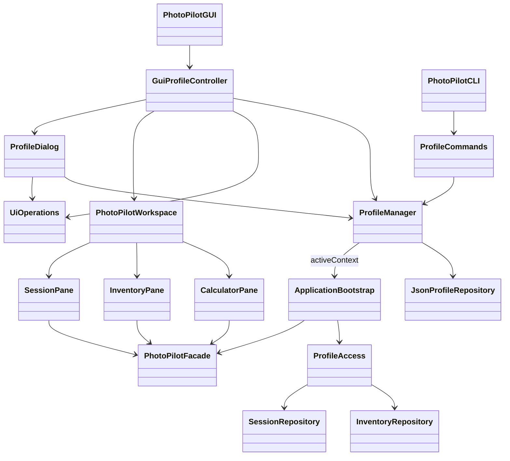
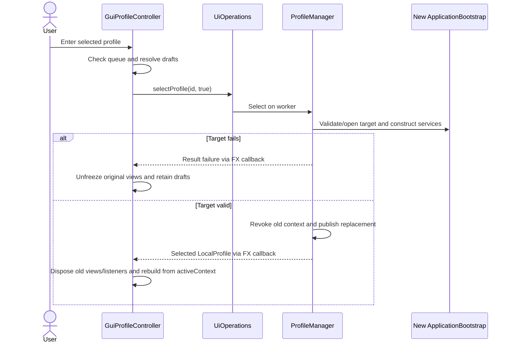

# Phase 4: GUI and CLI profile management

Implemented and verified 2026-10-31 on Windows/JDK 21, from Phase 3 commit `5844f69`. This adds usable profile management to the existing application; it does not increase the three implemented business features (F01/F05/F08) or implement live AI.

## Architecture inspected

The existing GUI is JavaFX 21, launched by `PhotoPilotGUI`, with `PhotoPilotWorkspace`, `FeaturePane`, F01/F05/F08 panes and a shared stylesheet/localization service. The existing `PhotoPilotCLI` accepts complete command lines from stdin or one complete command per argument, dispatching to shared application services. Both now own a `ProfileManager` rather than permanently retaining the initial bootstrap.

The Phase 3 API remains `createProfile(String)`, `listProfiles()`, `getProfile(UUID)`, `activeProfile()`, `renameProfile(UUID,String)`, `selectProfile(UUID,boolean pendingChangesHandled)`, `deleteProfile(UUID,boolean confirmed)`, `activeContext()` and `close()`. Result failures remain explicit. Immutable `LocalProfile` values carry UUID/name/timestamps. The registry, safe paths, archive guards, migration journal, revocable repositories and JSON codecs are reused without another storage implementation. Manager initialization delegates once to normal bootstrap, retaining the existing legacy-data notice.

## GUI usage and lifecycle

Startup still enters the stable default automatically. The header shows its actual name and **Manage profiles**. The modeless management window has selectable rows with a placeholder avatar, display name and secondary full UUID (to distinguish duplicate names without requiring typed IDs). Choose a row and **Enter profile**. Enter a new display name and **Create profile**, then enter the created profile; creating does not silently switch. **Rename selected** preserves identity and records. The same field supplies the new name; backend validation remains authoritative.

**Delete selected** opens a cancellable confirmation identifying name and UUID. The default action is Cancel. Deletion archives the registry entry and retains files on disk; it does not reclaim space and there is no restore command or automatic recovery promise. The existing manager rejects active/default deletion. Switch away before deleting an ordinary profile. No GUI code traverses or deletes directories.

All profile disk operations run on the same window worker queue as existing business operations. Switching and window closure are blocked while queued/running work or its JavaFX completion callback remains pending; the user gets wait/retry feedback. Session drafts, open equipment editors and calculator inputs require explicit discard confirmation when switching. Cancel preserves them. A failed target validation/open also preserves the old context, visible views and drafts even after discard was confirmed: disposal happens only after backend success. Users can cancel the switch, save through the existing form and retry.

On success, `GuiProfileController` disposes old panes, localization listeners and owned settings/profile windows, clears old forms/results/selections and constructs new panes from `ProfileManager.activeContext()`. F01 opens refreshed history; F05 inventory and F08 equipment prefill reload on navigation. Existing saved plans/reviews/loadout snapshots appear through F01's selected-profile aggregate. There are no separate implemented plan/review screens to refresh. The new main view starts on F01. The old Facade and repositories are revoked by Phase 3. Brief submission captures its original context and view and cannot update a replacement view.

Use **Refresh list** (or reopen profile management) after another process creates/renames/archives a profile. It also reloads the current-profile header. Use the existing F01 Search / Refresh or F05 Search / Refresh to observe external record changes. No filesystem watcher or live cross-process push is claimed; optimistic revisions continue to reject stale edits. If another process archives the current identity, the next guarded operation fails; refreshing profiles marks it unavailable and permits entry into another valid profile. A corrupt registry never becomes an empty replacement.

The shared English/Chinese bundles translate controls, confirmations, help and feedback; underlying backend diagnostics retain their original technical detail. The normal main window remains 1120×760, minimum 880×600; the scrollable management window is 660×620, minimum 480×480. Operation feedback sits in a fixed footer so it remains visible while the form scrolls. Names wrap within rows. No new framework/dependency or navigation redesign.

## CLI usage

Start the existing CLI from Stage2:

```powershell
./mvnw.cmd exec:java '-Dexec.mainClass=com.photopilot.ui.cli.PhotoPilotCLI'
```

Then type complete commands, one per line:

```text
profile help
profile list
profile create "Photography Trip"
profile current
profile select <UUID-from-list>
session create title="Trip Session" date=2026-11-01
gear list
profile rename <UUID-from-list> "Travel"
profile select <another-UUID>
profile delete <UUID-from-list> --confirm
exit
```

`profile` alone lists profiles. `profile current` and `*` in the list identify the actual current context. Duplicate names are accepted; operations target full UUIDs. Arguments/arity/UUIDs/names/unknown identities are validated. `profile delete UUID` without `--confirm` only prints the archive policy and required syntax, returning an error. Active/default protections remain in ProfileManager.

For a process-specific startup selection, supply `--profile UUID` or `--profile=UUID` once:

```powershell
./mvnw.cmd exec:java '-Dexec.mainClass=com.photopilot.ui.cli.PhotoPilotCLI' '-Dexec.args=--profile=00000000-0000-4000-8000-000000000001 "session list" exit'
```

Replace the example UUID with an existing ID. Preserve the existing convention: each multiword command must reach Java as a single argument, or use stdin. Nested quoting depends on the launcher; stdin is the simplest route for names containing spaces on Windows. An invalid/unknown/unavailable `--profile` aborts before business commands, with no default-profile fallback write. Selections are process-local and never change the registry's default: every independent launch returns to that same default unless explicitly selected. `--lang` retains invocation-only semantics across switches; persisted language remains application-wide.

`execute` keeps the existing dispatch return contract (0 handled, 1 request exit, 2 error); `run` accumulates failures and `main` exits 0 on success/normal exit or 2 on configuration/command failure. A failed command does not terminate an interactive session, but its final process exit status remains 2. This now makes existing business-command failures visible to scripts as well. Existing injected-Facade constructors remain for embedders/tests, with explicit profile-unavailable feedback; the normal entry point supplies ProfileManager.

## Implemented architecture and Stage 1 impact





Original design -> implementation -> reason -> impact:

| Original boundary | Phase 4 implementation | Reason / impact |
| --- | --- | --- |
| GUI and CLI hold one bootstrap/Facade | Process ProfileManager, GUI lifecycle controller and CLI context refresh | Actual switches must replace all profile-bound references; Facade business methods and original UML signatures retained. |
| Programmatic profile lifecycle | Modeless GUI editor and ProfileCommands adapter | Both expose the same application service; neither duplicates validation, identity generation or JSON IO. |
| Independent pane worker usage | Counted shared UiOperations through FX completion | Prevent transition before queued old-context effects and their callbacks complete. |
| No profile-specific UI teardown | Explicit pane/workspace disposal, owned settings closure, fresh graph | Remove stale forms, selections, calculator prefill/results and subscriptions. |

Facade, Strategy, Adapter, Command and State implementations remain intact. These Stage2 implementation diagrams supplement the original Stage1 UML; Stage1 artifacts are unchanged. Business services/repository schemas/LLM requests were not expanded. The per-bootstrap agent graph (history, model policy and tools) is replaced on selection; Phase 3 tests verify revocation and repository identity. Actual agent execution, live Gemini requests and saved-output producers remain scaffolded, so no live-AI acceptance is claimed.

## Files and verification

New production classes: `ui/cli/ProfileCommands`, `ui/gui/GuiProfileController`, `ui/gui/ProfileDialog`, `ui/gui/UiOperations`. Updated: both application entry points, ProfileManager initialization, workspace/feature/pane disposal and draft observations, shared CSS and three message bundles. New tests: `ProfileCliTest` (6) and `ProfileGuiTest` (5). No existing tests were removed or weakened.

Fresh baseline: **152/152**. Final full regression: **163/163**, zero failures/errors/skips, JAR packaging and **GUI_SMOKE_OK**:

```powershell
# Stage2, JDK 21 and existing Maven cache; smoke DATA/CONFIG overrides point under ignored target/.
./mvnw.cmd -B -o test package javafx:run '-Djavafx.args=--smoke-test'
./mvnw.cmd -B -o test '-Dtest=ProfileCliTest,ProfileGuiTest'
python tools/verify_sources.py
```

All 130 main and 29 test sources were compiled during implementation; this is not a Maven clean claim. New tests use temporary storage and real JavaFX controls/worker callbacks. They cover creation, selection, duplicate Unicode names, invalid input, rename, archive confirmation/cancel/protections, corrupt storage and failed transitions, session/equipment/calculator drafts, close/switch while busy, external rename/archive and refresh, old-listener/context disposal, UUID/data survival across reconstructed GUI windows and real CLI JVM restarts, malformed arguments/options, and exit status 2. A GUI-created profile, saved gear and saved session are read by a separate CLI JVM; that JVM edits the session, GUI refresh sees it, B stays isolated, and A's records survive switching and restart. Existing linked aggregates, agent graph, stale revisions, migration, locks, read-only storage and junction tests remain passing. A separate packaged-JAR CLI check passed profile creation, explicit selection, cross-directory restart, default isolation and invalid-selection exit 2. Source/UML audit passed 87 types, 267 fields, 184 operations, 83 recorded relationships and 20 unchanged original-source hashes; structural coverage is not a claim of completing scaffolded features.

First test iterations exposed test-harness assumptions (Windows nested argument quoting, absent lazy empty inventory file, using model toString instead of its title); the harness was corrected without weakening assertions. Native resizing is asynchronous; the layout test now waits for the scene resize before capture. An added narrow-window feedback check exposed offscreen error feedback; a fixed footer resolved it, and the five-test graphical rerun passed. Rendered snapshots in ignored `target/phase4-profiles-narrow-zh.png`, `target/phase4-profiles-feedback-zh.png` and `target/phase4-main-narrow-zh.png` were visually inspected; profile editor actions are reached by vertical scrolling at minimum height while errors stay visible. These are automated real-desktop workflows with image inspection, not a claimed human/manual full acceptance session or recorded demo.

## Limits and Phase 5 handoff

- Existing F01/F05/F08 remain verified; eight other workflows, live agent/provider behavior and demonstration recordings remain outstanding. Profile CRUD is infrastructure, not an extra major course feature.
- No live file watching, global remembered selection, authentication, permanent deletion or archive restore UI. Use refresh; back up the entire root including registry. Language preferences remain global.
- Windows graphical execution and ordinary filesystem failure/concurrency tests passed. Other OSes, multiple DPI settings, screen readers, very large registries, long-running stress, physical power loss and adversarial filesystem races are not verified.
- Phase 5 should run a full user acceptance/demo script, concurrent GUI/CLI rename/archive/edit/switch stress with stale handles, prolonged queued operations, repeated switches/leak observations, backup/recovery drills, additional disk-full/permission/interruption fault injection and large/long-name accessibility/layout checks. Preserve originals and use isolated copies; no real user-data fault injection.
- Future implemented AI requests must use the same tracked queue or an equally explicit captured-context cancellation/completion policy. Do not schedule untracked model tasks and assume the profile header identifies their ownership.

No known failing Phase 4 checks remain. This is readiness for the final validation phase, not completion of Phase 5.
