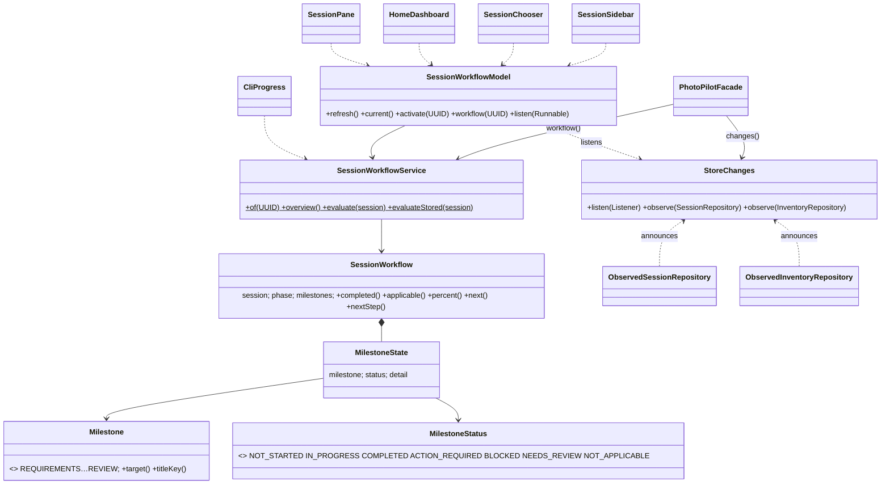

# Session-centric workflow: progress, sidebar and continuation (2026-11-23)

PhotoPilot is organised around the photography session. Every session has its own workflow progress, derived from
its stored records. The sidebar shows the session being worked on, its seven milestones and the recommended next
one. Session pages, Home, the session list and the CLI read the same progress, and every successful save updates it
at once. The business architecture is unchanged: every action still goes through `PhotoPilotFacade` and the existing
services, and operation-level execution feedback ([execution feedback](execution-feedback.md)) works as before.

## Problems found (before)

- **Feature-centric navigation.** The sidebar listed F01–F11 in three groups (Workspace, Equipment, Photography Tools).
  These followed implementation history, not the photographer's workflow: Shoot Planning sat in Workspace while
  Capability Analysis, Compatibility Check and Environment Planning were split across Equipment and Tools. Nothing
  showed which session was being worked on.
- **No session-level progress.** There were two partial step derivations, and they disagreed:
  - `HomeDashboard.Step` (requirement → profile → plan → shoot);
  - `NextSteps.session` (Draft → F03 or F10, skipping F06/F07/F09).
  Neither covered the seven milestones, and the session list showed only the lifecycle state.
- **Pages chose their session independently.** Each page's chooser fell back to the first listed session, so moving
  between pages could silently switch sessions.
- **No durable environment milestone.** The F09 assessment lives only in this process's memory, so "environment
  assessed" could not survive a restart.
- **Stale results were invisible.** After an upstream change, a stale capability profile, gear selection or approved
  plan showed only on the page that rechecks it.
- **No continuation after saving.** After a save, the next step came from a fixed successor table, even when that
  step was already done.

## Navigation (sidebar)

```
Before                                   After
Home                                     GENERAL
WORKSPACE                                  Home · Photography Sessions · Discover Inspiration
  Sessions & History, Inspiration,       ACTIVE SESSION
  Requirement Parsing, Shoot Planning      [session name · phase · bar · 57% · 4 of 7 milestones · Next: …]
EQUIPMENT                                  ① Shooting Requirements   ② Gear Requirements   ③ Gear Selection
  AI Gear Import, Gear Inventory,          ④ Environment Assessment  ⑤ Photography Plan
  Capability Analysis, Compatibility Check ⑥ Shooting Completion     ⑦ Post-Shoot Review
PHOTOGRAPHY TOOLS                        EQUIPMENT MANAGEMENT (collapsible)
  Technical Calculator,                    Gear Inventory · AI Gear Import · Gear Capability Report
  Environment Planning,                  PHOTOGRAPHY TOOLS (collapsible)
  Post-Shoot Analysis                      Technical Calculator · Camera Shutter Count
PREFERENCES                              SETTINGS (collapsible)
  User Settings, App Settings              User Settings · Application Settings
```

- **Entries and ids.** Every feature keeps its page and its stable entry id (`nav-F01` … `nav-F11`). Page titles use
  the workflow names, so the sidebar, page heading and guidance say the same thing:
  - Photography Sessions, Discover Inspiration;
  - Shooting Requirements, Gear Requirements, Gear Selection, Environment Assessment, Photography Plan,
    Post-Shoot Review.
  - "Gear", the vocabulary already used by Gear Inventory and AI Gear Import, replaces "Equipment" in the two
    milestone names, which keeps the labels short enough for the compact sidebar.
  - F04, F05 and F08 keep their names (tests pin them).
  - Messages that named the old pages were updated in both languages. The CLI `status` catalogue (`catalog.*`) is
    unchanged.
- **Additional sidebar destinations.**
  - *Shooting Completion* (`nav-shoot`): the sessions page, titled Shooting Completion, with the current session's
    editor open at its lifecycle action. The action gets keyboard focus only from the shoot day onwards, because
    recording the shoot freezes the session's records. It is never applied by navigation.
  - *Gear Capability Report*: the existing report card of the F06 page, shown on its own (`CapabilityPane.reportOnly`).
  - *Camera Shutter Count* opens the standalone photo checker. The Mini AI prompt and quick actions are on Home.
- **Active session block.** It shows the session name, phase, a thin bar with the percentage, "x of y milestones" and
  "Next: …".
  - Each milestone row shows a 20 px step badge in the usual icon slot, so row text keeps the width of every other row:
    - the step number while the milestone is not started;
    - otherwise a shape per status: check (done), half disc (started), "!" in a ring (action needed), warning
      triangle (needs review), lock (blocked), dashed ring with dash (not needed).
  - The recommended next milestone's badge is a solid accent disc with its number in the on-accent colour. The current
    page keeps the normal selected fill. The two differ in shape as well as colour; the row tooltip and accessible
    text name the status, the reason and "recommended next step".
  - Blocked and not-needed rows are muted but stay clickable: the page explains the prerequisite.
  - Without a current session the block shows "No active session" and a "Choose a session" link, and rows show
    neutral numbered badges.
- **Collapsing.** Equipment, Tools and Settings collapse (expanded by default). A collapsed section opens again when
  one of its entries is selected, and the selected entry stays visible.
- **Keyboard.** Up/Down/Home/End follow the display order over the visible rows. Moving to a page row selects it.
- **Fit.** New lines have fixed minimum heights, so rows do not move on a language switch (`LanguageLayoutGuiTest`).
  The block uses the workspace's existing localizer, so no localization listener is added.

## Session workflow architecture



### Core and wiring

| Class | Package | Responsibility |
| --- | --- | --- |
| `Milestone`, `MilestoneStatus`, `MilestoneState`, `SessionWorkflow` | `workflow` | Immutable read model: seven milestones in order, each with a status and a short reason (message key); completed/applicable/percent; recommended next milestone and its guidance. |
| `SessionWorkflowService` | `service` | Derives the workflow from persisted records only, reusing the services' own rules. No AI, network or writes. `overview()` makes one sessions read and one inventory read. |
| `EnvironmentCheck` | `model` | Minimal persisted record of an F09 assessment added to the session (see below). |
| `StoreChanges`, `ObservedSessionRepository`, `ObservedInventoryRepository` | `repository` | Observer subject and two Decorators, wired in `ApplicationBootstrap`. They announce each successful session or inventory write after it returned. Storage behaviour is unchanged, and a listener failure never affects a write. |

### GUI

| Class | Responsibility |
| --- | --- |
| `SessionWorkflowModel` | One per window and user: every session's workflow and the current session. |
| `SessionSidebar` | The Active Session block and the milestone badges. |
| `SessionChooser` | Ties a page's session chooser to the current session and shows its context line. |
| `SessionScoped` | Contract of the six session pages. |
| `WorkflowGlyphs` | Badges and bars. |

### Reused or extended

- `NextSteps.session` now delegates to the workflow.
- `NavigationRequest` gained the SHOOT, SESSION, REPORT and SHUTTER targets and one target-to-title resolver.
- `OperationRunner.guidance` and `CliProgress.run(kind, session, work)` replace the next step after a saved milestone
  with the session's own next milestone, so the progress card, the CLI `[NEXT]` line and the sidebar name the same
  step.
- `OperationKind.ENV_RECORD` and `advancesSession()` are new.
- `PlanningService.recordEnvironment`, the shared `selectionCheck` and a package-visible `sameShoot` were added.
- `EnvironmentEvidence.applies` uses the same rules as `check`, through one shared rule core.

### Removed

`HomeDashboard.Step` (duplicate step logic). The old `next.session.*`, `home.next.*` and `group.*` texts went with it.

## Milestone completion criteria

R is the confirmed requirement, P the reviewed profile, L the saved F07 selection, and Plan the latest approved
revision. Staleness is checked while the session is editable, with three exceptions.

- **Completed and reviewed sessions** keep their records' meaning: no NEEDS_REVIEW.
- **A planned session whose date has passed** goes straight to "mark the shoot as completed" rather than "revise".
- **A draft** is re-checked whatever its date, except its environment check: F09 cannot redo a past date, so a
  check that no longer applies to a past shoot date counts as skipped.

| Milestone | Completed when | Other states |
| --- | --- | --- |
| 01 Shooting Requirements | R is stored (only confirmed requirements are ever saved) | NOT_STARTED; historical without R: NOT_APPLICABLE |
| 02 Gear Requirements | P is stored and `PlanningService.usableProfile` accepts it (consistent with R) | NEEDS_REVIEW when R changed so P no longer fits; BLOCKED without R; NOT_STARTED |
| 03 Gear Selection | Before a plan: L is stored and the F07 recheck holds (`PlanningService.selectionCheck`: UC14 compatibility and F05 availability). Once a plan is approved: its gear (F10 may plan without or with another offer than L; approval requires gear) | NEEDS_REVIEW when L's gear changed or left the inventory; BLOCKED without a usable profile; NOT_STARTED |
| 04 Environment Assessment (optional) | An `EnvironmentCheck` is recorded and still applies (`EnvironmentEvidence.applies`: zone, shooting date, location, shooting time against the recorded availability, unchanged label-only location / timing text) | NEEDS_REVIEW when the date or place changed, when the shooting time no longer overlaps the recorded availability (partial overlap still counts), or when the timing text of a requirement without a start time changed; a check that no longer applies to a past shoot date is skipped. Not recorded: NOT_STARTED (recommended) until a plan is approved, then NOT_APPLICABLE (skipped), as when the date has passed |
| 05 Photography Plan | Plan exists and still records the shoot: `fixedConstraints` equal `PlanValidator.constraintsOf(R, P)`, `sameShoot` (date, place), plan gear still owned. Older plans without these records are not re-checked | NEEDS_REVIEW ("revision required"), with the reason: changed constraints need a new plan (F10 regenerates only then), a changed date, place or gear a revision; BLOCKED without R or P; NOT_STARTED. Previews/drafts are in memory only and shown by the page |
| 06 Shooting Completion | State COMPLETED or REVIEWED (only the explicit lifecycle action; never the calendar) | DRAFT: BLOCKED; PLANNED: NOT_STARTED, or ACTION_REQUIRED once the shooting date has passed |
| 07 Post-Shoot Review | State REVIEWED (a saved review) | COMPLETED with usable statistics: IN_PROGRESS; without: NOT_STARTED; earlier: BLOCKED |

**Progress** is completed ÷ applicable milestones (NOT_APPLICABLE is left out), rounded and capped at 99 % until
every applicable milestone is done. It means milestone completion, not time, effort, visits or AI requests. Drafts,
previews and running Gemini requests never change it.

**Phase:**

| State | Phase |
| --- | --- |
| Draft without R | Getting started |
| Draft with R | Planning in progress |
| Planned | Ready to shoot |
| Completed | Awaiting review |
| Reviewed | Completed |

"· needs attention" is added while any milestone needs review or action.

## Next-step resolution

- **The recommended next milestone** is the first milestone, in order, that is NEEDS_REVIEW, ACTION_REQUIRED,
  IN_PROGRESS or NOT_STARTED. BLOCKED rows are never recommended, because their prerequisite comes earlier. When
  every applicable milestone is done, the session is complete.
- **Guidance sentences.** The guidance (`SessionWorkflow.guidanceKey`) is a re-check, act-now, continue or start
  sentence for that milestone, with the milestone's page as its target. Environment Assessment is worded as optional.
- **After a save in the GUI.** When an operation that saves a milestone succeeds (requirement, profile, selection,
  environment check, plan, statistics or review), the progress card shows that same next step with
  "Continue to {page}".
- **How the card gets the step.** The store announces the save on the writing thread. The model evaluates the stored
  session there and applies it on the FX thread, before the saving task's own completion runs (FIFO), so the card and
  the sidebar agree.
- **The CLI** prints the same step as its `[NEXT]` line on the progress stream.
- **Other cases.** Failures, cancellations and prerequisites keep `NextSteps.after` / `NextSteps.before` ("Open …").
- **No side effects.** Navigation never approves, saves, deletes or calls a model.

## Dependencies, alternative paths and invalidation

- **Order is recommended, not enforced.** The milestone order guides the user but does not restrict them.
  - Pages remain reachable whatever the progress, and their own business guards are unchanged.
  - F07 and F09 are not required by F10, so skipping them never blocks the plan.
  - F09 can be used before F06.
  - Inventory, calculators and the shutter checker need no session.
- **Upstream changes are re-judged with the existing rules.** No change deletes or rewrites a record: approved plan
  revisions, gear snapshots, the recorded check and saved reviews are kept.
  - A requirement change can make the profile (02) and the plan (05) need review.
  - A date or place change affects 04 and 05.
  - An inventory change affects 03 before a plan, and 05.
- **Progress can drop, and the reason is shown.** The milestone's reason is shown in its tooltip and context line,
  and the recommended step becomes the re-check ("Review the gear requirements: they no longer match the shooting
  requirements").

## Environment check persistence (minimal, backward compatible)

`PhotographySession` gained an optional `environmentCheck`.

**What it records:**
- when the assessment was made, the shooting date and the place with coordinates;
- the reviewed availability in that place's zone and the number of validated windows;
- the confirmed requirement's location and time-window text the assessment was made under.

No weather values, provider payloads or AI text are stored. F06 and F10 keep using the in-process assessment, which a
check does not replace. After a restart a check still counts for progress, while F10 asks for a new assessment before
using weather and light (its existing note says so).

**Writes:**
- *GUI (F09):* the user adds the reviewed assessment with *Add to session*. Nothing is recorded automatically.
- *CLI:* `env record <id>`.
- *Refusals:* when there is no assessment, when a newer assessment replaced the one shown, when it is for another day
  than the shooting date, when it does not apply to the confirmed requirement, or when the session is historical.
- The usual revision check and atomic replacement apply.

**Storage format:**
- The key is written only when a check exists; an explicit `null` reads as none.
- Existing records keep their bytes and revisions, and stores without any recorded check stay readable by earlier
  builds.
- The repository freezes the field for completed and reviewed sessions, like the requirement, profile and selection.

## GUI behaviour

- **Current session.** It is the explicitly chosen session while it exists, otherwise the most recently changed
  unfinished session.
  - Explicit choices: Resume, View details / Create in Photography Sessions, a choice in a page's chooser, the F02
    and brief hand-offs, and Home's review action.
  - It lives in memory for the window. A deleted session is dropped, and another user starts with their own.
- **Session pages** (Shooting Requirements … Post-Shoot Review) select, in order:
  1. the session of an open draft (drafts keep their session, as before);
  2. the current session, when the page lists it;
  3. otherwise their previous selection, or the first listed session.
  When the current session exists but the page cannot list it (an editing page and a completed session, or the
  review page and a session not yet shot), nothing is selected and the page says why. It never silently shows another
  session.
- **Context line.** One secondary line under the chooser gives "phase · 57% · 4 of 7 milestones · Next: …" for the
  page's session. There is no second progress bar on the page.
- **Photography Sessions:**
  - Progress ("57% · 4/7" with a thin bar) and Next step columns. Rows are still sessions, so search, filters,
    sorting and deletion are unchanged.
  - *Resume*, or *View review* for a reviewed session, opens the recommended page. *View details* (formerly
    "Open / Edit") opens the editor, which shows the context line, a Continue action and the Shooting Completion
    lifecycle row.
  - Opening a session never generates AI content or calls a provider.
- **Home.** The Continue card shows the current unfinished session with a thin bar, "x of y milestones", the
  recommended step and the page it is on, and its action resumes there. The After-the-shoot card is unchanged except
  for the same progress row. One line counts the other sessions that need attention, are ready to shoot or await
  their review. Mini AI is unchanged.
- **Refresh without polling.**
  - A save in this window updates the sidebar, the context lines, the session list and Home at once.
  - Changes from another window or the CLI appear when Home or Photography Sessions is shown, or when that list is
    refreshed (one overview read).
  - All reads run on the window's ordered local lane, never on the FX thread.

## CLI

- **Session summary.** `session open|view|restore|create|edit|transition` print two more lines after the unchanged
  existing output:
  - `Workflow progress: 57% (4/7 milestones) · Planning in progress`;
  - `Next step: Photography Plan (plan generate <id>)`.
- **New commands.**
  - `session progress <id>` adds one line per milestone with status and reason.
  - `env record <id>` records the assessment made earlier in the same CLI process.
- **Next-step command.** The `Next step` line names the CLI command for the recommended milestone. Analysed photos
  continue with `review generate`. A plan that needs review because the date, place or gear changed is revised
  (`plan revise`); changed constraints call for `plan generate`.
- **Unchanged.** Exit codes, the existing stdout lines of every command (`session list` keeps its per-session lines)
  and the format of the progress stream (stderr).
- **Changed.**
  - After a saved milestone, the `[NEXT]` text on the progress stream is the session's next milestone.
  - Help lines gained `session progress` and `env record`.
  - Messages and next-step texts that named renamed pages use the new names in both languages.

## Localization, consistency and accessibility

- **Languages.** All new texts are in English and Simplified Chinese: navigation sections, milestone names, statuses,
  phases, progress, guidance, empty states, refusals, Resume/Continue. The three bundles stay key-identical.
- **Style.** Only existing theme tokens are used (accent, accent-soft, on-accent, text-muted, track, danger, hover),
  so light/dark, accent colours, transparency and font size apply unchanged. There are no new dependencies,
  animations or dialogs.
- **Long text.** Long session names and labels shorten with an ellipsis and show a tooltip.

## Verification

See [PROJECT_MEMORY](../../docs/PROJECT_MEMORY.md#session-centric-workflow-sidebar-and-progress-2026-11-23) for the
dated commands and results.

## Limits

- **Current session.** The current session is kept per window in memory. After a restart the latest unfinished
  session is current until the user chooses another.
- **Cross-process changes** (a second window, the CLI) are picked up when Home or Photography Sessions is shown or
  refreshed, not instantly.
- **Requirement start time.** A changed start time or time-window text does not mark an approved plan for review
  (`constraintsOf` does not include them). A recorded environment check is marked only when the new shooting time no
  longer overlaps its recorded availability, or when the timing text of a requirement without a start time changed.
- **Recorded environment check.** It records that an assessment was made, not its data. After a restart F10 needs a
  new assessment to use weather and light.
- **Compatibility.** Earlier builds cannot read a store once a session in it has a recorded environment check.
- **Not updated.** The Stage 2 UML diagrams (supplied UMLet files) are not changed. The classes they need are listed
  in [Stage 2 design changes](stage2-design-changes.md#for-the-stage-2-uml-and-report).
