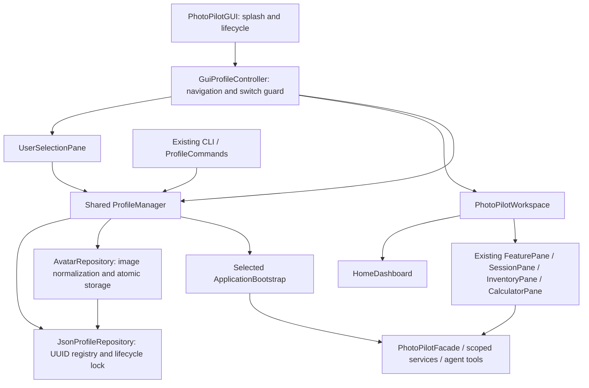

# User-centered desktop workspace

Implemented and verified on Windows / JDK 21, 2026-11-01 (America/Toronto).

## Startup and navigation

PhotoPilot now opens **Splash → Select User → Home → Feature Modules** in one JavaFX window. Local storage initialization runs on a background Task after the splash is shown. The splash has no artificial minimum delay, network calls or fake progress; a 160 ms fade reveals the next screen. A damaged default store uses the existing recovery chooser; damaged data is never reset. The first initialization retains the compatible stable Default user, and Select User offers Add User. The CLI's default-selection behavior is unchanged.

Select User shows local names, avatars, secondary UUIDs (to distinguish duplicate names), selected-row highlighting and Continue. Enter a display name to add a user, or select an existing user to rename it, import/remove an avatar, or request deletion. Registry validation still owns the 1–80 character name rule and stable identity. Delete has a cancellable, target-specific confirmation. It archives the identity while retaining its files; active and default users remain protected. There is no archive restoration command. These are local users, with no passwords or online accounts.

Home shows the real selected user's name/avatar and launches Equipment (F05), Sessions & History (F01), Technical Calculators (F08), Planning (F10) and AI Assistant / Inspiration (F02). F10/F02 cards explicitly say their workflows are coming later and open their existing availability pages. All eleven original feature entries remain in the sidebar, alongside Home. Home participates in keyboard navigation. No business feature or live provider is newly claimed by this shell integration.

The active-user bar offers **Switch User / User Settings** from every module and Home. This returns to the same-window chooser, including rename/avatar management. A different selection waits for queued work and asks before discarding unsaved session, equipment or calculator inputs. Cancellation/failure retains the previous context and drafts. Successful switching rebuilds all service-bound views and returns Home. Reselecting the same user validates storage, returns Home and retains that user's drafts; revisiting a module restores them. Separate Settings continues to manage global display language.

## Architecture and ownership

The former modeless `ProfileDialog` has been replaced by `UserSelectionPane`. Internal Profile names and CLI commands remain compatible; ordinary GUI copy uses User / 用户. No second UI framework, dependencies, JSON schema change, authentication or new business storage implementation was added.



`UserAvatar` only renders already-loaded bytes/default initials. Avatar normalization and filesystem operations stay outside presentation. `UiOperations` runs registry/avatar work off the FX thread and counts operations through completion delivery. Successful cross-user selection uses the existing bootstrap replacement/revocation boundary, replacing history, inventory, tools and agent dependencies. Old pane callbacks/listeners are disposed, and settings windows close. Returning Home suspends module activation without erasing drafts. There are no new global user-data caches or live LLM calls.

Original design → replace direct F01 entry and modeless profile management with a startup chooser and Home launcher → provide the requested coherent local-user workflow → changes presentation/composition, retaining F01/F05/F08 services, CLI commands, F01 lifecycle prerequisites, Facade/Repository/State contracts and all Stage1 artifacts.

## Avatar storage and failure behavior

`<PHOTOPILOT_DATA_DIR>/profiles/<uuid>/avatar.png` is optional. Default root selection is unchanged. Import reads actual PNG/JPEG content, bounds input to 10 MiB and 16 million pixels, center-crops and resizes to 256 × 256 PNG, and discards source metadata. The preview shows the exact normalized crop before confirmation. The source file path is not persisted. Rename preserves UUID/path; removal restores initials. Restart loads the same bytes.

Reads/writes/removal validate registry membership, the UUID directory and existing link/reparse paths. Avatar replacement uses the existing flush + same-directory atomic replacement, coordinated by the registry lock so archive and avatar operations cannot interleave. Unsupported or corrupt input does not overwrite the previous avatar. Missing/corrupt stored avatars render initials and do not prevent access to otherwise valid business data. Archived users cannot receive new avatars; archiving one user does not affect another user's bytes. Retained archive files include the avatar. Existing filesystem TOCTOU limitations remain as documented in [data storage](data-storage.md).

Registry/business-store errors preserve stored bytes and report localized guidance. UI operations do not expose stack traces or raw backend exception text. A malformed/missing registry with existing UUID directories is a recovery error, not permission to invent new identities. No automatic backup restoration or destructive deletion was added.

## Visual design

The shared `photopilot.css` uses a stationary diffuse pastel gradient, translucent white panels (60–84% opacity), subtle borders/shadows and restrained corner radii. This creates a frosted appearance through in-app layering; it does not implement native macOS vibrancy or blur windows behind the app. Dense forms/tables keep readable surfaces and dark text. Nothing applies blur to text. Home cards use two bounded columns and the existing scrollable content region. Selection, focus and keyboard navigation remain visible. No liquid-glass, morphing, spring or jelly animations are used.

## Verification and limits

Full-suite command, using the local JDK 21 and existing Maven cache, with smoke DATA/CONFIG overrides beneath ignored `target/user-flow-smoke/`:

```powershell
./mvnw.cmd -B -o test package javafx:run '-Djavafx.args=--smoke-test'
```

- **172 tests, zero failures/errors/skips**, successful JAR packaging and `GUI_SMOKE_OK`. A subsequent small long-name layout adjustment and removal of obsolete generated ProfileDialog classes were followed by **22/22** focused `ProfileGuiTest,ProfileManagerTest,StorageNoticeGuiTest` checks, fresh packaging and GUI_SMOKE_OK. All 135 main and 29 test sources were recompiled during verification; this was not Maven clean.
- Launch smoke exercises the real splash/lifecycle, chooser, backend selection, Home landing, all 11 feature entries and minimum-size navigation. The splash may be brief on fast local storage.
- Existing real JavaFX controls verify create/select/rename/confirmed archive, cancellation, draft preservation, failed switching, queue guards, corrupted-default recovery and correct active indicator. Existing child CLI JVM tests verify GUI/CLI data exchange, restart and isolation, including previous storage audit repairs.
- Two focused methods in `ProfileManagerTest` cover PNG/JPEG normalization, persisted avatars after manager restart/source removal, stable rename, two-user isolation, archived/unknown-user rejection, invalid input preservation and corrupt/missing avatar recovery. One new GUI method exercises avatar preview confirmation/removal, Home cards and bilingual renders. Existing tests were adapted to explicitly enter Home and navigate to F01 instead of relying on direct startup there.
- Inspected actual JavaFX-rendered splash, English chooser/Home and Chinese 880×600 chooser/Home images in ignored target output. This caught and corrected excessive TilePane card height. These are synthetic fixtures, not private user data.
- Initial sandbox compilation could not close existing JavaFX cache resources; permitted local execution recompiled successfully. The first full run exposed a nested FX-test wait and an outdated expectation of raw startup text; both were corrected before the successful final run.

The existing 169-test storage audit changes were present when work started, reviewed and retained as integration prerequisites. Only three focused test methods were added for this work; this is Stage 2 integration verification, not a Stage 3 expansion. The native OS file picker itself was not automated; tests invoke the same post-selection preview handler. Live AI/providers, other OSes, DPI settings, screen readers, adversarial concurrent filesystem replacement and power-loss recovery were not verified. Stage1 has no changes; a separate source/UML audit was not rerun.
