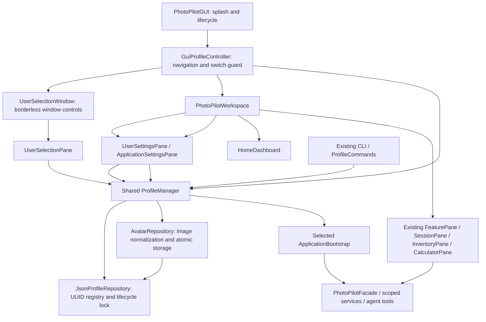

# User-centered desktop workspace

Implemented and verified on Windows / JDK 21, 2026-11-01 (America/Toronto).

## Startup and navigation

PhotoPilot now opens **Splash → Choose a workspace → Home → Feature Modules**. The chooser is a borderless window that hands over to the normal main window at the same position (see [Visual design](#visual-design)). The chooser only selects a workspace; management is the separate in-app User Settings page. Local storage initialization runs on a background Task after the splash is shown. The splash has no artificial minimum delay, network calls or fake progress; a 160 ms fade reveals the next screen. A damaged default store uses the existing recovery chooser; damaged data is never reset. The first initialization retains the compatible stable Default user, and an empty registry shows a single Add User action on the chooser as a first-run path. The CLI's default-selection behavior is unchanged.

The chooser shows users as workspace cards with rounded-square avatars and names beneath, a highlighted selected user and **Continue**. UUIDs are hidden in the GUI; duplicate names are told apart by avatar and position, and the CLI still lists identifiers. The selected user always takes the centre slot, with one neighbour either side; two users stay in place so the pair remains symmetric, and four or more add restrained previous/next arrows. Single-click selects, double-click or Enter continues, and Left/Right changes the user.

**User Settings** is an internal page (`UserSettingsPane`) that keeps the sidebar, themed background and session in place. Current Profile shows the active user with Change Avatar and Rename. Local Users lists every user with Add User, Refresh list and, for the selected row, Rename, Change Avatar and Restore Default Avatar; selecting a row never changes the session. Delete User is a separate panel, disabled for the current user. Add and Rename use a compact name dialog whose confirm button is disabled for a blank name as a hint only: registry validation still owns the 1–80 character name rule and stable identity, and a rejected name shows an error dialog. Delete has a cancellable, target-specific confirmation with Cancel as the default. It archives the identity while retaining its files; active and default users remain protected. There is no archive restoration command. These are local users, with no passwords or online accounts.

Home shows the real selected user's name/avatar and launches Equipment (F05), Sessions & History (F01), Technical Calculators (F08), Planning (F10), AI Assistant / Inspiration (F02) and Environment Planning (F09). All six cards open their implemented workflows; feature IDs remain internal and are not shown in the GUI. All eleven original feature entries remain in the sidebar, alongside Home. Home participates in keyboard navigation. No business feature or live provider is newly claimed by this shell integration.

*Updated 2026-11-07:* the top right is a read-only indicator of the current user (avatar and name; no arrow, menu, focus or pointer cursor) that follows every switch and rename. User Settings and Application Settings are opened from the sidebar. Switching moved into **User Settings → Local Users**: the active user's row shows **Current**; every other row has a compact **Switch** button that calls the same `GuiProfileController` switch the chooser uses (no second implementation), then stays on User Settings with the new user marked Current and a short notice. The chooser now appears only at startup. A different selection waits for queued work and asks before discarding unsaved session, equipment or calculator inputs. Cancellation/failure retains the previous context and drafts (a failure is reported on the User Settings page). Successful switching rebuilds all service-bound views; from the chooser it returns Home. Reselecting the same user validates storage, returns Home and retains that user's drafts; revisiting a module restores them. Application Settings is an internal page (`ApplicationSettingsPane`, which replaced the former modeless `SettingsDialog`) and manages global display language.

## Architecture and ownership

The former modeless `ProfileDialog` has been replaced by `UserSelectionPane`, hosted in `UserSelectionWindow`. `AppDialogs` and `AppIcons` hold the shared dialogs and outline icon family; `UserSnapshot` is the one read of users, active user and avatars that both the chooser and User Settings use. Internal Profile names and CLI commands remain compatible; ordinary GUI copy uses User / 用户. No second UI framework, dependencies, JSON schema change, authentication or new business storage implementation was added.



`UserAvatar` only renders already-loaded bytes/default initials. Avatar normalization and filesystem operations stay outside presentation. `UiOperations` runs registry/avatar work off the FX thread and counts operations through completion delivery. Successful cross-user selection uses the existing bootstrap replacement/revocation boundary, replacing history, inventory, tools and agent dependencies. Old pane callbacks/listeners are disposed. Returning Home suspends module activation without erasing drafts. There are no new global user-data caches or live LLM calls.

Original design → replace direct F01 entry and modeless profile management with a startup chooser and Home launcher → provide the requested coherent local-user workflow → changes presentation/composition, retaining F01/F05/F08 services, CLI commands, F01 lifecycle prerequisites, Facade/Repository/State contracts and all Stage1 artifacts.

## Avatar storage and failure behavior

`<PHOTOPILOT_DATA_DIR>/profiles/<uuid>/avatar.png` is optional. Default root selection is unchanged. Import reads actual PNG/JPEG content, bounds input to 10 MiB and 16 million pixels, center-crops and resizes to 256 × 256 PNG, and discards source metadata. The preview shows the exact normalized crop before confirmation. The source file path is not persisted. Rename preserves UUID/path; removal restores initials. Restart loads the same bytes.

Reads/writes/removal validate registry membership, the UUID directory and existing link/reparse paths. Avatar replacement uses the existing flush + same-directory atomic replacement, coordinated by the registry lock so archive and avatar operations cannot interleave. Unsupported or corrupt input does not overwrite the previous avatar. Missing/corrupt stored avatars render initials and do not prevent access to otherwise valid business data. Archived users cannot receive new avatars; archiving one user does not affect another user's bytes. Retained archive files include the avatar. Existing filesystem TOCTOU limitations remain as documented in [data storage](data-storage.md).

Registry/business-store errors preserve stored bytes and report localized guidance. UI operations do not expose stack traces or raw backend exception text. A malformed/missing registry with existing UUID directories is a recovery error, not permission to invent new identities. No automatic backup restoration or destructive deletion was added.

## Visual design

> Superseded 2026-11-07 by the [minimalist adaptive theme](appearance.md): the wallpapers below are replaced by a code-drawn wave background, the cream pill and blue selection by the chosen theme colour, and the chooser's circular avatars by workspace cards. Layout, sidebar, Home structure and chooser behaviour described here are unchanged. The paragraphs below describe the 2026-11-02 design.

The whole application shares one system, defined as tokens at the top of `photopilot.css`. Level 0 is `workspace-wallpaper.jpg`, the startup wallpaper with a true Gaussian blur (sigma 34 at 1920 px) and a 12% neutral overlay, precomputed by `tools/BlurWorkspaceWallpaper.java` so nothing blurs at runtime. Level 1 surfaces (header, sidebar, panels) are 56–62% white. Level 2 cards are 80% white, and planned cards are lighter so they do not outweigh working features. All text sits on a surface, because the wallpaper runs from amber to blue and no single text colour reads directly on it. The frosted look comes from layering over the blurred image; JavaFX has no live backdrop blur. The sidebar follows macOS System Settings: 36 px rows, one outline icon family, a rounded blue selection, 240 px wide and 212 px below 1000 px, scrolling independently. Home uses equal three-column rows so no card is left oversized or alone, and status comes from `FeaturePresentation`, not hard-coded labels. Primary actions reuse the startup screen's cream pill. Selection, focus and keyboard navigation remain visible. No liquid-glass, morphing, spring or jelly animations are used.

### Workspace chooser

`UserSelectionPane` is authored in reference-image pixels and scaled as one unit by `min(width / 1120, height / 941)`, so its proportions, type sizes and glow hold from the 880 × 600 minimum to a maximized window. Each row has a fixed slot, so text and controls cannot overlap; long names ellipsize.

`user-selection-wallpaper.jpg` is derived from the supplied reference: every UI element was masked out and filled by a harmonic solve, then upscaled to 1920 × 1080 with light dither against banding. It holds no interface elements. The reference and the one-off extraction tool are not in the repository. UI icons are vector shapes in `AppIcons`; the PhotoPilot logo is the generated PNG set in `icons/` (see [application icons](../packaging/README.md)).

JavaFX 21 cannot draw content under a native title bar (`StageStyle.EXTENDED` arrived later), so the chooser uses an undecorated `UserSelectionWindow` with working minimize, maximize/restore and close, title-bar drag, double-click maximize and edge/corner resizing. Close passes through the same unsaved-input guard as the main window. The decorated main window is hidden while the chooser shows and is restored at the matching position and size. It stays natively decorated to keep Snap and native controls, so its OS title bar is not blended into the wallpaper. Consequence: Windows Snap shortcuts and the native drop shadow do not apply to the chooser, and the splash still uses the decorated window for its brief appearance.

Fonts are Segoe UI on Windows. The reference's brand and heading use a more geometric face that Windows does not ship, so glyph shapes differ slightly. The Semibold/Semilight cuts apply to English only, because they lack CJK glyphs; Chinese keeps the readable font chosen by `FxLocalizer`.

## Verification and limits

Product-wide unification, 2026-11-02, Windows / JDK 21, with DATA/CONFIG overrides so no real user data was used:

- **175 tests, zero failures/errors/skips**, JAR packaging (both wallpapers and new classes confirmed inside it) and `GUI_SMOKE_OK`; the CLI ran on isolated data. A new test proves rename, cancel, add, rename-other and delete-other stay on User Settings with the same workspace and context, and that only Switch Workspace opens the chooser. Tests were moved from chooser controls to User Settings, and `LocalizationGuiTest` now uses the internal settings page.
- `CalculatorGuiTest` used to require stacked fields at minimum width. The content area is now wide enough for two columns there, so the check became: fields stay usable and inside the window.
- The real application was driven with real input at 1120, 1280, 1460 and 1920 px wide: every sidebar group, the user menu, Home, User Settings, Application Settings, Sessions, Gear Inventory, Calculator and a scaffolded page. Chinese renders were checked at 880 × 600. This found and fixed stretched cards, unreadable text on amber, oversized user rows and a menu running off the window.
- Limits: a live rename reached the service and stayed on the page, but the desktop input method dropped the simulated typing, so the header updating in place is proven by the JUnit test rather than that live run. The native file picker, other OS/DPI settings and screen readers are unverified, the recovery dialog keeps its old style, and the Python source/UML audit was not rerun (no Python here).

Chooser redesign, 2026-11-02, with the same isolation:

```powershell
./mvnw.cmd -B -o test package javafx:run '-Djavafx.args=--smoke-test'
```

- **174 tests, zero failures/errors/skips**, JAR packaging (wallpaper and new classes confirmed inside it) and `GUI_SMOKE_OK`. `ProfileGuiTest` was adapted to the new controls and gained two methods covering 1/2/3/5 users, centre-axis selection, hidden identifiers, region order, arrows, maximize, a corrupt avatar and the chooser close guard. Sources were recompiled; this was not Maven clean.
- The real application was launched against isolated data and compared with the reference at 1672 × 941: mean absolute colour distance **3.16/255** across the frame and about **0.55/255** in the four background corners. The residual is mostly glyph edges and the font difference. Test avatars for that comparison were cropped from the reference and stayed in temporary storage.
- Real mouse and keyboard input was sent to the running window at the default 1120 × 791 size: selection, rotation, Create User, Esc cancel, right-click menu, Delete prompt, Tab focus ring, Enter and double-click to continue, title-bar drag, corner and left-edge resize stopping at 880 × 600, maximize/restore to the work area, minimize/restore, and the chooser close button ending the process. This found and fixed two defects unit tests had missed: dialogs rendered see-through, and Enter did not continue. The default-button path was replaced with explicit handling in the chooser's key filter; why the accelerator did not fire was not determined.
- Rendered Chinese checks found and fixed a serif fallback in headings. English and Chinese chooser renders, one/two/five-user layouts and the error dialog were inspected.
- Not verified: the native file picker dialog (tests call the same post-selection preview), other operating systems and DPI scales, and screen readers. The Python source/UML audit was not rerun because no Python interpreter is installed here.

Earlier user-centered shell verification, 2026-11-01:

Full-suite command, using the local JDK 21 and existing Maven cache, with smoke DATA/CONFIG overrides beneath ignored `target/user-flow-smoke/`:

```powershell
./mvnw.cmd -B -o test package javafx:run '-Djavafx.args=--smoke-test'
```

- **172 tests, zero failures/errors/skips**, successful JAR packaging and `GUI_SMOKE_OK`. A subsequent small long-name layout adjustment and removal of obsolete generated ProfileDialog classes were followed by **22/22** focused `ProfileGuiTest,ProfileManagerTest,StorageNoticeGuiTest` checks, fresh packaging and GUI_SMOKE_OK. All 135 main and 29 test sources were recompiled during verification; this was not Maven clean.
- Launch smoke exercises the real splash/lifecycle, chooser, backend selection, Home landing, all 11 feature entries and minimum-size navigation. The splash may be brief on fast local storage.
- Existing real JavaFX controls verify create/select/rename/confirmed archive, cancellation, draft preservation, failed switching, queue guards, corrupted-default recovery and correct active indicator. Existing child CLI JVM tests verify GUI/CLI data exchange, restart and isolation, including previous storage audit repairs.
- Two focused methods in `ProfileManagerTest` cover PNG/JPEG normalization, persisted avatars after manager restart/source removal, stable rename, two-user isolation, archived/unknown-user rejection, invalid input preservation and corrupt/missing avatar recovery. One new GUI method exercises avatar preview confirmation/removal, Home cards and bilingual renders. Existing tests were adapted to explicitly enter Home and navigate to F01 instead of relying on direct startup there.
- Inspected actual JavaFX-rendered splash, English chooser/Home and Chinese 880×600 chooser/Home images in ignored target output. This caught and corrected excessive TilePane card height. These are synthetic fixtures, not private user data.
- Initial sandbox compilation could not close existing JavaFX cache resources; permitted local execution recompiled successfully. The first full run exposed a nested FX-test wait and an outdated expectation of raw startup text; both were corrected before the successful final run.

The existing 169-test storage audit changes were present when work started, reviewed and retained as integration prerequisites. Only three focused test methods were added for this work; this is Stage 2 integration verification, not a Stage 3 expansion. The native OS file picker itself was not automated; tests invoke the same post-selection preview handler. Live AI/providers, other OSes, DPI settings, screen readers, adversarial concurrent filesystem replacement and power-loss recovery were not verified. Stage1 has no changes; a separate source/UML audit was not rerun.
